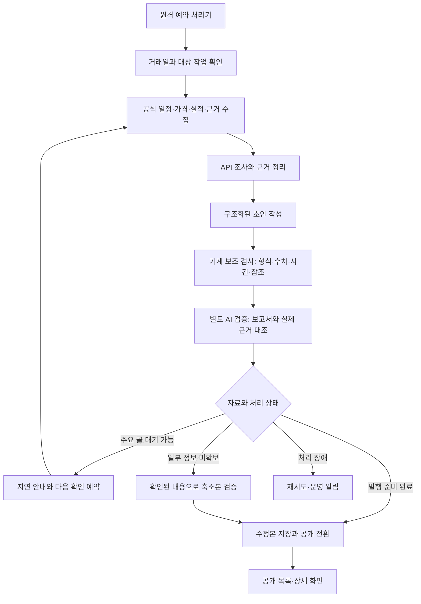

# NOCT Brief 기술 설계

상태: 2026-10-27 사용자 구현 지시에 따라 로컬 구현·검증 진행. 실제 결과·제약은 12절에 기록하며 아래 설계의 확정/제안 구분을 유지한다. 제품 요구사항은 [PRODUCT_SPEC.md](PRODUCT_SPEC.md), 작업 승인 기준은 [AGENTS.md](../AGENTS.md)를 따른다. 서버/API로 시작하는 교체 가능한 생성 구조와 Google 로그인을 채택했다. 환경은 로컬·운영 두 개로 계획한다. 차트·화면·조기 폐장일·어닝콜 재확인·텔레그램은 확정된 제품 정책을 따르며 별도의 공개 전 운영 시험 기간은 제외했다. 2026-11-24 생성 Astra 6·검증 Sol 6.2와 장후 한 편 발행을 선택했다. 그 밖의 기술 세부안은 AI 추천이며 새 조합의 실제 품질, 유료 서비스·데이터 공급원과 계약은 미확정이다.

이 문서는 공식 자료 조사 당시의 설계와 이후 구현 결과를 함께 보존한다. 로컬 예약 처리와 관리자 로그인 등 실제 검증 범위는 12절에 기록한다. 가격과 기능은 조사일 기준이며 도입 직전에 다시 확인한다.

## 1. 기준 구성과 남은 선택

사용자는 **4GB 자체 서버 + Node.js**를 확정했다. Next.js·TypeScript 구성을 유지하며 AWS Lightsail을 우선 후보로 검토한다. **PostgreSQL은 같은 서버에 직접 설치하고 DB 백업은 하루 1회·14일 보관하며 서버 전체 스냅샷은 제외**하는 것으로 확정했다. 리전·실행 구성·서버 구매는 아직 정하지 않았다. 기존 Vercel+Neon 안은 비교 자료로 보존하며 현재 구현 기본안으로 사용하지 않는다. 관리형 DB의 기존 비교와 비용·운영 책임·복구 범위는 8절에 보존한다. 서버에서 수집·AI 생성·검증·발행을 제어하는 방향은 유지한다. 공개 화면은 저장된 검증 결과를 읽으며 방문자 요청마다 AI를 실행하지 않는다. 생성 경로가 달라져도 공통 브리핑 데이터와 표시 화면은 유지한다.

| 구성 | 제안과 이유 | 확인·선정 상태 |
| --- | --- | --- |
| 웹·런타임 | Next.js App Router + TypeScript + Node.js. 공개 조회·관리자·발행 처리를 한 프로젝트에서 관리 | Node.js 확정, 기존 프레임워크 유지; 버전·자체 배포는 구현 승인 후 검증 |
| 호스팅·스케줄 | 4GB 자체 서버와 서버 예약 실행. 구체 후보는 AWS Lightsail | 4GB 자체 서버 확정; AWS 세부 상품·리전·설정 검토, 가입·결제 미승인 |
| DB | 같은 4GB 서버에 PostgreSQL 직접 설치 | 사용자 확정. 외부 관리형은 초기 제외; 로컬·운영 분리는 11절 |
| 생성 | 서버/API로 조사·작성하고 생성 부분은 교체 가능하게 분리. 초기 연결 후보는 OpenAI Responses API | API 시작 방향 확정; 실제 모델·도구 조합과 유료 사용은 미확정 |
| 시장 데이터 | 공개 표시 권한이 확인된 공급원 + 공식 경제 일정·기업 IR | 공급원·요금·대상 종목/지표 범위 미선정 |
| 관리자 | Google OIDC와 운영자 한 명의 고유 계정 ID 허용 목록 | 로컬 OAuth·본인 로그인·관리자 조회 검증; 운영 설정·다른 실제 계정 거부 미검증 |
| 알림 | 텔레그램 봇의 운영자 개인 대화로 예외 알림 | 영구 실패·기술적 15분 지연 기준 확정. 개인 대화 실수신 확인, 운영 자동 발송 검증 전 |
| 환경·배포 | 로컬·운영 두 환경, GitHub 연동 배포 후보 | 별도 스테이징 제외; 실제 저장소 연동·공개 배포는 별도 승인 후 |

Next.js 구성의 공식 기준은 [App Router 문서](https://nextjs.org/docs/app)를 따른다. 초기에는 별도 메시지 큐, Redis, 마이크로서비스, 다중 에이전트 플랫폼을 추가하지 않는다. DB에 지속되는 작은 작업 상태와 짧은 처리 단계로 시작하며 실제 한계가 확인될 때 확장한다.

초기 제외 범위: 사용자 회원가입, 관심 종목 설정 UI, 개인화 생성, 커뮤니티, 결제, 텔레그램 명령 처리, 전체 본문 검색, 자유 본문 편집기, 실시간 시세 스트리밍. 시장 전체 범위를 식별하는 필드를 두되 미래 개인화를 위해 별도 권한·추천 시스템을 미리 만들지 않는다.

### 자체 운영과 언어·런타임 선택 — 2026-10-27 보완

사용자는 자체 서버라면 Node.js에 고정할 필요가 없으며 적절하면 그대로 사용해도 된다고 밝혔다. AI는 기존 Next.js·TypeScript·Node.js 구성을 유지하는 것으로 정리했고 사용자가 후속 답변에서 4GB 자체 서버·Node.js를 확정했다. 웹 화면·관리자 인증·수집 및 발행 처리를 같은 언어와 데이터 계약으로 관리하고, 현재 요구에 별도 언어의 백엔드를 추가할 구체적인 필요가 없다는 설계 판단이다. 다른 언어보다 빠르거나 메모리가 적게 든다고 실측 비교한 결과는 아니다.

자체 서버는 실행 언어를 선택할 수 있다. 현재 계획한 Next.js 서버 기능을 유지하는 안에서는 Node.js 서버로 배포하며 Vercel 이용은 필수가 아니다. 정적 내보내기만 사용하는 안은 로그인·DB·발행 처리의 서버 기능을 별도로 구성해야 하므로 현재 기본안으로 채택하지 않는다. [Next.js 배포 방식](https://nextjs.org/docs/app/getting-started/deploying)

자체 서버에는 웹·관리자 앱과 같은 코드베이스의 예약 작업 실행기를 둔다. PostgreSQL은 같은 서버에 직접 설치한다. 외부 관리형은 비교 자료로만 남긴다. Next.js 서버가 시작 시 발행 작업을 등록하고 작업 상태·중복 방지·실패 복구는 DB에 유지한다. HTTPS를 처리하는 앞단 프록시, 프로세스 재시작, 외부 백업은 공급자 선정 후 구체화한다. 같은 서버의 장애는 웹·작업·DB에 함께 영향을 주므로 OS·DB 업데이트와 외부 백업·복원을 직접 관리한다. 4GB의 실제 여유는 구현 후 검증한다. [Next.js 자체 운영 안내](https://nextjs.org/docs/app/guides/self-hosting)

## 2. 생성 경로 비교

현재 선택은 서버/API 경로다. 아래 비교와 Work 조사는 선택 근거와 후속 대안으로 보존하며, 초기 구현에 Work 검증이나 동시 구현을 요구하지 않는다.

| 비교점 | Work 클라우드 → HTML → Drive → 수집 | 서버/API → 구조화된 브리핑 |
| --- | --- | --- |
| PC가 꺼진 상태 | 웹 기반 예약 작업 후보 사용. 로컬/데스크톱 작업과 구별 필요 | 서버 스케줄과 외부 API로 처리 |
| 공식 확인 범위 | Work 예약 작업과 연결 도구 활용은 안내됨 | 비동기 응답, 검색 도구, 구조화 출력이 문서화됨 |
| 미확인 핵심 | 해당 계정에서 임의 HTML을 Drive 파일로 무인 저장하고 실패·수정 상태를 전달하는 전체 흐름 | 선택 모델의 도구 조합·계정 한도, 실제 조사 품질·지연·사용량 |
| 발행·오류 제어 | 외부 작업의 완료·실패 신호와 파일 버전 규약을 확보해야 함 | 작업 상태, 재시도, 자료 마감과 수정본 검증을 서비스에서 제어 |
| 비용 | 기존 구독을 활용할 여지가 있으나 이용 한도·추가 연동 비용 미확인 | 모델·검색·서버·데이터 비용을 사용량으로 계산 가능 |
| 추천 | 구독 활용을 우선할 경우 아래 최소 확인부터 | 발행 운영을 직접 관리하려는 현재 요구에는 이 경로 권장 |

사용자는 API로 먼저 시작하고 생성 부분을 교체 가능하게 분리하는 제안을 채택했다. API 추천의 근거는 운영 제어에 관한 AI 설계 판단이며 더 좋은 시황 품질이나 더 싼 총비용을 실측한 결과가 아니다. 초기에는 API 경로만 구현한다.

공식 Work 안내는 웹 작업과 로컬 프로젝트 작업을 구분한다. 로컬 실행은 컴퓨터·앱 상태의 영향을 받으므로 PC가 꺼져도 돌아가야 하는 요구에 그대로 적용할 수 없다. 계정·플랜·워크스페이스에 따라 기능이 달라질 수 있다. [Work 예약 작업](https://learn.chatgpt.com/docs/automations), [PC가 꺼진 경우 웹 사용 예시](https://learn.chatgpt.com/use-cases/manage-your-inbox)

Drive API 자체는 일반 파일의 내용·메타데이터 업로드와 다운로드를 제공한다. 이것은 Work의 연결 도구가 같은 작업을 무인 수행한다는 증거가 아니다. [업로드](https://developers.google.com/workspace/drive/api/guides/manage-uploads), [다운로드](https://developers.google.com/workspace/drive/api/guides/manage-downloads)

### 공개 자료로 확인한 범위 — 2026-10-27 추가 조사

| 기능 | 공개 근거 | 이 프로젝트에서 아직 확인하지 못한 부분 |
| --- | --- | --- |
| Work에서 Google 문서 만들기 | 공식 교육 자료가 Google Docs·Slides 생성 과정을 보여줌 | HTML 파일을 원래 MIME으로 저장하는 동작은 이 예시가 아님 |
| Drive 연결과 파일 생성 | 조직용 연결 문서는 파일 생성 시 저장 위치·접근권 확인과 읽기/쓰기 권한 구분을 안내 | 개인 Pro 계정에 같은 작업·권한이 제공되는지, 임의 HTML 업로드가 있는지 |
| 연결 도구를 이용한 예약 작업 | 공식 예약 작업 안내는 연결 도구만 필요하면 웹/클라우드에서 실행하는 방식을 설명 | HTML 생성→지정 Drive 폴더→수집까지 사람 개입 없이 반복되는 전체 흐름 |

근거: [Google 문서·슬라이드 제작 예시](https://learn.chatgpt.com/training/walkthroughs/create-slides-and-docs), [Drive를 포함한 조직용 연결](https://learn.chatgpt.com/docs/enterprise/shared-connections), [연결 도구와 예약 실행](https://developers.openai.com/training/walkthroughs/scheduled-tasks).

기존 공개 자료가 전혀 없거나 Drive가 무조건 읽기 전용이라는 결론은 아니다. 이번에 확인한 자료에는 NOCT Brief가 요구하는 HTML 원본의 무인 예약 업로드·수정본·실패 처리까지 입증하는 명세나 재현 예시가 없었다. Google Docs 생성 사례를 HTML 업로드 성공 사례로 대체하지 않으며, 검색에서 찾지 못했다는 이유로 기능이 불가능하다고 단정하지 않는다. 실제 계정에서 필요한 작업을 확인하면 후보 판단을 갱신한다.

### 후속 Work 전환을 검토할 경우의 최소 확인

현재 API 구현의 선행 작업이 아니다. 후속 전환을 검토하고 필요한 설정 승인을 받은 경우 아래 최소 확인으로 판단한다. 실제 계정 연결·예약 시험은 수행하지 않았다.

1. 웹 기반 예약 작업과 Drive 쓰기 도구가 계정에서 사용 가능하고, 반복 실행이 사용자 개입 없이 허용되는지 확인한다.
2. 실제 시황 대신 명확히 가짜라고 표시한 작은 HTML 본문 조각과 메타데이터를 지정 폴더에 저장한다. Google Docs로 변환되지 않는지, 파일 ID·MIME·수정 시각·버전을 읽을 수 있는지 확인한다.
3. 서비스가 인증된 상태로 해당 파일을 내려받고 원문과 메타데이터를 검증할 수 있는지 확인한다. 폴더를 공개해서 연동 문제를 우회하지 않는다.
4. PC가 꺼진 상태의 예약 실행, 실패 식별, 같은 회차 수정본 전달을 확인한다. 실패나 정정 요청을 프로그램으로 처리할 수 없다면 관리자 수동 외부 실행이라는 운영 부담을 명시하고 API 경로와 비교한다.

실패한 경로를 브라우저 클릭 자동화로 억지로 유지하지 않는다. Work를 채택한다면 HTML은 전체 실행 가능한 페이지가 아닌 제한된 본문 조각으로 받고, 4절의 공통 데이터로 변환한다. 이 전달 형식 역시 확인 시험 전 제안이다.

## 3. 데이터 공급원·공개 권한·자료 지연

### 필요한 자료와 후보

| 자료 | 후보와 확인 범위 | 남은 확인 |
| --- | --- | --- |
| 미국 거래일·조기 폐장 | NYSE 공식 달력·거래시간 | 당해·다음 해 달력, 임시 휴장 반영 절차 |
| 경제 일정·결과 | Federal Reserve, BLS, BEA 공식 발표 | 수집 가능한 형식·업데이트 주기·시간대와 개별 이용 조건 |
| 실적·콜 일정·발표 | 기업 IR, SEC 공시, 계약한 기업 데이터 API | 실적 발표/콜 시각 구별, 변경 일정, 원문 접근성 |
| 지수·섹터·시장 지표 | FMP 또는 Twelve Data 등의 공급원 | 공개 표시 권리, 지표별 지연·정규장/시간외 범위·호출 한도 |
| 콜 원문 | 기업 IR의 공개 자료, 계약한 전문 공급원 | 실제 게시 지연·누락·허용 저장·인용 범위 |
| 사건과 해석 | 원문 발표와 검색으로 찾은 신뢰 가능한 보도 | 근거 연결, 중복 보도, 게시·수정 시각, 접근 가능성 |

공식 시작점: [NYSE](https://www.nyse.com/markets/hours-calendars), [FOMC 일정](https://www.federalreserve.gov/monetarypolicy/fomccalendars.htm), [BLS 발표 일정](https://www.bls.gov/schedule/), [BEA 발표 일정](https://www.bea.gov/news/schedule), [SEC API](https://www.sec.gov/search-filings/edgar-application-programming-interfaces). SEC의 공시·XBRL API를 실시간 가격이나 모든 콜 전문을 제공하는 API로 취급하지 않는다. 공급자의 접근 빈도 제한과 이용 조건을 따른다.

확정된 차트 범위는 일별 추이·섹터 비교 중심이며 사건 전후 장중 차트·실시간 스트리밍은 초기 필수가 아니다. 장전 선물·금리 등 필요한 시점의 상황 수치는 제외하지 않는다. 구체적인 가격 범위 후보는 미국 주요 지수, 필요할 때의 금리·달러·변동성 지표, 주요 섹터 비교다. S&P 500·Nasdaq·Dow 등 지수의 정확한 상품명과 공급원 심볼을 매핑한다. ETF 대체 시 지수라고 표시하지 않는다. 어떤 Nasdaq 지수를 쓰는지, 선물 계약·롤오버·수정 주가를 어떻게 처리하는지도 상품 선정 시 정한다. 전부를 매회 표시하는 요구는 아니다.

### 기본 공급원과 사건별 검색 — 2026-11-17 조사·구현 방향

사용자가 공급처 탐색과 첫 생성 시험 준비를 지시하고 매번 공급처를 찾는 방식의 효율을 질문했다. AI는 반복 관측값·발표 일정의 기본 출처를 정해 재사용하고, 사건별 추가 근거는 매회 검색하는 조합을 권한다. 아래는 공식 문서로 확인한 출발점과 구현 방향이며 유료 공급원 계약·검색 수집기 구현·실제 응답 품질 검증의 완료를 뜻하지 않는다.

| 자료 | 기본 출발점과 확인한 제공 방식 | 수집 시 구분할 것 |
| --- | --- | --- |
| 정책 발표·발언 | [연준 RSS](https://www.federalreserve.gov/feeds/feeds.htm), FOMC 공식 일정·성명 | RSS는 발견 수단. 원문 게시 시각과 발언 대상 시점 확인 |
| 물가·고용·GDP·PCE 일정과 결과 | [BLS iCalendar](https://www.bls.gov/help/hlpical.htm), [BEA 일정](https://www.bea.gov/news/schedule/)과 각 발표 원문 | 발표 예정/실제 발표, 대상 기간, 수정치 구분. 시장 예상치는 별도 출처가 필요 |
| 기업 실적·공시·콜 | 기업 IR과 [SEC EDGAR JSON API](https://www.sec.gov/search-filings/edgar-application-programming-interfaces) | SEC API는 인증 키 없이 공시 이력·XBRL 제공. 콜 전문이나 시장 예상치를 모두 제공하는 것으로 간주하지 않음 |
| 미국 국채 일별 금리 | [미 재무부 일별 XML](https://home.treasury.gov/treasury-daily-interest-rate-xml-feed) | 일별 공표 자료를 장전·장중 실시간 수익률로 표시하지 않음 |
| 지수·섹터·선물 등 반복 수치 | 공개 표시 조건을 확인한 시장 데이터 API 한 곳을 기본 공급원으로 선정 | FMP 견적 후보·Twelve Data 비교 후보 유지. 상품·심볼·종가/시간외·수정 기준과 공개 권한 미확정 |
| 당일 사건·추가 설명 | LLM 웹 검색으로 원문과 보도 탐색 | 미리 정한 언론사만으로 제한하지 않고 사건에 따라 확장. 같은 기사 재전송을 독립 근거로 세지 않음 |

검색은 공식 출처를 우선하고 부족한 시장·기업 사건은 날짜별 웹 보도로 보완한다. 조사 요청에서 Responses의 `tools: [{ type: "web_search" }]`와 `include: ["web_search_call.action.sources"]`를 사용하면 후보 URL을 확인할 수 있다. 현재 시험 명령은 직접 준비한 근거만 읽으며 이 조사 요청은 아직 구현 전이다. 과거 회차는 원문의 게시·수정 시각과 관측 시각을 확인한 자료만 작성·검증 입력으로 넘긴다. [OpenAI 웹 검색](https://developers.openai.com/api/docs/guides/tools-web-search)

- 동일 URL·자료 버전은 이용 조건이 허용하는 범위에서 재사용하고 새 공시·수정 발표·직전 회차 이후 사건을 우선 조사한다. 과거 기준 회차 시험에는 기준 시각 이후 자료를 섞지 않는다.
- 출처가 바뀐 수치를 같은 시계열에 조용히 이어 붙이지 않는다. 대체 공급원도 상품·단위·거래시간·수정 기준과 공개 권한이 맞는지 확인하고 변경 사실을 보존한다.
- 검색→출처·관측값·사건이 연결된 Bundle→초안→직접 근거 대조의 기존 경계를 유지한다. 쓰기만 다시 할 때 확인한 근거를 재사용하고, 새로운 자료가 필요할 때 조사 단계를 갱신한다.
- 매번 사용자가 기사 사이트를 지정하는 절차는 추가하지 않는다. 새 유료 계약·계정 변경·공개 권한 불확실성은 기존 승인 기준을 적용한다. 공개 웹에서 찾았다는 사실만으로 재표시 권리를 승인 처리하지 않는다.

### 무료 시세 API 후보 — 2026-11-17 공식 안내 확인

무료 요금제도 먼저 검토한다. 아래는 제공사 안내를 확인한 후보이며 실제 키·심볼 응답·발행 시각별 갱신·공개 이용권을 검증한 결과는 아니다.

| 후보 | 무료 제공 안내 | NOCT Brief에서 확인할 제약 |
| --- | --- | --- |
| [FMP Basic](https://site.financialmodelingprep.com/pricing-plans) | 하루 250회, 일말 과거 데이터·기업/참조 데이터 | 엔드포인트와 심볼별 제한이 있으며 무료 등급에 실시간 데이터는 미포함. 필요한 지수·섹터와 장후 발행 전 당일 종가 제공 여부를 확인 |
| [Twelve Data Basic](https://twelvedata.com/pricing) | 분당 8·하루 800 API credits, 미국 주식·ETF 등 | 요청당 소모량은 엔드포인트·심볼 수에 따라 다름. 주식/ETF 제공을 지수·선물 제공으로 간주하지 않음 |
| [Alpha Vantage 무료 키](https://www.alphavantage.co/premium/) | 표준 하루 25회, 다수 엔드포인트 무료 | 유료 전용 기능 제외. 적은 수의 대상 시험 후보이며 대상 수·재시도까지 고려하면 한도가 빠듯할 수 있음 |

Twelve Data는 기본 실시간 피드가 미국 전체 거래량의 약 5%를 반영하며, 전체 시장을 집계한 일별·종가 자료는 장 마감 후 **다음 거래일 00:00 ET 이후** 제공한다고 안내한다. 이 안내대로라면 당일 19:30 ET 장후 발행의 종가 공급원으로 바로 채택할 수 없다. 실시간 피드의 마지막 값을 전체 시장 공식 종가로 대신 표시하지 않는다. [미국 주식 범위·갱신 안내](https://support.twelvedata.com/en/articles/9935903-us-equities-market-data)

AI 추천은 FMP Basic의 필요한 심볼·종가 갱신 시각을 첫 확인 후보로 두고, Twelve Data는 과거 시계열 비교 후보로 유지하는 것이다. 무료만으로 기존 지수·섹터·장전 선물 요구를 모두 충족한다고 확정하지 않는다. API 무료 접근과 공개 사이트 표시 권한은 별개다. FMP는 표시·재배포 계약을 요구하며, Twelve Data Basic 가격표는 내부 비표시 용도로 안내한다. 유료 전환·계정 생성·계약은 수행하지 않았다.

### 공개 서비스에서 중요한 비용 제약

- FMP 가격표의 개인용 Ultimate는 조사 시 월 환산 $99, 연간 청구로 표시된다. 해당 가격만으로 공개 시세·차트 서비스 사용권이 확보되지 않는다. 공식 페이지는 데이터 표시·재배포에 별도 Data Display and Licensing Agreement가 필요하다고 안내한다. 공개 범위와 계약 견적을 별도로 확인해야 한다. [FMP 가격·라이선스 안내](https://site.financialmodelingprep.com/developer/docs/pricing)
- Twelve Data는 개인 이용과 외부 표시·재배포를 구분한다. 공개 화면용 상품도 거래소·데이터별 권리를 확인해야 하며 재배포는 별도 조건일 수 있다. 조사 시 Business 페이지에 표시된 한 Venture 구성은 월 청구 $499였지만, 이것은 이 프로젝트의 견적이나 최저 요금이 아니다. [이용 구분](https://support.twelvedata.com/en/articles/5332349-commercial-and-personal-usage), [Business 가격](https://twelvedata.com/pricing-business)
- 공개 포트폴리오라는 목적만으로 개인용 시세 구독을 외부 표시해도 된다고 판단하지 않는다. 출처 링크를 넣거나 지연 시세를 사용한다고 자동으로 권리 문제가 해결되지 않는다. 기사 전문·콜 전문도 무조건 장기 저장하거나 공개하지 않는다.

공급원 선정 시 **대상 지표, 공개 방문자, 지연 시간, 차트·파생값, 캐시·보관, 출처 표시, 가격**을 함께 확인한다. 현재 업체 문의·견적 요청·계약은 하지 않았다. 권한이 불명확한 실제 데이터로 공개 배포하지 않으며, 권한 확보 대신 공개 열람 요구를 임의로 개인 전용으로 바꾸지도 않는다.

### 검색으로 가격을 확인하는 방식과 Yahoo Finance — 2026-11-17 조사

검색으로 가격 몇 개와 날짜를 확인하는 것과 자동 발행용 시계열을 매회 확보하는 것은 구분한다. 데이터 수집에 API만을 필수 기술로 요구하지 않는다. 허용된 공식 표·CSV·JSON도 날짜·상품·시점·비교 기준을 보존해 정규화할 수 있다. API는 반복 수집의 구조·누락·재시도 처리를 단순하게 하는 추천 방식이며 API 키 보유가 공개 표시 권한을 대신하지 않는다. 공급원 비용과 권한을 확인하기 전에 비싼 계약을 선행 조건으로 확정하지 않는다.

Yahoo Finance는 사람이 가격을 참고하거나 교차 확인할 후보로 볼 수 있다. 그러나 검색 노출 가격을 매일 모아 공개 차트의 기본 데이터로 쓰는 안은 아직 채택하지 않는다. 공식 검색 색인에서 확인한 Yahoo 약관은 사전 허가 없는 자동 수집을 제한하며, 도움말은 과거 CSV 다운로드의 구독 조건과 일부 상품의 라이선스 제약을 안내한다. 조회 당시 원문 페이지는 999/429 오류로 열리지 않아 색인 내용까지 확인한 조사이며, 적용 지역·계약과 실제 허용 범위는 확정하지 않았다. 이 조사로 모든 검색 인용이 금지된다고 판단하거나 Yahoo의 승인된 자동 수집 API를 확보했다고 주장하지 않는다. [Yahoo 약관](https://legal.yahoo.com/sg/en/yahoo/terms/otos/index.html), [공식 과거 자료 다운로드 안내](https://help.yahoo.com/kb/finance-app-for-ios/download-historical-data-yahoo-finance-sln2311.html)

가격을 채택할 때는 종가와 수정 종가, 장중·시간외 값, 거래일, 통화, 지수와 ETF를 구분한다. 검색 결과의 숫자 몇 개를 보간해 차트 시계열을 만들어 채우지 않는다. 첫 생성 시험의 근거 수집과 공개 차트용 이용권 선정을 병행하되, 미확인 권한의 자료를 공개 모드에 반입하거나 기존 검사를 우회하지 않는다.

### 콜 종료와 원문 확보는 다른 시점

FMP는 최신 콜 전문을 찾는 목록·날짜 관련 엔드포인트의 갱신 주기를 4~6시간으로 설명한다. 이것을 모든 콜 전문이 종료 4~6시간 뒤 반드시 나온다는 SLA로 해석하지 않는다. 수집 설계는 실제 콜 시각, 자료 게시 시각, 최초 관측 시각을 구분해야 한다. [FMP 데이터 갱신 설명](https://site.financialmodelingprep.com/insights/platform/api-access/how-fresh-is-fmp-data-understanding-update-timing-across-prices)

따라서 합의된 ET 19:30 발행과 최대 1시간 대기 후에도 일부 전문이 없을 수 있다. 그때는 확보한 공식 실적 발표·준비 발언·출처가 분명한 보도의 확인 범위만 사용한다. 전문 미확보를 숨기거나 콜 발언을 만들어 채우지 않는다. 뒤늦은 새 정보는 다음 회차에 반영한다. 음성 녹음 수집·전사는 초기 필수 기능으로 추가하지 않는다.

## 4. 공통 브리핑 데이터와 인터페이스

API 경로에서는 모델이 페이지 HTML을 만드는 대신 구조화된 내용을 반환하고 서비스가 일정한 화면으로 표시하는 안을 권장한다. 외부 생성 경로를 선택하더라도 하나의 입력 변환 단계만 달리하고 이후 검증·저장·조회는 공유한다. 범용 플러그인 프레임워크는 만들지 않는다.

### 생성 부분 교체를 위한 최소 경계 — 방향 채택, 구현 세부안

사용자는 API로 시작하되 생성 부분을 교체할 수 있게 분리하는 방향을 채택했다. 아래 경계는 그 방향을 구현할 최소 설계이며 처음부터 여러 제공자를 모두 구현하지 않는다.

| 변경 수준 | 분리할 부분 | 유지할 부분과 한계 |
| --- | --- | --- |
| 같은 API 안의 모델·추론 강도 | 모델명·추론 강도·출력/검색 한도·프롬프트 버전을 설정으로 관리 | UI·DB·발행 정책 유지. 모델별 지원 옵션과 결과 품질은 다시 확인 |
| 다른 모델 API | 조사·생성 요청, 비동기 상태 조회, 결과·사용량 정규화를 맡는 작은 연결 모듈 | 공통 브리핑 계약·검증·저장·공개 유지. 검색·인용·구조화 출력 지원 차이는 모듈에서 처리 |
| Work→Drive 전달로 교체 | 외부 예약 실행과 파일 수집을 연결하는 모듈, 인증·파일 버전·실패 상태 규약 | 검증된 결과 이후의 저장·화면은 재사용. 외부 작업을 프로그램으로 재실행·정정할 수 있는지는 별도 확인 |

공통 입력은 대상 회차·자료 기준 시각·조사 범위·필요한 기존 근거다. 공통 결과는 4절 브리핑 계약에 맞춘 내용·출처·수치와 생성 방식·사용량·외부 참조 ID다. 준비 중/완료/실패 상태를 서비스 작업으로 정규화하되, Work가 지원하지 않는 실행·취소·재시도 기능을 지원한다고 가장하지 않는다.

진행 중인 작업에는 사용한 생성 경로·모델·프롬프트 버전을 고정하고 경로 변경은 다음 새 작업부터 적용한다. 같은 회차를 두 경로가 동시에 공개하지 않도록 기존 회차 키와 공개 버전 제약을 공유한다. 가격 데이터 공급원도 모델 생성과 구분해, 생성 모델 변경이 차트 수집 전체 변경을 요구하지 않게 한다.

이 설계는 변경 범위를 줄이기 위한 것이며 설정 한 줄로 모든 제공자나 Work 경로를 즉시 바꿀 수 있다는 보장은 아니다. 범용 플러그인 시스템·자동 모델 라우터·중복 생성 시스템은 초기 범위에 추가하지 않는다. 비용만으로 조용히 더 약한 모델에 자동 전환하는 정책도 채택하지 않는다.

### 브리핑 계약

| 묶음 | 주요 필드·의미 |
| --- | --- |
| 식별 | `schema_version`, `market_scope=us_market`, `us_trading_date`, `session=pre/post`, 회차 ID |
| 시간 | 목표 발행, 자료 기준, 생성, 실제 공개, 정정 시각. 시각은 UTC 저장, 거래일은 미국 날짜로 별도 보관 |
| 표시 | 제목, 요약 항목, 중요도 순서가 확정된 구역 배열, 각 구역의 안정적인 ID와 유형 |
| 주장 | 문장, `fact/source_interpretation/ai_inference`, 근거 ID 목록, 해석의 한계, 연결 사건 ID |
| 수치 | 상품 종류·공급원 심볼, 값·단위·통화, 가격 구간, 관측 시각, 비교 기준, 출처 ID |
| 시각자료 | 차트 유형, 관측값 또는 허용된 저장 참조, 기간·단위·출처, 대체 설명. 임의 실행 코드는 금지 |
| 사건 | 일정·실제 발생 시각, 예정/발표/연기/미확인, 결과·컨센서스의 출처와 발표 전후 관계 |
| 품질·누락 | 반영하지 못한 자료와 영향 범위, 검사 결과, 축소 발행 여부. 숫자형 신뢰도 점수는 초기 제외 |
| 출처 | URL·문서명·발표 주체·게시/확인 시각, 수집 방식, 사용권·보관 제약, 필요한 최소 근거 발췌. 마감 뒤에 읽은 자료는 인용 판본의 공개 시각과 이를 확인할 원문·보관본 URL(`version.availableAt`, `version.evidenceUrl`)을 포함한다. |

수치와 실제 사건 시간은 가능하면 수집 데이터에서 직접 연결한다. 모델이 입력에 없는 숫자를 새로 만들거나 출처 ID를 발명하면 검증에서 걸러낸다. 금액·기간·단위가 맞지 않는 값은 조용히 대체하지 않는다. 사실성 검사는 형식 검사와 별개다.

예정 시각이 확인된 사건은 기존 `scheduledAt` ISO 시각을 유지한다. 시·분 없이 장전·정규장·장후만 확인했다면 `scheduledAt:null`과 `scheduledWindow:{date,session}`을 사용한다. `date`는 미국 날짜이고 `session`은 `pre/regular/post`다. 정확 시각과 범위를 동시에 입력하지 않는다. 화면은 변환 가능한 KST 날짜 범위를 우선하고 원문의 미국 거래일·세션을 구분해 표시하며 임의의 시·분을 만들지 않는다. 범위 전체가 자료 마감 뒤부터 다음 실제 폐장 안에 있을 때만 예정 안내에 포함하고, 마감에 걸쳐 포함 여부가 불명확하면 짧은 미확인 안내를 남긴다. 기존 정확 시각 자료에 새 선택 필드를 자동 추가하지 않아 이전 요청의 직렬화와 저장본을 유지한다.

2026-11-26 비공개 시험의 출처 공개일(`publishedAt`), 판본 공개일(`version.availableAt`), 예정 사실 공개일(`firstObservedAt`)에는 공식 자료가 날짜만 명시한 경우 `YYYY-MM-DD`를 그대로 보존한다. 시간대를 모르는 날짜의 가능한 공개 시각 전체가 마감 이전인지 확인하기 위해 다음 날 12:00 UTC를 배제 경계로 계산한다. 이 경계는 판정에만 사용하고 실제 시각으로 저장·표시하거나 `timeReferences`에 넣지 않는다. 날짜만 있는 게시일은 한국 날짜로 환산하지 않는다. 정확한 관측·발생·예정 시각과 마감 시각에는 이 예외를 적용하지 않는다. 날짜만 있는 근거는 `private_trial`에서만 허용하며 정규 수집·생성·발행 및 샘플 검사는 거부한다. 기존 DB의 `events.first_observed_at` 구조와 저장값은 바꾸지 않았다.

### 비공개 읽기 HTML 템플릿 — 2026-11-26 사용자 확정

- 표시 기준은 PRODUCT_SPEC 10절의 이전 Astra 읽기본 디자인이다. 재사용 CSS와 로컬 렌더 도구는 정식 프로젝트 파일로 관리하며 임시 조사 파일이나 과거 HTML이 실행 시 필요하지 않게 한다. 저장된 보고서 JSON을 입력받아 네트워크·DB·생성 API 호출 없이 별도 HTML을 작성한다.
- Pretendard·로고는 저장소의 자산을 사용하며 독립 HTML 안에 포함한다. 폰트의 기존 라이선스 고지도 보존한다. 최초 비공개 템플릿 작업 뒤 같은 날 후속 승인으로 정규 보고서 화면과 공통 CSS를 공유한다. `templates/report-reading.css`는 `.report-reading` 아래의 네이티브 CSS Nesting과 `--report-*` 변수로 범위를 제한한다. 웹은 이 파일을 import하고 독립 HTML은 원문 CSS를 그대로 포함한다. 내장 폰트·masthead·독립 페이지 여백은 `templates/report-reading-standalone.css`에만 둔다.
- 웹의 목차·인용·정정·이전다음 배치는 `app/briefings/report-page.css`의 보고서 범위에서 관리한다. `components/chart.css`는 `.chart`에 한정한 공용 축·막대·값 표 표시를 맡아 관리자 저장 원고에서도 동작한다. 홈의 발행 일정 `.schedule`은 `.home`으로 범위를 제한한다. 보고서 제목·본문·목록의 중복 전역 규칙을 제거하고, 관리자에서도 쓰는 각주·표·한계 문구 규칙은 보존한다.
- 제목·요약·주장·한계·연결 출처 및 원고가 참조한 차트를 렌더한다. 사용하지 않은 bundle 자료를 자동으로 새 본문에 추가하지 않는다. 예정 claim의 첫 줄 `시각 | 이벤트명`과 다음 줄 설명은 표시 요소로 나누고 문구·비교 기준·시간대는 보존한다. 별도 검증을 다시 수행한 것처럼 표시하지 않고 저장된 판정 상태를 확인해 안내한다.
- 입력 문자열은 HTML로 이스케이프하고 외부 출처 링크는 기존 계약의 공개 HTTPS 주소로 제한한다. 새 출력 파일은 기존 파일을 덮어쓰지 않는다. 기존 보고서·고정 입력·환경 설정을 보존하며, 실제 렌더 확인 범위와 화면 접근 제약은 12절에 기록한다.

### 한국시간 표시와 서머타임 변환 — 2026-11-24 사용자 확정

- 독자 표시 정책은 PRODUCT_SPEC 4절을 따른다. 같은 날 후속 결정으로 KST를 먼저 쓰고 원본 시각·시간대를 병기한다. 저장된 UTC 시각·원문의 오프셋과 시간대·정확도·미국 거래일은 유지하고 표시 시각을 `Asia/Seoul`로 변환한다. 근거 원문을 한국시간 문장으로 덮어쓰지 않는다. 원본 시간대 메타가 없으면 사용자 지시에 따라 저장된 순간의 UTC를 원본 표시 기준으로 사용하며 별도 미확인 경고는 붙이지 않는다. 이 표시 규칙은 원래 기사에 쓰였던 시간대를 추정하거나 원본 데이터를 변경하는 기능이 아니다.
- 정확한 순간이 있는 ISO 시각을 우선한다. 날짜와 현지 시각만 있는 자료는 출처에서 시간대를 확인한 뒤 IANA 시간대 `America/New_York`의 해당 날짜 규칙을 적용한다. 런타임 시간대 데이터로 변환하며 서버·방문자의 로컬 시간대에 의존하지 않는다. 현지 시각이 중복되거나 존재하지 않을 때는 오프셋·UTC 원자료로 확인하고 자동 보정으로 확정하지 않는다.
- 예정 범위·마감 전 공개 여부는 변환된 문자열이 아니라 원래의 순간으로 비교한다. 표준시·서머타임, 봄·가을 전환 전후와 전환 주말을 가로지르는 안내, 한국 날짜·연도 넘김을 검증한다. 날짜만 있는 출처에는 시각이나 한국 날짜를 추측해 넣지 않는다.
- 새 시간 규칙의 API 입력에는 코드가 계산한 한국시간·원본 시각 쌍과 근거·역할을 제공한다. 기계 검사는 두 시각을 별도 허용 집합으로 비교하지 않고, 같은 근거의 한 순간에서 만들어진 한 쌍인지 연도·날짜·시·분·시간대까지 대조한다. 게시·관측·예정·발생 시각을 구별하며, 출처 게시 시각을 그 기사 속 사건의 발생 시각으로 자동 승격하지 않는다. 자유로운 문장의 의미와 시각 역할의 적절성은 별도 AI 근거 대조도 필요하다.
- 기존 `quality-v2` 프롬프트·접수 요청·입력·검사 결과는 보존하고 새 시간 규칙은 별도 버전과 시험 식별자로 구분한다. 이번 후속 승인 범위는 정책·새 기준 원고·필요한 앱 표시·시간 규칙과 무료 검증 연결이다. 기존 발행 본문과 API 결과를 일괄 재작성하지 않는다. 실제 API 품질 비교·전체 기사 프롬프트 확정은 사용자 원고 조정 이후이며 이번 유료 호출은 없다. 구체적인 구현·확인 상태는 12절에 기록한다.

원본 시간대를 확인한 자료에는 선택 필드 `sources[].publishedOriginalTime`, `observations[].observedOriginalTime`, `events[].scheduledOriginalTime`·`occurredOriginalTime`을 쓸 수 있다. 형태는 `{timestamp, zone?}`이며 `timestamp`는 원문 시각의 ISO 표기, `zone`은 확인한 IANA 지역이다. 명시 오프셋 또는 지역이 있어야 하며 관련 `publishedAt`·`observedAt`·`scheduledAt`·`occurredAt`과 같은 순간이어야 한다. 이 필드는 조사자가 확인한 원문 표기를 기록하는 곳이며 생성 모델이 만들어 채우는 근거가 아니다. 필드가 없는 기존 자료는 그대로 읽고 원본 표시 기준에 UTC를 쓴다. 같은 원문에 여러 사건 시각이 있다고 해서 게시 시각을 모든 사건에 복제하지 않는다.

새 시간 규칙은 `timePolicy=kst-original-v1`로 식별한다. 작성·보정과 별도 검증 입력에는 근거 ID·게시/관측/예정/발생 역할에 연결된 `timeReferences`를 코드로 생성한다. 모델은 해당 `text`를 사용하고, 기계 검사는 같은 출처와 필요한 관측·사건 ID를 인용했는지 및 병기 문자열 전체가 일치하는지 확인한다. 이 검사를 통과한 시각의 숫자를 금액·비율 같은 다른 주장에 재사용할 수는 없다. 발췌에만 있고 구조화된 시간 필드가 없는 관측은 새 입력에서 직접 확인해 구조화하거나 정확한 시각을 생략해야 한다. 이전 입력을 몰래 보충하거나 기사 게시 시각으로 대체하지 않는다.

표시 `text`는 `2026-11-21 08:02 KST (2026-11-20 18:02 EST)`처럼 날짜·시각·시간대만 포함한다. 미국 동부시간은 해당 날짜의 EST/EDT를 쓰고 원본 메타가 없으면 UTC를 쓴다. 숫자 오프셋만 확인되면 `UTC-05:00`처럼 표시하며 국가·도시를 추정하지 않는다. 다른 확인된 IANA 지역은 지역 식별자를 유지한다. 게시·관측·예정·발생은 별도 `role` 필드로 입력하고, 모델은 문장의 의미를 이 필드와 대조한다. 간결한 표시 자체로 역할의 의미까지 기계적으로 판정했다고 간주하지 않는다. 저장 원본·UTC 오프셋·동일 순간 검증은 그대로 유지한다.

### 최소 저장 구조

| 논리 테이블 | 역할과 핵심 제약 |
| --- | --- |
| `briefings` | 미국 거래일+세션+시장 범위로 유일한 회차. 현재 공개 버전 참조, 공개 여부, 목표 시각 |
| `briefing_versions` | 검증된 본문·근거 연결의 불변 수정본. 정정 사유·이전 버전·정정 시각·작성 설정 버전 |
| `jobs` | 회차·단계·시도·대기 사유·다음 재시도 시각·잠금 기한·외부 응답 ID·사용량 |
| `evidence` | 근거 메타데이터와 허용된 최소 원문/발췌. 변경된 원문은 별도 수집 버전으로 구분 |
| `events` | 일정과 결과, 회사/회계 기간, 이전 브리핑의 확인점과 연결. 늦게 확보한 자료의 최초 관측 시각 |
| `notification_outbox` | 발송 예정·성공·실패, 중복 방지 키, 해당 장애·회차와 연결 |

실제 SQL·마이그레이션은 구현 승인 후 작성한다. 인증 라이브러리가 필요로 하는 세션 등 저장 구조는 선정 후 최소 범위로 추가한다. 빈 회차나 실패 작업을 공개된 브리핑 버전처럼 저장하지 않는다.

공개 API/조회는 공개 회차의 목록·상세·다음 예정·지연 상태만 제공한다. 관리자 인터페이스는 상태 조회, 단계별 재시도, 근거를 포함한 정정 요청, 공개/비공개 전환으로 제한한다. 생성 처리기는 인증된 내부 호출만 받는다. 실제 경로·요청 형식은 이 경계를 유지해 구현 단계에서 정하고, 문서에는 검증된 형식을 보완한다.

## 5. 수집·생성·발행 흐름

### 자료수집 모델 분리와 네 조합 비교 — 2026-11-26 사용자 지시

자료수집은 생성·검증과 별도 환경 변수로 선택한다. 사용자는 Sol 6.2와 Astra 6을 high·xhigh로 각각 시험하고, 기존 Codex 결과와의 일치가 아닌 실제 필요 데이터의 수집 여부를 평가하도록 지시했다. 공통 요청·원문 시점·눈가림 평가·검색 비용과 기존 원장 합산 방식은 [자료수집 비교 시험](RESEARCH_TRIAL.md)에 둔다. 정규 발행 연결과 수집 운영 모델은 시험 결과 뒤 판단한다. 이 지시는 비공개 수집 네 조합 시험의 승인으로 한정하며 새 보고서 생성·추가 유료 재시험·계정 변경·배포·커밋·푸시를 포함하지 않는다.

### 문체·예정 목록 프롬프트 — 2026-11-26 사용자 확정

- 편집 기준은 PRODUCT_SPEC 9절의 「문체와 예정 목록 보완 기준」을 따른다. 정확성과 이해를 분량보다 우선하고, 자연스러운 기사 문장과 중요도에 따른 설명량을 적용한다. 비교 원고의 길이는 상한이 아니며 글자 수·문장 수 제한을 새로 만들지 않는다. API 출력 토큰 한도·데이터 필드 크기·비용 한도는 편집상의 목표 분량과 별도로 관리한다.
- 새 통합 시험은 `combined-v2-kst-original-v1`로 구분한다. 기본 기사형 기준과 기존 통합 기준 뒤에 새 문체·목록 기준을 추가한다. 이전 `quality-v2`와 `combined-v1`의 번호 원문·요청 조건은 보존하고, 보정 오류의 상세 정보도 새 버전에서만 요청 입력에 추가해 기존 접수 해시를 바꾸지 않는다.
- 예정 안내는 기존 JSON 계약에서 일정당 독립된 claim을 사용한다. 새 작성 지시는 첫 줄에 `예정 시각 | 이벤트명`, 줄바꿈 뒤에 설명·주목할 이유를 담게 한다. 실제 목록의 글머리·배치는 표시 단계에서 처리하며 모델이 claim 안에 마크다운 목록 기호를 넣게 하지 않는다. 필요한 설명이 길다는 이유로 실패시키거나 내용을 잘라내는 검사는 두지 않는다.
- 시각 검사의 판정 기준은 유지하고 보정용 진단에 주장 ID·필드와 문제 표현을 포함한다. 원본 시각 근거를 새로 만들거나 잘못된 표현을 자동으로 통과시키지 않는다. 정확한 시각을 뒷받침할 구조화된 근거가 없으면 확인된 순서·구간으로 설명하도록 지시한다. 일반적인 문체 선호와 근거 검증은 구분하고 필요한 해석 한계·인용 검사를 유지한다.
- 프롬프트 보완 단계는 작성·보정 지시와 진단·무료 검증에 한정했다. 기존 보고서·HTML과 정규 앱 표시는 다시 작성하지 않았다. 이후 별도 승인된 10,000토큰 상한의 v2 API 시험 결과와 읽기 화면 확인 제약은 12절에 기록한다.

### 생성·검증 모델 분리 — 2026-11-24 사용자 확정

- 생성·본문 보정은 `OPENAI_MODEL=gpt-6-astra`, 별도 근거 검증·재검증은 `OPENAI_VERIFICATION_MODEL=gpt-6.2-sol`로 선택한다. 추론은 medium, 요금제는 Standard를 사용한다. 2026-11-26 사용자 결정으로 `OPENAI_MAX_OUTPUT_TOKENS`의 기본값은 10,000토큰이다. 검증 모델을 명시하지 않은 기존 설정은 생성 모델을 함께 사용하는 방식으로 호환한다.
- 현재 별도 AI 근거 검증은 비공개 `report:trial` 경로에 연결돼 있다. 정규 worker는 기계 검사와 생성 모델의 제한 보정을 사용하며 별도 AI 검증을 포함한 정규 발행 연결은 아래 로드맵의 후속 단계다. 설정 분리만으로 정규 발행의 의미 검증까지 완료됐다고 소개하지 않는다.
- 기존 같은 모델 시험 키와 요청은 보존한다. 생성·검증 모델이 다른 새 비공개 시험은 두 모델을 모두 포함한 키로 분리하고, 단계별 실제 요청 모델로 비용을 예약·정산한다. 이미 접수된 요청은 같은 모델·입력·출력 상한으로 재구성해 요청 해시를 대조한 뒤 응답 ID로 재개한다. 8,000토큰 상한으로 접수된 시험 재개에는 해당 실행에만 `OPENAI_MAX_OUTPUT_TOKENS=8000`을 지정한다. 같은 회차의 모든 조합 비용은 기존 회차 한도에 합산한다.
  - 혼합 모델의 기본 키는 `<회차>/mixed-<생성모델>-verify-<검증모델>`, 품질 시험 키는 `<회차>/quality-v2-<생성모델>-verify-<검증모델>`이다. 출력 파일은 키의 `/`를 `-`로 바꾼다. 같은 모델의 기존 키에는 검증 모델 접미사를 붙이지 않는다.
- 이번 작업은 설정·발행·표시 코드와 무료 검증, 이어서 Codex 기준 원고 초안까지다. 원고 사용자 조정은 다음 단계이며 그 뒤에 API 작성·검증과 비교를 진행한다. 이번에는 유료 API 요청을 하지 않고 `quality-v2` 작성 원문과 번호 원칙을 보존한다. 새 예정 안내의 프롬프트는 원고 조정 후 별도 버전으로 반영한다.

1. 이전 회차의 자료 기준·핵심 변수·미반영 항목과 대상 거래일 일정을 읽는다. 조사 범위가 휴장 기간을 포함하도록 한다. 검색 기간만 최근 24시간으로 고정하지 않는다.
2. 가격·캘린더·IR 등 수집 결과의 시각과 출처를 보존한다. 콜 탐색은 최신 목록 첫 항목만 읽지 않고 회사·회계 기간·자료 버전으로 비교한다. 늦게 올라온 과거 콜도 다음 회차 후보에 포함한다.
3. AI는 추가 조사, 근거 정리, 중요도 판단과 설명을 수행한다. 검색 결과·기사·HTML은 자료로 취급하며 그 안의 지시를 실행하지 않는다. 이전 글의 AI 해석을 새 원문 사실의 근거로 재사용하지 않는다.
4. 확인한 근거 묶음을 입력으로 구조화된 초안을 작성한다. 긴 조사와 최종 출력은 나눌 수 있고, 조사 전체를 매번 다시 실행하지 않는다. 모델·프롬프트·스키마 버전과 사용량을 남긴다.
5. 자동 검사 후 문제가 있는 부분은 제한적으로 수정하거나 제외하고 한계를 표시한다. 같은 모델에게 재확인시켰다는 이유만으로 검증을 완료했다고 보지 않는다. 출처·수치의 직접 대조와 시간 관계 검사가 필요하다.
6. 검증된 버전 저장과 현재 공개 버전 전환을 하나의 DB 트랜잭션으로 처리한다. 목표 시각보다 일찍 준비된 결과는 비공개로 보관한다. 공개 전 자료 시각·지연 여부를 다시 판단한다.

Responses API의 비동기 실행을 사용하면 긴 생성 동안 서버 함수를 계속 열어둘 필요가 없다. 외부 응답 ID를 저장하고 다음 짧은 처리에서 상태와 결과를 회수한다. 결과 보관 옵션은 명시적으로 선택하고 완료 결과를 자체 DB에 신속히 저장한다. 현재 문서는 `store`를 생략하거나 false로 두는 백그라운드 응답의 짧은 보관 기간을 설명하므로 재개 가능성을 고려해 설정해야 한다. [Background mode](https://developers.openai.com/api/docs/guides/background)

Structured Outputs는 데이터 형태를 제한하는 기능이며 사실성을 보증하지 않는다. 거부·중단·형식 오류와 내용 오류를 따로 처리한다. 웹 검색을 사용한 답변에는 독자가 볼 수 있는 클릭 가능한 인용을 제공한다. 선택 모델과 검색·비동기·구조화 출력 조합은 승인 후 작은 시험에서 확인한다. [구조화 출력](https://developers.openai.com/api/docs/guides/structured-outputs), [웹 검색](https://developers.openai.com/api/docs/guides/tools-web-search)

### 생성 후 근거 검증의 보완 범위 — 2026-11-17

사용자는 보고서에 첨부한 자료가 내용을 뒷받침하는지 생성 후 확인하는 단계를 요청했고, 후속 답변에서 AI 검사를 의도했다고 명확히 했다. **의미 대조의 주체는 별도 검증 AI이며 기존 기계 검사는 보조 수단**이다. 기존 `validateContent`는 구조·참조·일부 시간 관계·근거 안 숫자 토큰·차트 단위를 검사한다. 예를 들어 같은 출처에 수치가 있어도 다른 회사나 다른 분기의 값을 잘못 연결한 문장은 통과할 수 있다. 자동 검사 통과를 원문 사실 확인 완료로 표현하지 않는다.

기존 시간 규칙이 없는 시험은 직접 인용한 발췌 안의 시간대·시·분을 대조하는 방식을 유지한다. 한국어 오전·오후 및 시·분 표기와 24시간 `HH:mm`을 연결하되 시각에서 떼어낸 숫자를 금액·등락률의 근거로 사용하지 않는다. 기존 검사에서는 미국 시장 보고서의 시간대 무표기 시각을 동부시간으로 해석하며 인접한 지원 시간대 표기는 구분한다. 이 경로는 시간대 간 오프셋 변환이나 ET와 EST/EDT의 계절별 환산을 하지 않는다. 새 `kst-original-v1` 규칙에서는 4절의 코드 계산 병기와 단일 순간 대조를 적용하고, 근거 없는 단일 시각을 임의 변환해 통과시키지 않는다. 자유로운 문장 전체의 시간대·사건 역할·인과관계 의미 검증은 별도 AI 대조가 계속 담당한다.

추가할 검증은 다음의 짧은 흐름으로 기존 생성→검증→보정/발행 경계에 연결한다. 11월 21일 비공개 시험 명령에 검증용 호출을 연결했다. 현재 이 경로는 직접 확인해 준비한 근거 묶음을 사용한다. 자동 수집과 정규 발행 경로의 의미 검증은 후속 과제다.

1. 수집 단계에서 실제로 확인한 원문/데이터와 게시·수정·관측 시각을 기준으로 근거를 정규화한다. 생성 모델이 만들어 준 발췌를 원문을 직접 확인한 결과로 취급하지 않는다. 필요한 발췌와 수치만 허용된 보관 범위에서 재사용한다.
2. 기존 기계 검사 후 작성과 분리한 AI 검증 요청에 초안과 실제 확인한 인용별 근거를 제공한다. 제목·요약·본문의 주요 주장, 수치·부호·단위·종목·대상 기간, 사실/예정·출처 해석/AI 추론 구분을 대조한다. 같은 모델을 별도 요청·문맥으로 사용해 시작할 수 있으며 다른 공급자 모델을 필수로 요구하지 않는다. 작성 요청의 자기 평가를 그대로 사용하지 않으며 별도 호출도 오류 가능성이 있으므로 직접 수치 대조를 함께 유지한다.
3. 결과는 주장 식별자, `뒷받침됨 / 충돌 / 확인 불가`, 문제 이유와 해당 근거를 남긴다. 확인하지 못한 출처, 일부만 검토한 응답, 읽을 수 없는 원문을 전체 통과로 표시하지 않는다. 차트 값도 관측 자료와 대조한다. 중요 수치나 출처 간 충돌이 있을 때 추가 원문·독립 출처를 확인하며 매번 전체 웹 조사를 반복하지 않는다.
4. 충돌·미지원 주장은 기존 1회 보정 범위에서 수정하고 바뀐 내용과 관련 주장·요약을 다시 검사한다. 해결되지 않으면 해당 내용을 제외하거나 확인 불가로 표시하며, 확인된 내용만 남기는 축소본에도 같은 기준을 적용한다. 자료가 없으면 추론으로 메우지 않는다.

장후 품질 시험에서는 [장후 보고서 작성 기준](PRODUCT_SPEC.md#장후-보고서-작성-기준)을 다음과 같이 적용한다. 비공개 시험 명령의 `--quality`는 작성·보정에 이 절이 참조하는 제품 명세의 번호 매긴 원칙을 제공한다. 현재 `quality-v2`는 중요도에 따른 선별, 의미를 연결하는 문단, 중복 수치·주의 문구 축소를 추가한 기사형 작성 기준이다. 날짜별 적용 예와 Codex 편집본의 문장은 모델 입력에서 제외한다. 버전·모델별 요청을 별도로 저장하며 동일 회차의 비용 한도는 공유한다. v1 기록을 새 프롬프트로 덮어쓰지 않는다.

- **작성 입력.** 회차 마감 전 근거에서 시장 전체를 설명할 비교 자료, 주요 사건에서 새로 알려진 내용, 가능한 해석에 어긋나는 관측을 확인한다. Codex에서 반복 수정한 편집본의 문장이나 사건 순위를 정답으로 주지 않는다. 원문 URL과 실제 제공한 발췌는 구분한다. 당시 기대·사건의 의미·반대 관측을 설명하는 데 필요한 맥락까지 발췌에 남긴다. 필요한 자료가 빠지면 수집 단계에서 보완하거나 확인한 범위로 주제를 좁히며 프롬프트만으로 빠진 근거를 복원하지 않는다.
- **근거 판정.** 검증자는 제목과 첫 요약을 이어 읽고 독자가 도출할 결론을 한 문장으로 적어 근거와 대조한다. 사실인 두 문장을 나란히 놓아 근거 없는 원인을 암시해도 해당 제목이나 요약을 보정 대상으로 잡는다. 본문 말미의 단서만 덧붙여 통과시키지 않는다. 11월 20일 사례에서는 보도 주체, 가격의 비교 기준, 개별주에서 지수로 넓힌 주장을 각각 판정한다.
  - 검증 결과는 사실·근거의 판정이며 글의 편집 점수가 아니다. 모든 입력 자료를 쓰지 않았거나 같은 단서를 반복하지 않았다는 이유만으로 미지원 판정을 하지 않는다. 중요한 반대 근거·자료 부족을 생략해 과장된 결론을 암시하는 경우는 계속 검증한다. 소제목의 복합 주장도 해당 구역에 연결된 출처로 직접 확인한다.
  - 시장 전체에 관한 설명은 해당 업종·기업의 근거를 빼고도 어떤 자료가 남는지 확인한다. 동반 등락만 확인되면 현상으로 서술한다. 특정 업종의 충격이 시장으로 번졌다고 쓸 때는 다른 업종에 영향을 주는 경로와 당시 근거를 확인한다. 이전부터 반영된 부담을 당일에 발생한 충격으로 판정하지 않는다.
- **편집 검토.** 근거 판정 뒤 실제 읽기본에서 “이날 시장의 특징은 무엇이었나”, “무엇이 새로 알려졌고 왜 중요한가”, “어떤 후속 관측이 이 해석을 바꿀까”에 답하는 대목을 찾는다. 수치만 반복한 대목은 비교나 맥락을 보강하고, 확인할 수 없는 설명은 줄인다. 근거를 통과해도 내용이 빈약하면 품질 비교용 초안을 보완한다. 실제 회차에서 자료가 부족할 때는 [제품 기획 4절의 축소 발행 기준](PRODUCT_SPEC.md#4-발행-시각과-운영-정책)을 따른다.
  - 기존 Codex 편집본과 얼마나 닮았는지가 아니라 독자가 핵심과 의미를 이해할 수 있는지 평가한다. 작성·보정 모델에는 제출 전 글 전체를 읽고 중요도·연결·중복을 다듬도록 지시한다. 독립 근거 검증의 30개 중 몇 개 통과 같은 수치를 가독성 검증으로 대체하지 않는다. 자동 편집 점수나 별도 추가 모델 호출은 이번에 도입하지 않는다.
  - 당시의 기대와 실제 반응을 대조해, 빠졌을 때 독자의 해석이 달라질 사건이 있는지 살핀다. 제목과 요약만 읽어도 그 사건에 부여한 의미가 본문 근거의 범위 안에 있어야 한다.

검증용 호출·필요한 추가 검색·보정은 8절의 승인된 동일 회차·하루·시험 누적 한도에 모두 포함한다. 한도 도달이나 검증 실패를 통과로 간주하지 않으며 무제한 수정·재검증 루프를 만들지 않는다. 외부 계정·실제 원문 접근과 숫자 한도 통제를 연결하기 전에는 실제 검증 완료로 소개하지 않는다.

## 6. 시간·중복·실패·정정 운영

### 발행 일정과 짧은 작업 처리

발행 시각·휴장·최대 콜 대기 시간은 제품 기획 4절을 그대로 따른다. `America/New_York`으로 대상 미국 거래일의 시각을 만든 뒤 UTC로 저장하고 `Asia/Seoul`로 표시한다. 한국 날짜로 회차 키를 만들지 않는다. 임시 휴장 등 공식 달력 변경은 감지·재확인 후 미발행 일정에 반영하고 이미 공개된 회차를 삭제하지 않는다.

2026-11-24부터 새 예약·다음 발행 안내·복구 대상 최초 회차는 `post`만 계산한다. 관리자 신규 발행도 장후만 허용한다. 기존 `pre` 최초 작업을 새로 처리하거나 재시도해 유료 생성하지 않으며 기존 회차·버전·접수 기록을 보존한다. 기존 장전 보고서의 조회·정정은 유지하고 과거 회차의 `schedule(date, "pre")` 계산 자체를 삭제하지 않는다.

예정 안내의 끝은 다음 실제 거래일의 정규장 폐장 시각이다. 자료 마감 뒤의 `scheduled` 사건 중 해당 범위의 확인된 일정을 표시한다. 주말·휴장일을 포함하고 조기 폐장과 서머타임을 달력으로 계산한다. 다음 거래일을 확인할 수 없으면 임의로 평일을 선택하지 않고 범위 미확인을 표시한다. 이미 발생한 사건과 아직 예정인 사건을 분리하며, 형식은 제품 기획 7절을 따른다.

이전 Vercel 비교 참고: Vercel Cron의 시간대는 UTC다. Hobby는 각 작업의 실행 빈도가 하루 한 번이며 실행 정밀도가 시간 단위다. 두 개의 일일 작업을 만드는 것 자체가 불가능한 것은 아니지만, 현재 요구의 분 단위 예약·진행 상태 확인에는 Pro가 더 적합하다. Cron 실패의 자동 재시도도 제공되지 않으므로 서비스에서 처리한다. [Cron 개요](https://vercel.com/docs/cron-jobs), [플랜별 제한](https://vercel.com/docs/cron-jobs/usage-and-pricing), [실행·실패 관리](https://vercel.com/docs/cron-jobs/manage-cron-jobs)

사용자 결정에 따라 상시 실행하는 Node.js 서버 내부에 발행 작업을 등록한다. Next.js의 `instrumentation.register()`가 운영 Node 런타임에서 활성화 조건을 확인하고 시작 즉시 및 이후 1분마다 DB 작업을 확인한다. 한 프로세스에서 등록과 실행이 겹치는 것을 막고, 인스턴스 간에는 DB 유일 제약·트랜잭션·작업 잠금을 사용한다. [Next.js 서버 시작 훅](https://nextjs.org/docs/app/api-reference/file-conventions/instrumentation)

- 분 단위 처리기가 DB에서 실행할 작업을 가져와 짧게 처리한다. 처리 시간 제한과 중복 방지를 두고 진행 상태를 저장해 프로세스 재시작 후 이어갈 수 있게 한다. 장시간 대기를 웹 요청 안에 두지 않으며 작업이 없을 때 모델 호출은 하지 않는다.
- 조사 준비는 목표 발행 약 30분 전부터, 핵심 수치·일정 확인은 발행 직전 다시 수행하는 안으로 시작한다. 실제 조사 소요 시간을 측정해 조정하며 30분이면 항상 충분하다고 약속하지 않는다.
- 최신 자료가 없는 것은 자료 대기, 네트워크/API 오류는 처리 실패, 사실·단위 불일치는 검증 실패로 구분한다. 대기 때문에 같은 긴 모델 호출을 반복하지 않는다.
- 콜 자료 대기 상한에 도달하면 추가 자료 수집을 기다리지 않고 확보된 내용으로 마무리한다. 상한은 실제 발행 성공 시각을 보장하는 SLA가 아니다.
- 조기 폐장일에도 발행 시각을 유지하고 실제 폐장 시각을 표시하는 제품 기획 11절의 확정 정책을 따른다. 주요 어닝콜 자료 대기는 최대 1시간, 재확인은 약 10분 간격으로 한다.

### 작업 상태와 재시도 기본값

작업 상태는 `queued → collecting → generating → validating → ready → published`를 기본으로 하되 `waiting_data`, `retry_wait`, `failed`를 별도로 둔다. 실제 호출 기록 없이 “생성 중”으로 표시하지 않는다. 회차의 공개 여부와 자료 완전성은 작업 상태와 다른 필드로 관리한다.

- 회차·작업 종류의 중복 생성은 유일 제약으로 막는다. 작업 잠금에는 만료 시각과 소유자/버전을 두고 현재 잠금을 가진 처리기만 결과를 반영한다. 중복 예약 점검·동시 관리자 재시도가 두 개의 공개 글을 만들지 않아야 한다.
- 잠금 안에서 외부 요청을 기다리며 긴 DB 트랜잭션을 유지하지 않는다. 저장한 단계와 외부 응답 ID로 중단 지점부터 이어간다. 외부 요청 접수 여부가 불분명하면 별도 상태로 남기고 무제한 새 유료 요청을 만들지 않는다.
- 일시적 네트워크·429·5xx 오류는 최초 시도 후 최대 3회, 기본 1·5·15분 간격으로 재시도하는 안을 제안한다. 제공자의 Retry-After와 발행·자료 마감 정책을 우선한다. 인증·권한·잘못된 요청은 같은 요청을 반복하지 않고 실패 원인을 알린다.
- 내용 검증에 실패하면 해당 범위의 수정 시도를 1회로 제한하는 안을 제안한다. 해결하지 못한 항목은 제외·표시하여 축소 발행한다. 전체 초안을 믿을 수 없거나 생성 서비스가 실패하면 확보한 사실만 정해진 형식으로 표시하는 축소본을 시도한다.
- 저장·조회 서비스 장애까지 포함해 매회 성공을 보장하지 않는다. 발행 시각이 지난 최신 정규 회차만 재개한다. 이미 도래한 다음 회차가 있으면 이전 미발행 회차와 작업을 한 트랜잭션에서 마감한다. 고정 안내는 아카이브에 표시하고 최신 보고서와 정정 이력은 보존한다. 재개한 보고서에는 실제 공개 시각을 표시한다. 지나간 마감 시점의 자료가 없다면 나중 정보를 원래 알고 있었던 것처럼 과거 회차를 재작성하지 않는다.
- 데이터 공급원·모델 호출 횟수, 사용량과 지연을 회차별로 관찰한다. 재시도 제한은 폭주를 막는 운영 기본값이며 사용자가 월 예산 상한을 정한 것으로 해석하지 않는다.

### 정정과 공개 상태

새로 나온 정보는 다음 회차로 넘기고 기존 오류는 해당 글에서 정정하는 제품 정책을 따른다. 수정된 출처를 뒤늦게 확보했을 때도 새 정보인지 기존 주장의 오류인지 먼저 구별한다.

과거 회차의 초기 생성·재시도와 비공개 회고 시험은 자료 기준 시각까지 공개된 판본만 사용한다. 마감 시각과 정확히 일치하면 허용한다. 마감 뒤에 읽은 자료는 직접 대조한 당시 발표 원본·공시 등록본 등으로 인용 판본을 특정할 수 있어야 한다. 게시일만 남은 현재 본문은 반입과 생성 전에 거부한다. 시각 비교는 UTC 기준이며, 예정된 사건은 마감 전에 알려진 일정까지만 쓴다. 기존 어닝콜 대기는 당시에 기록된 대기 창을 사용한다. 뒤늦게 실행한 시각으로 마감을 늘리지 않는다.

기존 오류를 밝히는 사후 정정 자료는 `scripts/import-bundle.ts`의 `--correction-source SOURCE_ID`로 명시할 수 있다. 정정 요청에서 같은 출처 URL을 지정했을 때만 별도의 정정 근거로 모델에 제공한다. 당시 관측값·사건·차트와 분리하며 정규 생성에는 사용할 수 없다. 판본의 실제 원문과 문서에 적힌 시각을 대조하는 작업은 현재 수동이다.

관리자의 정정 요청은 문제 항목·이유·근거와 원래 버전 ID를 받는다. 자료를 재확인하고 해당 범위의 수정본을 검증한 후 현재 버전이 요청 시점과 같은지 확인해 교체한다. 정정 이력에 변경 내용·이유·시각을 남기고 원래 버전은 내부에서 보존한다. 새로운 본문이 검증될 때까지 기존 버전을 자동 덮어쓰지 않는다. 현재 내용이 심각하게 잘못됐다면 운영자가 먼저 비공개로 전환할 수 있다.

비공개 전환·정정 시 목록·상세·공유 미리보기 캐시도 갱신한다. 공개 요청마다 공개 상태가 유효하도록 하고 이전 버전의 직접 URL로 비공개 본문이 노출되지 않게 한다. 관리자가 공개를 복구하더라도 내용 검증을 건너뛰는 기능은 제공하지 않는다.

### 텔레그램과 운영 관측

- 사용자 확정: 복구할 수 없는 실패와 기술적 이유로 목표 시각보다 15분 이상 미발행인 경우 텔레그램으로 알린다. 인증·권한 오류는 즉시 감지하고, 일시적 오류의 재시도 소진은 상세 재시도 기본값에 따라 처리한다.
- 합의된 주요 콜 대기 중에는 공개 화면에서 지연을 안내하되 단순 대기만으로 장애 알림을 보내지 않는다. 최대 대기 뒤 축소 발행까지 완료됐다면 정상 발행 알림은 생략한다. 대기 상한을 넘어서도 실제로 공개하지 못했거나 새 기술 장애가 있으면 알린다.
- 회차+문제 종류로 알림을 중복 억제한다. 동일 문제의 매분 알림은 보내지 않는다. 원인·심각도가 바뀌면 새 상태로 알릴 수 있다. 알림에는 회차, 문제, 확인된 현재 상태, 관리자 링크만 넣는다.
- 발송은 별도 outbox에 기록해 실패한 발송을 제한적으로 재시도한다. 텔레그램 발송 성공을 브리핑 공개 성공과 혼동하지 않는다. 봇 비밀키와 운영자 chat ID는 서버에서만 사용한다. 실제 전송 방식은 [Telegram Bot API](https://core.telegram.org/bots/api)를 따른다.
- 관리 화면에는 마지막 예약 실행, 회차별 목표·실제 발행·자료 기준, 실패 단계, 미확보 자료, 알림 발송 결과, 모델/검색 사용량을 보여준다. 전체 민감 로그를 공개하거나 운영자 화면에 그대로 출력하지 않는다.
- 예약 처리기·호스팅 전체가 멈추면 같은 서비스 안의 코드만으로는 스스로 알림을 보낼 수 없다. 외부 heartbeat 감시를 운영 배포 전 후보로 검토한다. 외부 감시를 아직 설치하거나 동작 검증한 것으로 취급하지 않는다.

### AWS 설정·업데이트·주기적 백업 — 방향과 설계 제안

사용자는 AWS 설정 지원을 요청했고 서버 업데이트를 스크립트로 관리하며, 비용이 크지 않으면 백업도 주기적으로 실행하기를 원한다. 후속 사용자 결정으로 PostgreSQL 자체 설치, DB 백업 하루 1회·14일 보관, 서버 전체 스냅샷 제외를 확정했다. 아래의 실행 시각·저장소·도구·복구 세부안은 AI 운영 제안이며 운영 스크립트 작성은 구현 승인 후 진행하고, 실제 자원·계정 설정·구매·운영 적용은 해당 배포·비용 승인 범위에서 수행한다.

- Lightsail을 우선 검토하며 일반 EC2에서 VPC·서브넷·라우팅·게이트웨이를 직접 구성하는 안과 구별한다. 단일 서버안에 별도 NAT Gateway나 로드밸런서를 기본 추가하지 않는다. 리전·OS, 고정 IP, DNS·HTTPS, SSH 접근, 인스턴스/OS 방화벽, 비밀정보, 백업·감시 설정을 배포 단계에서 함께 준비한다. 자동 네트워크 구성도 접근 규칙 확인을 대신하지 않는다. [AWS 비교 안내](https://aws.amazon.com/free/compute/lightsail-vs-ec2/), [네트워크 설정](https://docs.aws.amazon.com/lightsail/latest/userguide/amazon-lightsail-faq-networking.html)
- 외부 웹 접근은 HTTPS 중심으로 구성하고 SSH는 허용한 관리 경로로 제한한다. 자체 DB는 로컬 연결 등 최소 범위에서 접근하며 인터넷에 DB 포트를 공개하지 않는다. 관리형은 해당 서비스의 TLS·접근 제한을 적용한다.
- Ubuntu를 선택하면 OS 보안 업데이트는 unattended-upgrades 같은 표준 도구를 활용한다. 스크립트는 설정 재현, 사전 확인·백업, 앱 배포·상태 확인·복원에 집중한다. Node.js·PostgreSQL 주요 버전과 앱 의존성을 무조건 최신으로 올리지 않는다. 재부팅·DB 변경은 발행·수집과 겹치지 않는 유지보수 시간에 수행하는 안이다. [Ubuntu 자동 업데이트](https://ubuntu.com/server/docs/how-to/software/automatic-updates/)
- 사용자 확정: **DB 백업 하루 1회·14일 보관**. 구현안은 압축 pg_dump를 비공개 외부 저장소에 보관하고 주요 DB 변경 전 추가 백업하는 방식이다. 사용자 표현의 “DB 데이터 스냅샷”은 DB를 복원할 백업이라는 요구로 반영하고 구현안은 논리 덤프로 구체화한다. 실행 중인 DB 폴더를 단순 복사하는 방식은 사용하지 않는다. 덤프에는 데이터와 스키마를 포함하고 역할·권한 등 별도 복원 요소는 재현 가능한 설정이나 적절히 보호한 백업으로 준비한다. 실행 시각과 저장소는 배포 준비에서 정한다. 최근 성공한 백업 이후 변경은 유실될 수 있다. [PostgreSQL 덤프·복원](https://www.postgresql.org/docs/current/backup-dump.html)
- 백업 성공 시각·파일·업로드를 확인하고 실패·장기 미실행은 텔레그램 예외 알림 대상으로 추가하는 안을 제안한다. 분리된 DB에서 실제 복원을 확인한다. 저장소는 비공개·제한된 자격 증명을 사용하고 운영 DB 백업에 확정된 14일 보관 정책을 적용한다. 일일 생성·외부 업로드·만료 정리를 확인하고, 백업 실패 상태에서도 정상 보관 중인 복사본을 잘못 삭제하지 않도록 검증한다.
- 복구는 원인에 따라 구분한다. 앱 배포 오류는 이전 검증 버전을 재배포하고, OS·디스크·인스턴스 문제는 새 서버 생성 → 정식 설정·배포 스크립트 실행 → 비밀정보 재주입 → DB 복원으로 대응한다. 코드 롤백이 OS와 DB 변경까지 되돌린다고 가정하지 않으며 스키마 변경 후에는 이전 앱과의 호환성을 확인한다. 비밀정보는 Git과 별도의 안전한 보관 수단에서 복원한다.
- 서버 스냅샷을 생략하는 대신 필요한 OS·Node.js·DB 버전, 프록시·프로세스·예약 작업 설정, 복원 절차를 재현 가능하게 남긴다. 이전 검증 버전의 소스·의존성 잠금 파일 또는 배포 산출물을 유지한다. 서버 내부에만 존재하는 영구 데이터를 두지 않으며 추후 DB 밖의 원본 파일이 생기면 보존 대상을 별도로 정한다. 새 서버 재구성은 스냅샷 복원보다 수작업·시간이 늘 수 있고 실제 복구 소요 시간은 검증 전이다.
- 계속 사용하는 운영 스크립트는 구현 승인 후 정식 scripts/ops/ 등 프로젝트 경로와 docs/ 운영 안내에서 관리한다. 운영 스크립트와 systemd 설정은 작성했으며 AWS 자원·운영 예약 작업은 생성하거나 실행하지 않았다.

## 7. 보안·관리자 인증·HTML

사용자는 Google 로그인 추천을 채택했다. 초기에는 Google 하나만 연결하며 GitHub 로그인은 함께 구현하지 않는다. Better Auth는 두 제공자를 모두 지원한다. Google은 Cloud 프로젝트·OAuth 동의 화면·클라이언트와 리다이렉트 설정, GitHub는 OAuth 앱·클라이언트와 콜백 설정이 필요하다. 기본 로그인 하나를 붙이는 범위에서 제공자 때문에 전체 구조가 크게 달라지지 않는다는 판단이며 실제 개발 시간을 비교 측정한 것은 아니다. [Google 인증](https://better-auth.com/docs/authentication/google), [GitHub 인증](https://better-auth.com/docs/authentication/github)

Google 인증에서는 검증된 ID 토큰의 발급자·대상·만료 등을 확인하고 안정적인 `sub`로 운영자 한 명을 허용한다. 이메일이나 표시 이름만으로 계정을 식별하거나 첫 로그인 사용자를 자동 관리자로 만들지 않는다. Google 공식 문서는 이메일 대신 `sub`를 고유 식별자로 사용하도록 설명한다. 로그인에는 필요한 기본 신원 범위만 요청하며 Drive·Gmail 권한을 묶지 않는다. Google 로그인 선택과 Work/Drive 연동 선택은 독립적이다. [Google OIDC](https://developers.google.com/identity/openid-connect/openid-connect)

모든 관리 조회·수정·재시도에서 서버가 인증·권한을 확인한다. 공개 가입 UI나 여러 관리자 역할은 만들지 않는다. 쿠키·세션·CSRF 보호와 변경 요청의 재실행 방지를 적용하고 테스트한다. 발행 예약은 서버 내부에서만 등록한다. 환경별 데이터·비밀정보·자동 실행 분리는 11절을 따르며 운영 외 환경이 운영 작업이나 알림을 실행하지 않도록 한다.

현재 Google 범위는 `openid email profile`만 명시하고 `accessType=online`, 추가 권한 병합 금지를 적용한다. 계정 연결은 비활성화하고 OAuth 액세스·갱신 토큰의 DB 암호화를 켠다. 이 옵션은 ID 토큰이나 DB 전체 암호화가 아니므로 DB·백업 접근 통제도 유지한다. 세션은 8시간, 갱신 간격 1시간이며 쿠키 캐시를 사용하지 않아 매 요청의 sub 허용 목록을 다시 확인한다. 인증 처리 전에 DB 환경·데이터 모드 표식도 검사한다. 인증 POST는 설정한 origin과 JSON 형식만 받으며 Google GET 콜백은 기존 OAuth state·PKCE 검증 경로를 유지한다. 관리자 진입 주소는 설정된 인증 호스트로 맞추고 실패 시 일반 안내만 표시한다. 개발 서버의 OAuth 콜백 요청 로그는 제외해 일회용 인증 코드·state가 출력되지 않게 한다. 세션 비밀키 교체는 암호화된 기존 토큰·세션에 영향을 줄 수 있으므로 단순 설정 변경으로 취급하지 않는다.

API 출력은 검증된 구조화 데이터로 표시하고 문자를 이스케이프한다. Work HTML을 선택한 경우에는 허용된 문단·제목·목록·표·링크만 변환하며 script, 이벤트 핸들러, iframe, 실행 URL, 임의 스타일·외부 리소스를 거부한다. 단순 정규식 치환만으로 HTML을 정제하지 않는다. [OWASP XSS 예방 기준](https://cheatsheetseries.owasp.org/cheatsheets/Cross_Site_Scripting_Prevention_Cheat_Sheet.html)

외부 URL 수집은 HTTP(S), 대상 호스트·리다이렉트 검증, 내부망·메타데이터 주소 차단, 용량·시간 제한을 둔다. 원문 안에 포함된 명령·키 요청·도구 지시는 실행하지 않는다. 출처 링크와 표기 텍스트도 검증한다. API 비밀정보, 인증 토큰, 원문에 포함된 민감정보를 공개 출력·로그·모델 입력에 불필요하게 포함하지 않는다.

사용권이 허용하는 범위의 근거·버전·정정 기록을 보관한다. 원문 전체의 무기한 저장을 기본값으로 삼지 않는다. 공개 문서 삭제 여부와 내부 증거 보관은 공급 계약·보안 원칙에 맞춰 별도로 처리한다. 저장·백업·복구는 확정한 자체 PostgreSQL·일일 백업·14일 보관을 기준으로 하며, 데이터 보관 권한과 외부 저장소 조건을 함께 확인한다.

## 8. 비용 예시와 남은 견적

금액은 USD, 세금·환율 제외다. **모든 수량은 계산용 가정이며 측정값이나 월 요금 보장이 아니다. 공개 데이터 계약 금액이 없으므로 전체 운영비는 아직 산정 완료가 아니다.**

### 모델·검색

**아래 44회·Sol 단일 모델 표는 이전 2회 발행안의 계산 이력이다.** 현재 선택은 미국 거래일마다 장후 1회, 생성 Astra 6·검증 Sol 6.2다. 예정 안내를 포함한 새 원고와 입력이 미확정이므로 아래 금액을 단순히 절반으로 나누어 현재 운영비라고 안내하지 않는다. 통합으로 줄어드는 것은 공통 입력·중복 설명이고 새 일정의 자료와 출력 비용은 남는다. 추가 작성비가 10%라는 상한은 합의하지 않았다. 실제 새 API 생성 전에 조정된 원고·자료량으로 먼저 추산하고, 이후 사용량과 구분해 기록한다.

아래 월간 예시는 2026-11-17에 산정했다. 당시 비용 계산 후보는 GPT-6.1 Sol의 Standard 입력 $2/100만 토큰, 출력 $10/100만 토큰이다. 최종 생성 모델을 확정한 것이 아니다. 검색은 호출당 $0.01이며 검색 내용의 입력 토큰 요금은 별도이므로 아래 입력량에 포함한다. 모델 문서에서 웹 검색 지원을 확인했으나 실제 계정의 도구 조합·품질은 시험 전이다. [모델 가격·지원 기능](https://developers.openai.com/api/docs/models/gpt-6.1-sol), [도구 가격](https://developers.openai.com/api/docs/pricing)

월 22개 미국 거래일×2회=44회를 가정한다. 토큰 수는 회차별 조사·작성·검증 호출 전체 합계이며, 과금되는 추론 출력과 검색 내용 입력도 포함해야 한다. 캐시·Batch 할인은 적용하지 않았고 각 호출은 사용한 기본 가격 구간 안이라는 가정이다.

| 계산 시나리오 | 회차당 입력 / 출력 / 검색 | 회차당 | 월 44회 | 재시도 등 50% 여유 포함 |
| --- | --- | --- | --- | --- |
| 가벼운 조사 | 20,000 / 4,000 / 8회 | $0.16 | $7.04 | $10.56 |
| 기준 예시 | 60,000 / 12,000 / 20회 | $0.44 | $19.36 | $29.04 |
| 긴 조사 | 150,000 / 30,000 / 40회 | $1.00 | $44.00 | $66.00 |

계산식: 입력 토큰÷1,000,000×2 + 출력 토큰÷1,000,000×10 + 검색 횟수×0.01. 50%는 비교용 여유분이며 합의된 예산이나 재시도 성공률이 아니다. 실제 품질을 확인한 뒤 모델·호출 수·조사 범위를 조정한다.

### API만 분리한 비용

위 가정에서 모델 요금과 검색 호출료를 나누면 아래와 같다. 검색 내용 토큰은 모델 요금에 포함한다. 월 44회, Standard 가격, 세금 제외이며 서버·DB·시세 데이터 API·전문 이용권은 포함하지 않는다.

| 조사량 가정 | 모델만 | 검색 호출료 | 모델+검색 | 50% 여유 포함 |
| --- | --- | --- | --- | --- |
| 가벼운 조사 | $3.52 | $3.52 | $7.04 | $10.56 |
| 기준 예시 | $10.56 | $8.80 | $19.36 | $29.04 |
| 긴 조사 | $26.40 | $17.60 | $44.00 | $66.00 |

개발을 수행하는 Codex 모델과 브리핑을 매일 생성하는 운영 모델은 별개다. 개발 대화에서 Astra를 사용한다는 이유로 운영 모델이나 API 과금을 Astra로 고정하지 않는다. 위 계산은 Sol 기준이며 최종 모델 선택 전이다. 확정 월 요금·최대 비용은 아니고, 구현 중 회차별 실제 입력·출력·검색·재시도 사용량을 확인해 추정치를 갱신한다. 비용을 측정하기 위해 별도의 5거래일 비공개 운영 기간을 강제하지 않는다.

### 첫 유료 시험과 비상 한도 — 2026-11-17 시험 금액 사용자 수락

사용자는 정상 조사에 충분한 비용 여유를 두고 비정상 사용에 대비한 제한만 원한다. 작은 비용 목표에 맞추려고 근거 수집을 먼저 줄이지 않는다. 2026-11-21 사용자는 **GPT-6.2 Astra**로 첫 비공개 회차를 작성·검증하고 비용을 보고 GPT-6.2 Sol로 교체할 수 있도록 환경 변수로 선택하기로 했다. 당시 시험 설정은 medium·Standard였다. 2026-11-23 사용자는 이후 시험 모델을 **GPT-6.1 Sol(`gpt-6.1-sol`)**, 비교 모델을 **GPT-6 Astra(`gpt-6-astra`)**로 변경했다. 추론 강도 medium·Standard는 유지하며, 기존 6.2 응답·사용량·검증 기록은 당시 모델로 보존한다. 앞선 작업은 기존 보고서 비교와 모델 교체에 한정했다. 이후 같은 날 사용자가 기사형 작성 프롬프트 보완을 요청했다. 2026-11-24에는 입력 보완 후 Sol 6.1 비공개 재생성 시험을 진행하도록 승인했다. 당시 승인은 해당 작성·기존 1회 보정·별도 근거 검증에 적용했으며, 아래의 후속 Astra 비교 승인은 별도로 받았다. 외부 계정 변경·배포·커밋·푸시는 승인 범위가 아니다.

아래는 모델 비교를 진행할 때의 승인 이력이다. 당시 장후판을 먼저 다듬고 장전판은 별도로 진행하기로 했으나, 이후 같은 날 장후 한 편으로 통합하는 5·10절의 사용자 결정으로 변경됐다. **GPT-6.1 Sol**의 장후 초안이 시장의 마감 결과와 주요 사건을 설명하고 핵심 수치와 주장을 원문에서 확인할 수 있으면 사용자 승인 후 해당 회차의 모델 비교를 시작하기로 했다. 2026-11-24 사용자는 시각 표기 검사 오탐 수정, 기존 Sol 검증 마무리, 동일 조건의 **GPT-6 Astra** 비교 시험 진행을 승인했다. 같은 회차의 마감 시각·자료 묶음·프롬프트·추론 강도를 고정하고 Astra에도 초안을 독립적으로 작성시켰다. 두 결과에서 수치와 출처의 정확성, 주요 사건 선택, 해석의 근거와 한계를 살피고 실제 사용량과 비용을 함께 봤다. 초안끼리를 우선 비교하고 보정 횟수 차이를 명시했다. 비교 승인 자체를 운영 모델 자동 변경이나 외부 계정 변경·배포·커밋·푸시 승인으로 확대하지 않았다.

같은 날 사용자는 기존 Astra 6·Sol 6.1 결과를 보존하고 동일 조건의 **GPT-6.2 Sol**을 한 번 추가 작성·검증해 세 결과를 비교하도록 승인했다. 입력 26건·`quality-v2`·medium·Standard를 유지하고 필요한 기존 1회 보정 경로만 허용한다. 기본 모델이나 프롬프트를 바꾸거나 비교 횟수를 임의로 늘리지 않는다.

2026-11-26 사용자는 코덱스의 장후 결과·예정 이벤트 통합 구성을 이번 시험 기준으로 채택하고, 무료 사전검사 뒤 API 결과를 보고 조정하기로 했다. 생성·보정 Astra 6, 검증·재검증 Sol 6.2·medium·Standard로 한 회차를 시험한다. 기존 1회 보정·재검증과 같은 응답 ID 조회 재개는 이 시험 안에 포함한다. 기존 `quality-v2`와 비교용 코덱스 원고를 보존하고, 새 `combined-v1-kst-original-v1` 키에 준비한 입력과 사용량을 기록한다. 코덱스 원고 문장을 작성 자료로 제공하지 않는다. 아래의 기존 비용 한도와 외부 계정·배포·커밋·푸시 승인 기준은 유지한다.

같은 날 사용자는 문체·예정 목록을 보완한 뒤 출력 상한을 10,000토큰으로 올리고 API 시험을 이어가도록 승인했다. 같은 근거 입력과 생성·검증 모델, medium·Standard를 유지하고 `combined-v2-kst-original-v1`의 작성·검증 및 필요시 기존 1회 보정·재검증에 적용했다. 이번 시험의 추가 반복이나 운영 배포·외부 계정 변경·커밋·푸시로 승인을 확대하지 않는다.

사용자는 후속 답변에서 아래 회차·하루·시험 누적 금액을 수락했다. 승인된 시험 비용 범위 안에서 조사·작성·생성 후 검증·보정·재시도를 합산한다. 같은 금액을 다시 승인받는 절차를 추가하지 않는다. 전용 프로젝트의 월간 설정은 별도 계정 변경 제안이며, 구체적인 모델·자료 공급원 계약을 금액 수락만으로 확정하지 않는다.

| 적용 범위 | 금액·상태 | 의미 |
| --- | --- | --- |
| 동일 브리핑 회차의 조사·작성·검증·보정·재시도 합계 | $10 · 수락 | 비정상적으로 긴 회차의 추가 유료 호출 중단 기준 |
| 하루 합계, Asia/Seoul 날짜 기준 | $30 · 수락 | 예약·수동 재실행이 반복되는 경우의 추가 호출 중단 기준 |
| 첫 시험 전체 누적 | $100 · 수락 | 여러 회차·수정 시험을 모두 포함. 날짜·월 변경이나 재시도로 초기화하지 않음 |
| 전용 API 프로젝트의 월간 hard spend limit | $100 · 계정 설정 제안 | 공급자 측 추가 방어선. 시험 누적 한도를 대신하지 않으며 계정 설정 승인 후 적용 |

2026-11-26 자료수집 네 조합 비교 중 사용자 추가 승인으로 **2026-11-20 장후 회차의 합산 한도만 $15**로 올렸다. 다른 회차의 $10, 하루 $30, 시험 전체 $100은 유지한다. 기존 보고서 시험과 수집 비용을 같은 원장에 합산하며 이번 승인은 새로운 보고서 생성이나 반복 유료 시험을 추가 승인하지 않는다.

해당 자료수집 단회 시험의 사용량·비용은 아래와 같다. 검색은 `tool_usage.web_search.num_requests`의 청구 대상 수이며 페이지 열기와 구분한다. 출력은 추론을 포함한다.

| 수집 조합 | 입력 토큰 | 출력 / 그중 추론 | 청구 대상 검색 | 사용량 환산 비용 |
| --- | ---: | ---: | ---: | ---: |
| Sol 6.2 high | 260,512 | 29,163 / 9,391 | 31 | $1.125734 |
| Sol 6.2 xhigh | 308,408 | 31,844 / 13,738 | 33 | $1.268336–2.047451 |
| Astra 6 high | 210,288 | 23,993 / 7,242 | 16 | $3.481645 |
| Astra 6 xhigh | 265,570 | 28,733 / 13,495 | 20 | $4.311465 |

Sol xhigh의 웹 도구 반복 사용량 합계가 272k를 넘었다. 공식 모델 요금은 장문 요청의 입력·캐시 2배와 출력 1.5배를 명시하지만, 도구 반복의 합산 `usage.input_tokens`가 이 판정 길이와 같은지는 공개 문서로 확인하지 못했다. 표에는 기본 요율과 장문 배수 가정을 함께 표시하고 원장에는 큰 값을 적용했다. 청구서 대조 전이며 확정 청구액으로 표현하지 않는다. [Sol 요금 조건](https://developers.openai.com/api/docs/models/gpt-6.2-sol), [Astra 요금 조건](https://developers.openai.com/api/docs/models/gpt-6-astra), [응답 사용량·검색 집계](https://developers.openai.com/api/reference/resources/responses/methods/create).

새 수집 네 건의 합계는 $10.187180–10.966295, 이전 보고서 시험 $3.884335를 포함한 회차·전체 누적은 $14.071515–14.850630이다. 보수적인 원장 값은 KST 당일 $13.164153이며 하루 $30·전체 $100 안이다. 새 요청은 네 건, 추가 유료 제출·처리 중 요청은 0건이다. 이번 비용은 마감 후 과거 판본을 재조사한 비용으로, 매일 운영 시 동일 비용이 든다는 실측은 아니다.

USD 기준이며 세금·환율·시세 계약·서버 요금은 제외한다. 수락한 금액은 쓸 목표나 실측 예상액이 아니라 첫 시험의 비상 기준이다. 기존 긴 조사 계산 예시보다 여유를 둔 AI 판단이며 모든 모델·입력에 충분하다는 보장은 아니다. 정식 운영의 월 예산은 첫 시험 결과와 데이터 계약을 본 뒤 정한다. 알림은 회차 $3, 시험 누적 $50·$80에서 제공하되 그 자체로 중단하지 않는 안이다.

구현할 통제는 요청 전 사용량·진행 중 요청의 예상 비용을 함께 확인하고, 비용이 불명확한 요청을 무료로 간주해 다음 호출을 시작하지 않는 방식이다. 자동 재시도·보정도 같은 한도에 합산한다. 입력 크기·최대 출력·도구 호출 범위를 제한하고 응답 ID와 실제 사용량을 저장하며, 동일 단계의 중복 생성과 무제한 재조사를 막는다. 정상적으로 필요한 자료를 확보했으면 잔여 예산이 있어도 조사를 끝낸다. 첫 시험에서 계측과 차단을 모의 검증한 뒤 유료 호출을 켠다.

현재 공식 API는 알림과 월간 강제 차단을 구분한다. hard limit 도달 시 프로젝트/조직 지출 한도 오류를 반환하지만 반영 지연으로 소액 초과할 수 있다. 앱의 요청 전 검사도 진행 중 요청의 최종 청구액을 정확히 보장하지 못하므로, 이 설정을 1센트도 넘지 않는 결제 보장으로 설명하지 않는다. 계정의 실제 기능·권한·한도와 전용 프로젝트 설정을 확인해야 한다. [OpenAI Spend limits](https://developers.openai.com/api/docs/guides/spend-limits)

**비공개 시험의 비용 통제.** `report:trial`은 무료 사전 검사를 기본으로 한다. `--run`에서는 전용 로컬 PostgreSQL에 응답별 예약액을 먼저 기록하고 실제 입력·출력·캐시 사용량으로 정산한다. 같은 회차·단계의 동시 제출을 막고 이미 받은 응답 ID는 다시 조회한다. 사용량 미확인 건은 예약액을 유지한다. 작성과 별도 검증, 필요하면 보정 한 번과 재검증을 같은 한도에 합산한다. 이 경로에서는 유료 검색 도구를 호출하지 않는다. 정규 발행 작업자와 자동 조사 비용 통합은 후속 범위다.

2026-11-21 확인한 짧은 문맥 Standard 단가는 100만 토큰당 GPT-6.2 Astra 일반 입력 $8, 출력 $40, 캐시 읽기 $0.40, 30분 캐시 쓰기 $10이다. GPT-6.2 Sol은 각각 $2, $10, $0.10, $2.50이다. 시험은 입력 크기와 최대 출력을 한정하며, 실행 전 표시하는 예약액은 예상 청구액과 구분한다. 단계별 비교액은 동일한 토큰 수로 환산하며 Sol이 실제로 생성할 토큰 수와 품질은 별도 측정 사항이다. [공식 가격](https://developers.openai.com/api/docs/pricing) · [캐시 사용량 정의](https://developers.openai.com/api/docs/guides/prompt-caching)

2026-11-23 모델 변경 후 공식 문서에서 재확인한 짧은 문맥 Standard 단가는 다음과 같다. `lib/report-trial.ts`에 새 모델의 예약·정산 단가를 추가하고 기존 6.2 단가는 과거 기록 처리용으로 유지한다. 새 결과의 Sol 환산에는 `gpt-6.1-sol`을 사용하고 기준 모델을 함께 기록한다. 모델 사용 가능 여부와 실제 응답 품질은 새 유료 호출로 검증하지 않았다.

| 선택 모델 | 일반 입력 / 100만 토큰 | 캐시 읽기 | 30분 캐시 쓰기 | 출력 |
| --- | --- | --- | --- | --- |
| [GPT-6.1 Sol](https://developers.openai.com/api/docs/models/gpt-6.1-sol) | $2 | $0.10 | $2.50 | $10 |
| [GPT-6 Astra](https://developers.openai.com/api/docs/models/gpt-6-astra) | $10 | $1 | $12.50 | $50 |

### 호스팅·DB·데이터

- Vercel Pro 기본 금액은 월 $20이며 포함 사용량 크레딧이 있다. 크레딧을 추가 현금 비용처럼 중복 계산하지 않는다. 사용량·좌석 등 추가 과금은 별도다. [Vercel 가격](https://vercel.com/pricing)
- Neon Free는 프로젝트당 월 100 CU-hours·저장 1GB를 제시한다. 하지만 분 단위 DB 조회는 5분 유휴 정지를 막을 수 있어 운영에서 무료를 보장할 수 없다. Launch의 계산 단가는 $0.106/CU-hour, 저장 $0.35/GB-month다. 0.25 CU가 30일 내내 실행되고 1GB를 저장한다면 기본 컴퓨트·저장은 약 $19.43다. 추가 브랜치·복구 이력·전송 등은 별도 확인한다. [Neon 가격](https://neon.com/pricing), [유휴 정지](https://neon.com/docs/introduction/scale-to-zero)
- 초기에는 항상 상태를 확인하는 단순 운영안으로 비용을 비교한다. DB 조회를 발행 시간대에 집중해 비용을 줄이는 안은 추후 사용량이 확인되면 검토한다. 장애 감지·수동 재시도의 원격 실행을 깨뜨리면서 무료 한도에 맞추지 않는다.
- 이전 Vercel 대안의 참고 계산: 위 모델 여유분 + Vercel $20 + DB 기본 예시 $19.43를 합치면 가벼운 조사 **$49.99**, 기준 **$68.47**, 긴 조사 **$105.43/월**이다. 방문량·저장량이 작다는 가정이며 확정 청구액이 아니다.
- **위 합계에는 공개 시세·차트·전문·뉴스 이용권, 도메인, 초과 호스팅/DB 사용량, 추가 감시 서비스, 세금이 포함되지 않는다.** 데이터 공개 권한 비용이 모델 비용보다 클 수 있다. 3절의 개인용 가격을 전체 공개 서비스의 데이터 예산으로 합산하지 않는다.

무료 개발 환경의 가능성과 안정적인 공개 운영 예산은 구별한다. 월 고정 상한은 사용자가 정하지 않았다. 구체적인 유료 사용은 필요한 항목과 예상액을 보고 선택한 뒤 시작한다.

**2026-11-22 공개 시세 비용 조사.** Tiingo의 미국 주식·ETF 표시용 Base Equities Redistribution 공시가는 스타트업 월 $250, 엔터프라이즈 월 $500다. 일반 Commercial 월 $50은 내부용이다. 표시용 상품의 대상 자격, AI 작성·검증 입력, 과거 글 보관 조건과 별도 지수 이용료를 합친 NOCT Brief 견적은 미확정이다. FMP는 별도 표시 계약을 안내한다. 현재 서비스에 적용할 확정 금액은 없다. [Tiingo 상품표](https://www.tiingo.com/products/end-of-day-stock-price-data) · [Tiingo 이용 조건 §7.3](https://app.tiingo.com/tos/) · [FMP 상업용 조건](https://site.financialmodelingprep.com/pricing-plans?planType=commercial)

### 호스팅 대안·도메인·백업을 포함한 비교 — 2026-10-27 검토

사용자는 단일 서버에서 웹과 PostgreSQL을 함께 운영할 때 2GB의 메모리 여유를 우려하며 4GB 이상이 필요하다는 의견을 제시했다. AWS 대안은 **Lightsail Linux·공인 IPv4 포함 4GB, 월 $24**를 비교 기준으로 사용한다. 후속 논의에서 사용자는 4GB 자체 서버·Node.js를 확정했다. 아래 자체 PostgreSQL 비용은 확정한 DB 직접 설치 기준의 예시다. AWS 세부 설정·실제 서버 구매·백업 저장소는 미확정이다. 4GB의 실제 여유도 구현 후 동시 조회·수집·DB 작업과 배포 과정에서 확인한다. AWS에서는 운영용 빌드를 Linux CI 등 서버 외부에서 수행하는 안을 우선 검토한다. [Lightsail 요금](https://aws.amazon.com/lightsail/pricing/)

백업 범위를 다음과 같이 구분한다.

- **앱 배포 복구:** 자체 서버에서는 이전 검증 버전 재배포와 서버 재구성을 6절 기준으로 구분한다. 이전 비교안의 Vercel Instant Rollback은 이전 앱 배포로 트래픽을 돌리는 기능이다. 외부 PostgreSQL 데이터를 이전 상태로 복구하는 기능으로 취급하지 않는다. 소스는 Git 이력으로 관리하되 Git도 실제 운영 데이터의 백업을 대신하지 않는다. [Vercel 배포 복구](https://vercel.com/docs/instant-rollback)
- **Neon DB 복구:** 변경 이력으로 특정 시점에 복구하는 기능을 제공한다. Launch의 이력 보관은 기본 1일·최대 7일이며 보관하는 변경 이력은 $0.20/GB-month로 일반 DB 저장과 별도 과금한다. 기존 $19.43의 컴퓨트·일반 저장 예시에는 이 비용이 포함되지 않았다. [이력 보관과 과금](https://neon.com/docs/postgres/backup-restore/history-window)
- **Lightsail 서버 스냅샷 — 초기 범위에서 제외:** 아래는 이전 비교를 위한 참고이며 현재 운영안·비용 합계에는 포함하지 않는다. 스냅샷은 서버·디스크를 해당 시점 기준으로 복원할 자료다. 자동 스냅샷은 활성화해야 매일 생성되며 최근 7개가 유지되고 저장 비용은 별도다. $0.05/GB-month로 청구되며 전체 청구 대상 저장량이 월평균 40GB라면 $2다. 디스크 용량에 스냅샷 개수를 단순히 곱하지 않고 변경분과 보존량으로 계산한다. 원본 삭제 시 자동 스냅샷도 삭제되는 정책이 있으므로 자동 스냅샷만을 독립 보존 수단으로 삼지 않는다. [자동 스냅샷](https://docs.aws.amazon.com/lightsail/latest/userguide/amazon-lightsail-configuring-automatic-snapshots.html), [스냅샷 과금](https://docs.aws.amazon.com/lightsail/latest/userguide/amazon-lightsail-frequently-asked-questions-faq-billing-and-account-management.html)
- **DB 백업 파일:** PostgreSQL 자체 설치와 하루 1회·14일 보관은 확정했다. 일관된 pg_dump 백업을 서버 밖에 보관하고 실행 시각·복구 목표·저장소는 구체화한다. Neon의 독립 보관은 이전 대안의 비교 내용이다. 일별 스냅샷·덤프와 연속 변경 이력을 통한 시점 복구는 복구 정밀도가 같지 않다. 설정만으로 복구 성공을 가정하지 않고 실제 복원을 확인한다. [PostgreSQL SQL Dump](https://www.postgresql.org/docs/current/backup-dump.html)

도메인은 서버와 독립적으로 등록·갱신한다. 사용자는 .com을 필수로 요구하지 않으므로 아래 .com 금액은 동일 조건의 비교 예시로만 남긴다. 이름·확장자·등록처를 정할 때 첫해 할인과 이후 갱신비를 구분한다. Vercel은 기본 .vercel.app 주소를 제공하므로 이 주소를 사용하면 별도 도메인 구매가 필요 없다. 자체 도메인을 선택하면 일반적으로 별도 등록·갱신 비용이 든다. [Vercel 도메인 안내](https://vercel.com/docs/domains/working-with-domains)

현재 AWS 공식 등록 요금표의 일반 .com은 연 $15이므로 비교에서 월 $1.25로 환산한다. 실제 청구는 연 단위이며 도메인 이름·등록처·갱신 가격·구매 시점에 따라 달라질 수 있다. 도메인·등록처 선택이나 이름의 구매 가능 여부는 확인하지 않았다. [공식 도메인 요금표](https://d32ze2gidvkk54.cloudfront.net/Amazon_Route_53_Domain_Registration_Pricing_20140731.pdf)

Vercel 유료 Pro 팀에는 프로모션 기간 중 .app·.dev 등 대상 도메인 하나의 첫 1년 등록 무료 혜택이 있다. 실제 계정·선택 이름에 Free With Pro가 표시되는지 확인해야 하며 Pro 체험판은 제외된다. .com은 대상 목록에 없고, 프리미엄 이름은 제외되며 이후 정상 갱신 가격을 적용한다. 동일 .com 비교에는 혜택을 빼서 계산하고 실제 선택 시 첫해와 갱신 이후를 따로 확인한다. Lightsail의 포함 DNS 또는 무료 DNS 구성을 기준으로 하며 별도 유료 DNS를 선택하면 그 비용도 추가한다. [Vercel 도메인 혜택](https://vercel.com/docs/domains/free-domain-with-pro), [Lightsail DNS](https://docs.aws.amazon.com/lightsail/latest/userguide/amazon-lightsail-frequently-asked-questions-faq-billing-and-account-management.html)

| 월 비용 항목 | Vercel Pro + Neon Launch 예시 | Lightsail 4GB + 자체 PostgreSQL 예시 |
| --- | --- | --- |
| 웹·작업 실행 | $20, 포함 사용량 내라는 가정 | $24, 포함 트래픽 내라는 가정 |
| DB 컴퓨트·일반 저장 | $19.43: 기존 0.25 CU 상시 가동·1GB 저장 가정 | 위 서버에 함께 설치, 별도 관리형 DB 요금 없음 |
| 복구용 저장 예시 | $1: 평균 변경 이력 보관 5GB × $0.20 | $0: 서버 전체 스냅샷 제외. DB 백업 저장은 다음 행 |
| 독립 DB 백업 파일 보관 예산 | $1 임시 예산 | $1 임시 예산 |
| 일반 .com 도메인 월 환산 | $1.25 | $1.25 |
| **가정에 따른 월 합계** | **$42.68** | **$26.25** |

두 안의 실제 복구 기능·메모리·관리 수준이 동등하다는 비교가 아니다. Neon 변경 이력 5GB는 계산 가정이다. 이전에 가정한 서버 스냅샷 40GB·$2는 제외했고 자체 서버 예시 합계는 $28.25에서 $26.25로 조정했다. 실제 저장량이나 절감 성과를 측정한 것은 아니다. 독립 백업의 $1은 저장소를 선정하기 전 임시 예산이며 확인된 상품 요금이나 상한이 아니다. 실제 보관량·요청·전송 비용을 확인해 바꾼다. AI·시장 데이터 이용권·세금·초과 사용량·복구 시험 중 임시 자원 비용은 이 합계에서 제외한다. AWS는 OS·배포·HTTPS·DB 운영과 복구 절차를 직접 관리하고 Vercel+Neon은 해당 관리 부담을 줄이는 대가를 지불한다.

### DB 운영 방식 비교 — 2026-10-27 자체 설치 확정, 비교 근거 보존

현재 선택은 4GB 서버에 PostgreSQL을 직접 설치하는 방식이다. 아래는 검토했던 외부 관리형 대안의 비교로, 초기 구현 대상이 아니다. 주된 차이는 SQL 기능보다 자원·장애 범위의 분리와 업데이트·백업·시점 복구의 관리 책임이다. 관리형도 스키마·권한·쿼리·앱 연결·복원 확인까지 대신하지 않으며 모든 상품이 고가용성인 것은 아니다.

| DB 방식 | 월 DB 추가 비용 또는 계산 예시 | 4GB 앱 서버 $24와 합계 | 운영 차이 |
| --- | --- | --- | --- |
| 같은 서버에 PostgreSQL 설치 | DB 서비스 요금 $0, 백업 저장 별도 | $24 + 백업 저장 | 웹과 자원·장애 범위 공유. 업데이트·백업·복원 직접 관리 |
| Neon Launch | 0.25 CU 상시 30일 + 1GB 저장 약 $19.43 | 약 $43.43 + 복구 이력 등 | DB 인프라 관리 분리, 사용량 과금. 복구 이력·전송 등 별도 |
| Lightsail 관리형 Standard 1GB | $15 | $39 | 7일 자동 백업·시점 복구, 마이너 업데이트. 저장 데이터 암호화 없음 |
| Lightsail 관리형 Standard 2GB | $30 | $54 | 저장 데이터 암호화 포함, 7일 자동 백업·시점 복구. HA 상품은 별도 |

AI·시장 데이터·도메인·세금·초과 사용량·추가 백업 저장은 제외했다. 같은 성능·복구 수준의 비교가 아니다. Neon 금액은 무료 한도나 고정 요금이 아니며 분 단위 DB 조회 시 유휴 정지를 기대하지 않는 기존 가정이다. Lightsail 일반 설명의 암호화 안내와 달리 가격표에 최소 요금제 예외가 있어 선택 시 확인해야 한다. 관리형 Lightsail 자동 백업은 7일이며 원본 DB 삭제 시 함께 사라지므로 독립 보관 필요는 별도 판단한다. [Neon 요금](https://neon.com/pricing), [Lightsail 요금](https://aws.amazon.com/lightsail/pricing/), [관리형 DB 유지보수·백업](https://docs.aws.amazon.com/lightsail/latest/userguide/amazon-lightsail-faq-databases.html)

외부 백업 후보인 Lightsail Object Storage는 5GB 저장·25GB 전송이 월 $1, 100GB 저장·250GB 전송이 월 $3이다. 한도 초과와 리전별 전송 조건은 별도다. 14일 전체 덤프가 5GB에 들어간다고 가정하지 않고 실제 압축본·보존 개수로 선택한다. 서버 전체 스냅샷은 제외했으며 기존 표의 $1 임시 예산은 DB 백업 비용의 상한이 아니다. $3 저장소가 필요하면 해당 표의 자체 서버 예시 합계도 $2 늘어난다. [저장소 요금](https://aws.amazon.com/lightsail/pricing/)

PostgreSQL을 AWS 인스턴스에 직접 설치하는 방식은 AWS가 공식 백서에서 다루는 배포 선택지다. 공식 자료의 존재가 사용 비율이나 이 프로젝트의 안정성을 보장하지는 않으며 실제 운영 검증은 필요하다. [AWS 자체 PostgreSQL 운영 백서](https://docs.aws.amazon.com/pdfs/whitepapers/latest/optimizing-postgresql-on-ec2-using-ebs/optimizing-postgresql-on-ec2-using-ebs.pdf)
AI가 현재 규모와 비용을 고려해 제안한 자체 PostgreSQL·자동 외부 백업을 사용자가 채택했고 하루 1회·14일 보관을 확정했다. 관리형으로 운영 부담을 줄이는 가치와 아래 비교는 후속 검토 자료로 보존한다. 관리형을 추가하면 자체 서버의 비용 절감 폭이 줄어드는 점을 함께 비교한다. 표준 PostgreSQL과 버전 관리한 마이그레이션을 사용해 이전 여지를 두되 나중의 서비스 이전도 데이터 복사·확장 기능·권한·연결·중단 시간 검증이 필요하다.

## 9. 개발 중 확인 항목과 현재 결과

사용자는 별도의 공개 전 검증 단계·5거래일 비공개 관찰을 제외하고 개발 도중 내용과 화면을 보며 수정한 뒤 공개하는 방향을 선택했다. 아래 항목은 개발 중 기능·보안·콘텐츠 처리를 확인하기 위한 기준이며, 모두를 별도 운영 시험 기간으로 묶어 공개를 지연하는 절차가 아니다. 운영에서만 확인되는 사용량·지연·희귀 상황은 공개 후 관찰과 필요한 모의 재현으로 보완한다.

| 검증 영역 | 개발 중 확인할 사례·기대 동작 |
| --- | --- |
| 시간·달력 | DST 전환 전후의 목표 KST, 미국 금요일→한국 토요일, 미국 휴장·연휴 누적, 조기 폐장·임시 휴장, 다음 예정과 실제 회차 일치 |
| 자료 범위 | 장전 확인점의 장후 결과 연결, 콜 발표/시작/자료 확보 시각 구분, 늦게 추가된 이전 콜, 누락·충돌 표기 |
| 수치·내용 | 단위·통화·기간·회계 기준, 정규장/시간외·지수/ETF/선물, 근거 없는 숫자·출처 ID 거부, 인과 과장과 미래 정보 소급 방지 |
| 발행 | 조기 준비 후 목표 시각 공개, 정상 회차, 원인 불명 회차, 최대 1시간 콜 대기와 축소본, 기술 실패 시 실제 미발행 표시 |
| 재실행 | 중복 예약 점검, 같은 회차 동시 처리, 잠금 만료·중간 재시작, 외부 요청 접수 불명, 429/5xx·영구 오류, 알림 중복·전송 실패 |
| 정정·보안 | 잘못된 수치 정정과 새 정보 구분, 수정 중 원본 보존, 동시 수정 충돌, 비공개 캐시·직접 주소, 비운영자 차단, 악성 HTML/URL 거부 |
| 화면 | PC·모바일의 요약→본문→출처→지난 회차, 필터, 빈 상태·오류·로딩, 긴 표·차트, 키보드·확대·대비 |
| 원격 운영 | PC를 끈 상태의 예약 실행·수집·발행·예외 알림, 제공자 중단 시 복구, 실제 비용·지연 측정 |
| 백업·복구 | 하루 1회 DB 백업·외부 업로드·14일 보관 및 만료 처리, 실패 감지, 새 서버 재구성과 분리된 DB 복원. 서버 전체 스냅샷에 의존하지 않음 |
| 환경 분리 | 로컬 빌드·테스트가 개발 DB만 사용, 운영 예약·공개·알림 차단, Google 콜백·키 구분, 알 수 없는 환경에서 외부 실행 차단 |

구현 후 중요한 실패 사례는 테스트 데이터와 모의 실패로 재현한다. 의도한 실패 시험을 실제 운영 장애나 검증된 서비스 성과로 소개하지 않는다. 빌드·정적 검사·테스트 명령은 실제 프로젝트 설정 후 실행 결과와 함께 README에 기록한다.

설계 단계에서는 공식 문서·정합성·후보 색상 대비·비용 산식을 확인했다. 이후 로컬 구현에서 추가 검증한 결과와 실제 계정·원격 운영에서 미확인인 항목은 12절을 기준으로 한다. 제품 완료 판단은 제품 기획 12절과 함께 한다.

## 10. 구현 승인 후 순서와 준비사항

### 남은 작업 순서 — 2026-11-21 사용자 결정

1. **완료 — 텔레그램 설정 및 실수신.** 로컬 자동 전송을 끈 상태에서 운영자의 확인 문구로 개인 대화를 식별해 시험 메시지 한 건을 보냈다. Telegram API가 전송 성공을 반환했고 운영자가 메시지를 받았다고 확인했다.
2. **첫 비공개 회차 완료.** 미국 11월 20일 장후의 공식 자료로 작성·보정·검증하고 원문 및 비용을 대조했다. 지수 종가·섹터·시간외 자료를 포함한 정규 회차 품질은 3·5·8절 기준으로 이어서 점검한다.
3. 운영 서버와 DB를 준비하고 GitHub Actions에 `main` 수동 배포를 구성한다. 운영 관리자 로그인, 예약 재시작, 장애 알림, 외부 백업 복원을 실제 환경에서 확인한다. 배포 절차는 [운영·복구](OPERATIONS.md)를 따른다.

### 정규 리포트 발행 로드맵

2026-11-24 사용자 결정을 반영했다. 텔레그램 실수신과 로컬 발행·관리 검증은 완료했다. 지금은 모델 설정 분리·장후 단독 발행의 코딩과 무료 검증을 먼저 마친 뒤 새 구성의 Codex 기준 원고를 작성한다.

| 단계·상태 | 목표 | 완료 기준 |
| --- | --- | --- |
| 1. 무료 API·웹 원문으로 자료 확보 · 진행 중 | 첫 장후 회차에 필요한 정규장 종가와 사건을 날짜별 보도·공식 발표 또는 개인이 접근할 수 있는 API로 확인한다. 장후 마감까지 확인된 시간외 반응은 정규장 수치와 구분한다. | 자료마다 대상·관측 시각·당시 공개 판본·출처를 확인하고 부족한 항목을 기록한다. 업체 견적 문의 단계는 제외한다. [항목별 자료 경로](INTEGRATION_READINESS.md#정규-발행-데이터-조사) |
| 2. 장후 결과·예정 안내의 품질 완성 · 진행 중 | 코딩·검증 뒤 Codex 기준 원고를 작성한다. 다음 단계에서 사용자와 원고를 조정하고, 조정 완료 후 별도 단계에서 Astra 6 작성·Sol 6.2 검증 결과와 비교해 세부를 다듬는다. 별도 장전판은 만들지 않는다. | 두 구역을 구분해 읽고 시장의 배경과 중요한 예정 일정을 이해할 수 있다. 이번 완료 범위는 기준 원고 초안까지이며 사용자 조정·새 API 호출·비교 완료를 앞당겨 보고하지 않는다. 최종 품질 단계에서는 수치·시각·근거·가독성·비용을 실제 결과로 확인한다. |
| 3. 확인한 수집 방식 자동화 · 예정 | 품질 확인에 쓴 API와 웹 원문 조사를 거래일·세션별로 반복할 수 있게 한다. | 자료 파일을 수작업으로 준비하지 않아도 같은 검사를 통과하고, 수정·중복·지연된 근거를 구분한다. |
| 4. 정규 자동 발행 연결 · 품질 완성 후 | 기존 예약 작업에 수집·작성·근거 검증·제한 보정·비용 정산을 연결한다. | 공개에 쓸 근거의 사용 범위를 확인하고, 정상 회차가 검증 뒤 한 번만 발행된다. 실패·자료 부족은 기존 알림·축소 발행·미발행 정책대로 처리한다. |
| 5. 운영 배포·실동작 확인 · 예정 | 운영 Node.js·PostgreSQL과 GitHub Actions의 버튼식 `main` 배포를 구성한다. | 서버가 거래일마다 장후 한 회차를 발행한다. 운영 관리자 로그인, 재시작 시 최신 누락 회차 처리, 장애 시 텔레그램 수신, 서버 밖 백업으로 새 환경 복원을 확인한다. |

2026-11-22 사용자 결정에 따라 Codex 장후 편집본를 완성본 단위로 검토하고 같은 회차를 다시 편집하거나 다른 회차에도 기준을 적용해 본다. 개별 완성본의 피드백은 다음 편집에 반영한다. 앞으로의 보고서에 쓸 작성 방식이 맞아서 사용자가 Sol로 전환하기로 했을 때 근거를 모델 입력으로 준비하고 작성·검증 프롬프트에 반영한다. 그 뒤 Sol의 독립 작성 결과를 5절에 따라 점검한다. 2026-11-23 사용자는 기존 편집본이 Codex에서 반복 수정한 잠정 결과임을 명확히 하고, 핵심 선별과 강조·읽기 흐름을 갖춘 기사형 프롬프트 보완을 요청했다. 내용과 글의 가독성을 함께 개선하고 완성본에서 확인한다. 자동 발행 연결과 운영 공개는 품질 점검 뒤에 진행한다.

### 관리자와 발행 관리 선행 배경 — 2026-11-18

사용자는 리포트 생성 결과를 나중에 조정하기 쉽도록 실제 자료 수집·생성·AI 검증 연결과 품질 조정을 마지막 단계로 미루고, **관리자 화면·발행 관리 흐름을 먼저 진행**하기로 했다. 기존 코드·공급원 조사·AI 검증 요구·수락한 시험 한도는 보존한다. 생성 관련 상세 기준은 3·5·8절을 따르며 당시 관리자 점검 범위에서 새로운 자료 조사와 유료 생성 시험은 제외했다.

관리자는 기존 범위인 회차 상태 확인, 실패 재시도, 근거를 포함한 오류 정정 요청, 공개·비공개 전환을 중심으로 점검한다. 로컬 Google 로그인과 인증된 더미 관리 흐름은 12절의 2026-11-18 기록처럼 검증했다. 운영 Google 설정·알림·배포 검증은 필요한 설정과 기존 승인 범위에 따라 별도로 진행한다. 생성 연결이 끝나기 전까지 실제 시황 자동 서비스의 완료로 소개하지 않는다.

사용자는 후속 설명에서 관리자에서 관리할 상태·재시도·결과 보관을 먼저 정하고, 나머지 기능이 완성된 뒤 더미 생성 부분을 실제 생성기로 교체하는 순서를 명확히 했다. 따라서 저장·발행·정정 처리는 실제 로직으로 검증하고 수집·작성 결과만 가상 자료로 제공한다. 로컬 샘플 모드의 관리자 테스트 조작은 회차 등록과 대기 작업의 단계 진행으로 한정하며 실제 관리자 인증·같은 출처 검사와 환경 제한을 유지한다. 관리자 화면은 로컬에서도 로그인 후 같은 DB 조회 경로를 사용한다. 기본 시드는 공개 예시와 비공개 정정 작업을 하나의 트랜잭션에서 저장하고, 이미 등록된 회차는 건너뛴다.

### 완료한 로컬 점검과 남은 운영 검증 — 2026-11-21

아래는 2026-11-21 인계 시 정리한 점검 순서다. 같은 날 후속 작업에서 네 항목의 로컬·모의 검사와 인증된 모바일 조회를 마쳤다. 결과는 12절에 있다. Telegram 최초 실수신은 위 1단계에서 확인했다. 운영 Node.js 프로세스 재시작, 운영 앱의 장애 알림, 비공개 저장소에서 내려받은 백업의 새 서버 복원은 3단계에서 확인한다. 대상 계정·저장소·서버와 승인 범위를 정한 뒤 진행한다.

1. **예약 실행:** `lib/scheduler.ts`, `lib/calendar.ts`, `lib/worker.ts`, 로컬 시험용 `scripts/worker.ts`, 서버 진입점 `instrumentation.ts`, `lib/server-schedules.ts`를 함께 읽는다. 기존 달력·중복 예약·lease/fence 검사를 재사용하고, 누락 회차 회복·중단 후 재개·마지막 실행 기록·실행 환경 차단에 남은 검증 공백을 확인한다. `--sample`도 DB를 변경하므로 분리 DB·모의 제공자로 시험한다.
2. **예외 알림:** `lib/notifications.ts`와 기존 outbox 통합 검사를 확인한다. 발송 실패 재시도·중복 억제·최종 실패 표시, 기술 지연과 콜 자료 대기의 구분, 백업 실패·26시간 미갱신 안내를 점검한다. 실제 Telegram 메시지 전송은 별도 승인 전까지 모의 요청으로 대체한다.
3. **백업·복구:** `scripts/ops/backup.ts`, `restore.ts`, `backup-policy.ts`, 관련 timer와 `docs/OPERATIONS.md`를 확인한다. 기존 실제 dump/분리 DB restore 검사와 운영 스크립트 자체의 검증을 구분하고, 실패 시 성공 기록·정리 순서, 사용 중이거나 비어 있지 않은 DB에 대한 복원 차단, 복원 후 데이터·공개 상태 확인을 점검한다. 외부 버킷 업로드/만료 삭제·Linux 서비스 적용·새 서버 복원은 미검증 상태이며 승인과 실제 환경이 필요하다.
4. **남은 화면 확인:** 인증된 관리자 화면을 실제 390px 뷰포트에서 재검증한다. 2026-11-18에는 크기 변경 요청이 적용되지 않아 완료하지 못했다. 고정 시연 화면의 기존 모바일 확인을 실제 세션 검증으로 대신하지 않는다. 다른 실제 Google 계정의 로그인 거부도 단위 검사와 구분해 미검증으로 유지한다.

이 단계의 완료 기준은 확인한 결함의 수정·관련 회귀 검사, 로컬/모의 결과와 실제 외부 미확인 항목의 구분, 운영 절차·설정 샘플의 필요 변경 반영이다. 필요한 외부 결정에는 목적·추천안·승인 범위를 정리하되 이미 승인된 로컬 작업까지 중단하지 않는다. 중복 기능이나 범용 시험 플랫폼을 추가하지 않고 기존 검사를 우선 활용한다. 실제 수집·생성·AI 의미 검증과 품질 조정은 위 2단계에서 재개한다.

### 초기 구현 순서 — 기존 계획

다음은 실행한 작업이 아닌 계획이다. 핵심 제품·운영 방향은 초기 구현을 시작할 만큼 정리됐으나 새 대화에서 사용자가 명시적으로 구현을 지시하기 전에는 시작하지 않는다. 추가 제품 질답 없이 샘플 기반 구현을 시작할 수 있고, 실제 연동에 필요한 공급원·이용권·모델·계정은 해당 단계 전에 확인한다. 세부 기술 제안의 적용 범위는 공통 규칙을 따르고, 외부 연동이 보류되더라도 독립적으로 가능한 구현·모의 검증·운영 스크립트 작업은 계속한다. 이 판단은 데이터 확보·공개 가능성이나 운영 품질이 검증됐다는 뜻이 아니다.

1. 채택한 Next.js·TypeScript·Node.js·자체 PostgreSQL, API·Google 로그인·로컬/운영 환경과 화면 기준으로 시작하고 호환 버전·운영 모델·공개 데이터 공급원을 구체화한다. 데이터 계약 전에는 명확한 가상 데이터를 사용할 수 있으나 실제 공개 데이터 사용으로 넘어가지 않는다.
2. 공통 브리핑 계약과 공식 소스 구조, 가상 데이터, 공개 목록·상세·상태 화면을 구현한다. 승인된 명세와 검증 도구는 저장소의 정식 경로에 둔다.
3. 승인된 공급원 연결, 저장·조회, 조사·생성·검증과 수정본 발행을 연결한다. 선택하지 않은 생성 경로는 함께 구현하지 않는다.
4. 관리자 인증, 재시도·정정·비공개, 원격 예약 실행과 텔레그램 예외 알림을 연결한다. 정식 운영 스크립트로 하루 1회 DB 외부 백업·14일 보관, 앱 배포·복원과 서버 재구성 절차를 구현하고 해당 환경에서 확인한다.
5. 개발 중 9절의 관련 기능·보안과 실제 콘텐츠·화면을 확인하고 수정한다. 별도 공개 전 운영 시험 기간은 두지 않고 운영 관찰은 공개 후에도 이어간다. 과금 설정·외부 계정 변경은 승인된 범위에서 진행한다.
6. 실제 운영 전 이용권·비밀정보·캐시·백업·실패 감시와 비용을 점검하고 별도 배포 승인을 받는다. 개발 완료만으로 자동 공개 배포하지 않는다.

예상 소스 배치: 웹·서버 경로는 `app/`, 공통 표시 요소는 `components/`, 수집·검증·일정·저장은 `lib/`, 정식 테스트는 `tests/`, DB 마이그레이션은 선정 도구의 정식 경로. 상세 문서는 `docs/`를 유지한다. 이 구조를 구현했으며 DB 마이그레이션은 db/migrations/, 운영 스크립트는 scripts/ops/에 둔다.

환경 변수 이름·기본값·항목별 준비 방법은 루트 [.env.example](../.env.example)을 공개 샘플로 관리하고, 복사·보관 방법은 [README](../README.md)의 환경 설정 안내를 따른다. 현재 샘플은 구현된 설정 로더·필수 값 검사·기능 차단과 함께 관리한다. 아래는 필요한 정보의 범위다. 실제 값은 대화나 문서에 붙여 넣지 않고 승인된 비밀 저장 수단에 등록한다.

| 환경 정보 | 용도 |
| --- | --- |
| 로컬·운영 각각의 DB 연결 정보 | 개발 데이터와 운영 데이터 분리, 저장·조회와 필요한 마이그레이션 권한 구분 |
| OpenAI API 키·선택 모델 | 채택한 API 경로의 초기 연결 후보; 승인된 사용 범위·사용량과 환경별 키 권한 확인 |
| 시장 데이터 키·상품 설정 | 공개 이용 계약 범위와 공급원 심볼·지연 정보 |
| 자동 발행 활성화 설정 | 운영 Node.js 서버 시작 시 등록 여부 |
| Google OAuth 클라이언트·인증 비밀키·운영자 고유 ID | 로컬·운영의 클라이언트와 콜백 분리, 운영자 한 명만 허용 |
| 텔레그램 봇 토큰·운영자 chat ID | 운영 예외 알림; 사용자가 봇과 대화를 시작하는 초기 절차 필요 |
| 로컬·운영 주소와 실행 환경 구분 | OAuth 콜백·관리자 링크 구분, 운영 외 환경에서 실제 자동 발행·알림 차단 |

초기 생성 경로·Google 로그인·두 환경의 방향은 정리됐다. 남은 연동 준비는 **공개 데이터 공급원·권리·비용, 선택한 생성·검증 모델 조합의 품질과 실제 운영 계정·요금 설정**이다. 차트·화면은 제품 기획의 초기 기준을 따르고 조기 폐장·어닝콜 재확인·텔레그램 정책과 별도 공개 전 시험 기간 제외도 유지한다. API 선택만으로 모든 공급원과 과금이 승인되는 것은 아니다. 승인 후 실제 데이터 연결 전에 필요한 계정·요금 준비를 구체화하며, 확인되지 않은 기능을 전제로 전체 구현 완료를 선언하지 않는다.

## 11. 로컬·운영 환경 분리 — 두 환경을 기준으로 계획

초기에는 로컬 개발과 실제 운영 두 환경만 관리하고 별도 스테이징 서버·DB·배포 절차는 만들지 않는다. 운영자 한 명과 현재 기능 범위에서는 환경 하나를 더 유지하는 부담보다 두 환경의 데이터와 외부 실행을 명확히 구분하는 것을 우선한다. 아래 환경 분리 검사를 구현했고 로컬 개발 DB만 생성했다. 실제 운영 환경은 아직 생성하지 않았다.

| 항목 | 로컬 | 운영 |
| --- | --- | --- |
| 용도 | 개발·화면 확인·기능 시험 | 공개 서비스·정기 브리핑 발행 |
| DB | 별도 개발 PostgreSQL, 가상·시험 데이터. 로컬 실행을 우선 검토 | 운영용 PostgreSQL, 실제 회차·작업·정정 이력 |
| AI·외부 데이터 | 기본은 가상·고정 샘플, 승인된 범위의 명시적인 연동 시험만 실제 호출 | 승인된 공급원·모델로 예약 작업 실행 |
| 발행 | 수동 시험 결과를 개발 DB에만 저장·표시 | 거래일·목표 시각에 실제 자동 공개 |
| 텔레그램 | 기본 비활성, 필요한 발송 시험은 명시적으로 실행하고 시험 표시 | 기존 실패·지연 기준의 운영 알림 |
| Google 로그인 | 로컬용 OAuth 클라이언트·콜백·세션 비밀키 | 운영용 OAuth 클라이언트·실제 도메인 콜백·별도 세션 비밀키 |
| 비밀정보 | 개발용 값만 사용, 실제 값을 담는 로컬 환경 파일은 Git 제외 | 호스팅 환경의 비밀정보 저장 수단으로 관리 |

- 두 DB는 연결 정보와 접근 자격을 분리한다. 로컬에서 운영 DB에 연결해 개발하거나 시험 데이터를 운영에 넣지 않는다. 스키마와 마이그레이션은 같은 버전 관리 파일을 사용한다.
- 2026-11-18 사용자 승인으로 로컬 전용 Google Cloud 프로젝트 `NOCT Brief Local`과 웹 OAuth 클라이언트를 생성했다. 외부 사용자 유형·테스트 모드를 유지하며 본인 계정만 테스트 사용자로 등록했다. 운영 프로젝트·클라이언트는 아직 생성하지 않았고, 로컬 자격 증명을 운영에 재사용하지 않는다. 관리자 한 명 허용 정책은 두 환경에 동일하게 적용한다.
- 애플리케이션의 실행 환경은 샘플의 `APP_ENV=local|production`으로 명시적으로 구분한다. 변수 이름이나 필수 조건을 바꾸면 샘플·README와 구현을 함께 갱신한다. `NODE_ENV=production`만으로 실제 운영을 판단하지 않는다. 로컬의 배포용 빌드·테스트도 같은 값을 사용할 수 있기 때문이다.
- 예약 발행·외부 알림은 명시적으로 허용된 실제 운영 배포에서만 자동 실행한다. 환경 설정이 없거나 서로 맞지 않으면 자동 실행을 차단한다. 로컬 수동 시험은 같은 처리 로직과 개발 DB를 사용한다.
- 유료 API 연동 시험은 UI 조회나 파일 변경만으로 반복 호출되지 않게 분리하고 사용량을 기록한다. 실제 호출을 허용한 범위와 비용 기준은 기존 승인 정책을 따른다.
- 이전 Vercel 대안의 참고: Vercel은 Local·Preview·Production 구분과 환경별 변수를 제공한다. 이 프로젝트는 별도 Preview를 상시 운영할 요구사항을 두지 않으며 초기 자동 배포 연결 시 불필요한 Preview 생성을 제한한다. 필요에 따라 임시 화면 확인용 배포를 만들더라도 운영 DB·운영 비밀정보·예약 발행·운영 알림을 연결하지 않고 가상 데이터만 사용한다. 플랫폼 기본 구분이 있다는 이유로 세 번째 상시 환경을 만들지는 않는다. [Vercel 환경 문서](https://vercel.com/docs/deployments/environments)
- 로컬에서 빌드·관련 기능을 확인한 변경을 기존 배포 승인 범위에 맞춰 운영에 반영한다. DB 변경은 대상 환경을 확인하고 운영 적용 전에 백업·복구 방법을 준비한다. 별도 스테이징을 공개의 필수 절차로 추가하지 않는다.

환경 설정을 구현할 때는 문자열 `"false"`를 켜짐으로 취급하지 않도록 불리언과 열거값을 명시적으로 검증한다. 비밀 값이 비어 있으면 해당 외부 연동을 실행하지 않고, 관리자 식별자가 없으면 관리자 권한을 부여하지 않는다. 운영의 필수 설정 누락을 샘플 모드로 조용히 대체하지 않는다. 오류에는 누락된 변수 이름만 표시하고 실제 값은 출력하지 않는다. `.env.example`의 빈 값은 실제 값으로 쓸 수 있는 기본 비밀키가 아니다.

## 12. 구현 상태와 검증 결과 — 2026-10-27

사용자의 명시적 구현 지시에 따라 아래 로컬 구현을 수행했다. 제품 범위·기술 스택·별도 승인 경계는 유지한다. 가역적인 코드·UI·실행 세부값은 AI가 선택한 초기 구현이며 미확정 외부 상품을 사용자 결정으로 바꾸지 않는다.

### 실제 구현

| 경계 | 소스와 동작 |
| --- | --- |
| 화면 | app/, components/: 요약 우선 상세·장전/장후 최신 글·날짜/세션 필터·페이지 이동·차트와 표·이벤트·근거·정정·이전/다음 글. sample 표시, 로딩·빈 결과·오류·미공개 처리 |
| 데이터 | lib/contract.ts와 db/migrations/: Zod 계약, 출처·관측값·사건·시각·숫자·차트 단위·공개 권한 검사, 회차 고유 키·불변 버전·복합 FK |
| 작업 | lib/worker.ts, repository.ts: 90초 lease와 fence, 상태 저장·재개, 목표 이전 비공개, 1/5/15분 재시도, 콜 10분/최대 1시간 대기, 입력 변경 확인, 1회 보정 후 축소본 |
| 일정 | lib/calendar.ts, data/calendar.json: ET→UTC→KST, DST, 2026~2027 확인 달력, 조기 폐장·임시 휴장 override. 미확인 연도 차단. 중단 뒤 최대 31일 회차 복구 시도 |
| 정정 | 요청 UUID 재전송 차단, 기존 버전 CAS, 자료 기준 유지, 원본 보존, 정정 이유/항목 기록. 비공개 글의 정정은 비공개 유지 |
| 생성 | lib/providers.ts: 교체 가능한 Generator, Responses background/store=true, strict JSON schema, 응답 ID 회수, 회차 설정·사용량 저장, 모호한 POST 재요청 중단 |
| 수집 | lib/runtime.ts, scripts/import-bundle.ts: Collector 경계와 검증된 DB Bundle 입력. 실제 시장 API·자동 웹 조사 수집기는 아직 미연결 |
| 관리자 | lib/auth.ts와 API: Better Auth Google sub 허용 목록·서버 세션·origin/JSON 검사. 비밀 설정 미완료 시 관리 기능 차단 |
| 알림/운영 | 알림 outbox, 실패·15분 기술 지연 중복 억제, 백업 성공 기록 감시. scripts/ops/에 백업/분리 DB 복원·Linux 서버 준비·systemd·Caddy·배포 묶음/앱 롤백 준비 |

현재 Next.js 16.4.6·React 19.3.1·TypeScript 7.0.2·Better Auth 1.7.14와 Node.js 24.14.0으로 로컬 검증했다. 최초 Next.js 16.4.3에서 2026-11-18 보안 패치를 적용했으며 상세 결과는 아래 후속 기록을 따른다. 버전은 package-lock.json에 고정한다. Windows 개발 DB는 embedded PostgreSQL 18.4, dump/restore는 공식 EDB 18.6 클라이언트다. 운영 준비 스크립트의 Ubuntu 24.04/PostgreSQL 16 환경과 동일한 실행 검증을 한 것은 아니다.

### 수행한 검사

- `npm run check` 통과: TypeScript, 단위 테스트 33개, 실제 로컬 PostgreSQL 통합 확인 14개, Next 프로덕션 빌드.
- 단위: DST·휴장·조기 폐장·미확인 연도·누락 회차, 네 가상 시나리오, 근거 없는 수치·잘못된 단위·미래 사건·안전하지 않은 URL 거부, 환경 값·CSRF, 백업 만료 범위. 생성 API는 성공·429·응답 불명·거절·불완전 응답을 모의 검사.
- 통합: 마이그레이션 반복, 중복 예약·동시 작업자·잠금 만료, 비공개 목록/직접 조회 차단, 정정 중 원본·불변 버전·시각 유지·충돌, 응답 불명 재요청 차단, 429 최대 재시도, 콜 대기·무변경 생성 억제, 목표 시각, 보정 실패 축소본·발행 직전 자료 갱신, 알림 중복/로컬 차단, 실제 pg_dump와 분리 DB pg_restore 후 버전 수 대조. 외부 API/Telegram은 모의 응답이다.
- `npm run test:http` 통과: 홈·빈 필터·미공개 상세/noindex·교차 origin·위조 세션·비활성 예약·health·관리자 설정 전 차단. 개발 서버와 독립 standalone 묶음에서 확인. Next 스트리밍 이후 notFound는 200+noindex일 수 있어 화면/노출 여부를 함께 검사한다.
- 실제 브라우저: 데스크톱 1440px, 모바일 390px 및 최소 폭 320px. 홈→상세, 요약·출처·차트 표 펼침, 날짜 필터 빈 결과, 관리자 연결 안내, 로딩 표시, 의도적으로 연결 불가 DB를 둔 별도 서버의 오류/재시도 화면을 확인. 모바일 가로 넘침 없음. 실제 사용자 이해도·접근성 보조기기 검사를 대체하지 않는다.
- `npm run release:package`의 허용 목록·환경 파일 제외·manifest 생성, Windows 심볼릭 링크를 실파일로 복사한 독립 standalone 실행을 확인했다. 실제 서버로 전송·배포하지 않았다.

### 남은 구현·실제 연동 검증

공급원·공개 이용권·실제 API 데이터 형태를 확정한 뒤 시장 데이터 수집기와 공식 자료/웹 조사 정규화를 Collector에 연결해야 한다. 현재 반입된 Bundle만 읽는 경계를 자동 조사 완료로 소개하지 않는다. 로컬 Google 본인 로그인·관리자 조회는 아래 2026-11-18 기록처럼 검증했다. 모델 응답 품질·지연·요금은 아래 첫 비공개 시험 범위에서 확인했다. 유료 검색 도구 조합, Google 다른 실제 계정 거부·운영 로그인, 운영 서버의 Telegram 자동 장애 알림, AWS·DNS·HTTPS·Linux 서비스·외부 백업/새 서버 복원·PC가 꺼진 상태의 예약 실행은 검증하지 않았다.

콘텐츠 검사는 구조·참조·수치 토큰·단위·시각 위주다. 수치 토큰이 근거에 존재해도 그 숫자의 의미나 자연어 인과 설명이 올바르다는 보장은 없다. 실제 근거와 생성 결과의 품질 검토가 남아 있다. 관리자 정정 변경 요약은 요청 항목을 기록하며 자동 문장 단위 diff는 제공하지 않는다. 임시 휴장은 공식 자료를 보고 달력 파일에 반영해야 하며 자동 공지 감시는 미구현이다. 서버 전체 장애를 감지할 외부 heartbeat는 아직 설치하지 않았다.

필요 결정·추천은 [외부 연동 준비](INTEGRATION_READINESS.md), 운영 상세는 [운영·복구 절차](OPERATIONS.md)를 따른다. 실제 서비스를 완료·공개했다고 판단하거나 별도의 장기 비공개 시험 기간을 추가하지 않는다.

### 2026-11-01 로컬 반복 갱신 대응

사용자가 미리보기의 계속되는 새로고침을 보고했다. Next.js 16.4.3 Turbopack 개발 서버에서 코드 수정 없이 `Compiled`와 `GET / 200`이 반복되는 로그를 확인했다. 빌드 실행으로 우선 반복을 중단한 뒤 같은 코드·DB의 Webpack 개발 서버를 비교했고, 최초 로드 이후 반복 재컴파일·갱신이 없는 상태를 확인했다. `npm run dev`를 공식 CLI의 `--webpack` 옵션으로 전환했다. 앱 기능·DB·유료 호출·프로덕션 빌드 도구는 변경하지 않았다. Turbopack 내부의 반복 유발 원인이나 모든 Windows 환경의 재현 여부까지 규명한 것은 아니다. [Next.js 공식 CLI](https://nextjs.org/docs/app/api-reference/cli/next#next-dev-options)

### 2026-11-01 블랙 테마 조정

초기 화면의 강한 대비가 의도한 고급스러운 블랙과 다르다는 사용자 피드백을 반영했다. 제품 명세 10절의 현재 팔레트를 `app/globals.css` 공통 변수로 적용하고, 홈·상세의 제목 굵기·줄바꿈·소개 여백·패널 경계를 조정했다. `components/chart.tsx`의 고정된 파란 색상을 공통 변수로 교체했다. 새 서체 패키지나 외부 자산은 추가하지 않았다. 정확한 스타일 값은 AI의 구현 선택이며 최종 미감에 대한 사용자 확인은 아직 없다.

- TypeScript·전체 형식 검사·프로덕션 빌드 통과. 첫 빌드는 Windows 제한 환경의 경로 접근 거부로 실패했고, 같은 빌드를 허용된 로컬 실행 환경에서 재실행해 통과했다.
- 실제 브라우저에서 1440px PC와 390/320px 모바일의 홈·상세 배치를 확인했다. 320px 홈·상세의 문서 폭과 스크롤 폭이 일치했고, 390px 상세도 가로 넘침이 없었다. 요약 번호의 줄바꿈 방지, 차트 공통 색상, 값 표 펼침, 날짜 필터의 빈 결과·초기화, 키보드 이동 시 3px 포커스 표시를 확인했다.
- 단색 상대휘도 계산에서 본문/구역 배경 9.96:1, 보조 글자 6.25:1, 링크 8.29:1, 조작 경계 3.66:1을 확인했다. 차트 상승·하락 막대와 트랙은 각각 6.03:1·5.10:1이다. 보조기기·사용자 이해도·최종 디자인 만족도나 전체 접근성 준수를 검증한 것은 아니다.
- 이번 수정은 표시 스타일 범위이며 데이터·작업 처리 변경이 없어 DB 통합·외부 연동 검사를 다시 수행하지 않았다. 실제 시황 연동·운영의 미확인 항목은 위의 남은 구현 목록을 따른다.

### 2026-11-01 후속 피드백: 서체·가독성·표면 깊이

앞선 조정은 사용자에게 신문 같은 분위기로 보였고 가독성이 나빠졌다는 피드백을 받았다. 위 단색 대비 검사 통과를 사용자 만족도나 체감 가독성 검증으로 해석하지 않는다. 현재 구현은 제품 명세 10절의 후속 기준으로 변경했다. 제목과 본문을 밝고 명확하게 나누고, 그라디언트는 상단 배경·홈 카드·작은 브랜드 표식·주 읽기 링크에 사용한다. 상세 요약·본문은 단색으로 유지한다.

- `public/fonts/pretendard/`에 공식 v1.3.9 가변 WOFF2와 원본 LICENSE.txt를 포함했다. [공식 글꼴 파일](https://raw.githubusercontent.com/orioncactus/pretendard/v1.3.9/packages/pretendard/dist/web/variable/woff2/PretendardVariable.woff2), [공식 라이선스](https://raw.githubusercontent.com/orioncactus/pretendard/v1.3.9/LICENSE). 원본 크기는 2,057,688바이트이며 SHA-256은 `9599f12fd42fc0bce1cd50b47a0c022e108d7aa64dd0d1bb0ed44f3282d900b4`다. 단일 가변 파일로 굵기를 일관되게 제공하며 첫 로드에 해당 파일 전송이 필요하다. CSS `font-display: swap`과 로컬 preload를 사용한다. 방문자가 외부 폰트 CDN에 접속하지 않는다.
- `scripts/ops/package-release.ts`의 허용 목록에 public을 추가하고 standalone/public에도 복사한다. 생성한 로컬 묶음의 독립 서버에서 폰트·라이선스 200 응답, 원본/응답 폰트 해시 일치와 preload를 확인했다. manifest에서 환경 파일·로컬 데이터·제외 파일이 없는 것을 확인했으며 실제 배포는 하지 않았다.
- TypeScript·전체 형식 검사·프로덕션 빌드·배포 묶음 생성 통과. 브라우저에서 웹폰트 로드와 650/600 제목 굵기, 그라디언트 적용을 확인했다. PC 1440px와 모바일 390/320px의 홈·상세 읽기 흐름과 요약을 확인했고 검사한 문서 폭과 스크롤 폭이 일치했다. 좁은 화면에서 카드·본문을 실제로 확인했다.
- 가장 밝은 카드 배경의 보수적 상한 `#2D3540`을 기준으로 본문 9.09:1·보조 글자 5.93:1·링크 7.41:1을 계산했다. 주요 읽기 버튼은 가장 어두운 밝은 면에서도 글자 대비 9.68:1이다. 수치와 로컬 검증은 최종 미감·사용자 읽기 편의에 대한 확인을 대신하지 않는다.

### 2026-11-01 실제 다크 사이트 조사 후 화면 조정

사용자가 실제 사이트를 조사하고 참고해 구현할 것을 요청했다. Linear 홈·Changelog, Resend 홈·문서, Raycast 홈을 브라우저에서 직접 비교했다. 관찰한 특징과 NOCT에 적용·제외한 범위는 제품 명세 10절에 출처 링크와 함께 기록했다. 서비스의 공개 기능·데이터 계약·계정 및 배포 승인 범위는 그대로다.

- `app/page.tsx`의 큰 소개 문구와 장식용 고정 시간 패널을 짧은 제품 제목·실제 다음 발행 안내로 정리했다. 최신 회차의 제목을 강조하고 아카이브의 제목·필터를 PC에서 나란히 배치했다. `components/briefing-card.tsx`는 세션·최근 발행 상태·미국 거래일을 분리해 표시한다.
- `app/globals.css`의 중성 블랙·표면 명암·한정된 그라디언트를 공통 적용했다. 최신 카드에는 미세한 보랏빛과 윗면 하이라이트를, 반대 세션·상세에는 단색을 사용한다. 글자에 그라디언트나 투명도를 적용하지 않는다. 상세 요약 번호·태그와 구분선을 정리하고 모바일에서는 번호의 세로 열을 없애 본문이 가용 폭을 쓰게 했다. 기능과 관계없는 이미지·애니메이션·라이브러리는 추가하지 않았다.
- TypeScript·전체 형식 검사·프로덕션 빌드를 통과했다. 실제 브라우저에서 1440px PC와 390/320px 모바일의 홈·상세를 확인했다. 검사한 문서 폭/스크롤 폭은 각각 1425/1425, 375/375, 305/305px이며 가로 넘침이 없었다. 본문 18px·모바일 17px과 Pretendard 로드를 확인했다. 목차·출처 이동, 차트 값 표 펼침, 날짜 필터의 빈 결과·초기화, 키보드 3px 포커스 표시를 확인했다.
- 현재 단색 본문/구역 배경은 13.57:1, 가장 밝은 카드의 보수적 상한 배경에서는 본문 10.35:1·보조 글자 5.95:1이다. 입력 경계/버튼 hover는 3.22:1, 주 읽기 버튼의 최저 글자 대비는 11.90:1이다. 계산·브라우저 확인은 사용자 만족도나 전체 접근성 준수 검증을 대신하지 않는다.
- 이번 수정은 표시 범위여서 DB 통합·외부 연동·독립 배포 묶음 검사를 반복하지 않았다. 실제 운영은 여전히 미연결 상태이며 별도 승인 작업은 수행하지 않았다.

### 2026-11-01 후속 가독성 조정: 최신 제목·요약과 중간 화면 폭

사용자는 이전보다 나아졌지만 완전히 만족하지 않으며 텍스트가 눈에 잘 들어오지 않는 느낌이라고 설명했다. 실제 미리보기의 문서 폭 831px에서 두 카드가 나란히 놓이고 최신 제목 27px·550, 요약 16px·400으로 표시되는 것을 확인했다. 이 배치·위계가 시선을 분산시킬 수 있다는 구현 판단이며 사용자 체감의 단일 원인으로 확정하지 않는다.

- `app/page.tsx`, `components/briefing-card.tsx`, `app/globals.css`: 팔레트·그라디언트를 유지하면서 소개 영문 라벨을 제외하고 최신 제목 650·요약 18px를 중심으로 조정했다. 회차 상태·미국 거래일·세션을 하나의 묶음으로, 자료 기준·발행 시각은 정의 목록으로 정렬했다. 반대 세션의 외곽 상자를 없애 최신 회차와의 위계를 구분했다. 1000px 이하에서 한 열로 바꾸고 360px 이하 제목·안쪽 여백을 따로 조정했다. 목록 제목과 발행 정보도 확대했다. 데이터·시각 값·상세 본문·외부 연동 동작은 변경하지 않았다.
- TypeScript·형식 검사·프로덕션 빌드 통과. 실제 미리보기 폭 831px와 1440/390/320px에서 홈의 제목·요약·메타데이터와 줄바꿈을 확인했다. 문서/스크롤 폭은 각각 831/831, 1425/1425, 375/375, 305/305px로 같았다. 최신 제목은 PC 34px·650, 요약은 모바일에서도 18px임을 확인했고 320px 제목은 25px로 표시됐다. 웹폰트 로드, 홈의 읽기 링크로 실제 상세 이동, 날짜 필터의 로딩·빈 결과·초기화를 확인했다. 체감 가독성·최종 미감이 개선됐는지는 사용자 확인 전이다.

### 2026-11-01 색상 역할 분리와 지속 디자인 기준

사용자가 조사한 디자인 원칙에 맞춘 수정과 이후 큰 틀의 유지를 요청했다. 제품 명세 10절에 색상 배분·의미별 역할·대비·정보 위계·실제 화면 확인 원칙을 명시하고 AGENTS.md에서 후속 화면 작업의 기준으로 연결했다. 60–30–10은 배분 지침이며 정확한 면적 측정이나 전체 접근성 준수를 주장하지 않는다.

- `app/globals.css`의 단일 accent를 행동·주의·데이터 변수로 분리했다. 블루바이올렛 주 버튼·링크·선택·포커스, 앰버 가상 데이터·자료 한계·오류 안내, 중성 일반 표식, 스틸블루 지수 추이를 적용했다. `components/chart.tsx`와 관리자 주요 버튼에 같은 역할을 연결했다. 기존 글자 크기·배치·본문 대비·상승/하락 부호는 유지했다.
- 실제 검증 중 필터 초기화 후 전체 목록으로 돌아와도 선택 상자에 장후가 남는 현상을 확인했다. `app/page.tsx`의 폼에 적용된 날짜·세션 기준 key를 두어 검색 조건 변경 시 입력 초기값도 다시 반영한다. 날짜+장후 적용→빈 결과→필터 초기화에서 URL 조건 제거, 선택 값 전체·중성색 복귀와 전체 목록 표시를 확인했다.
- TypeScript·전체 형식 검사·프로덕션 빌드·`git diff --check` 통과. 실제 미리보기 831px 및 1440/390/320px에서 홈·상세를 확인했고 검사한 문서/스크롤 폭이 일치했다. 웹폰트, 주 버튼의 흰 글자와 그라디언트, 주의 안내, 출처의 색상·밑줄, 차트 추이선·값 표 펼침, 키보드 3px 포커스를 확인했다. 검사 종료 시 브라우저 오류 로그는 없었다.
- 상대휘도 계산: 버튼 글자 최소 4.78:1·hover 6.01:1, 링크/구역 배경 8.21:1·카드 밝은 상한 배경 6.25:1, 버튼 경계/카드 상한 6.45:1, 선택 필터 글자 7.02:1, 주의 글자/주의 표면 9.31:1, 추이선/구역 배경 9.12:1. 색상 외 문구·부호·밑줄·선택 값도 유지했다. 계산과 로컬 확인은 최종 미감·사용자 체감이나 전체 보조기기 검증을 대신하지 않는다.
- 이번에는 표시·필터 초기화 범위만 검증했다. 인증된 관리자 화면과 실제 오류·지연 상태를 새로 발생시켜 검사하지 않았고, DB·외부 API·독립 배포 묶음 검사를 반복하지 않았다. 비용 발생·계정 변경·배포·커밋·푸시를 수행하지 않았다.

### 2026-11-01 대표 그래픽·아이콘·파비콘 구현

아래는 당시 구현·검증 이력이다. 홈 차트 미리보기는 같은 날 뒤의 「홈 편집 구조와 거래일별 아카이브」 변경으로 제거했으며 아이콘·파비콘과 상세 차트는 유지한다.

사용자가 조사 후 보완과 파비콘 구현을 요청했다. 제품 명세 10절의 참고 사례와 기존 색상 역할을 기준으로 최신 카드의 데이터 미리보기, Lucide 아이콘, 공통 N 표식을 적용했다. 데이터 계약·외부 수집·인증 구조는 변경하지 않았다.

- `lib/chart-preview.ts`는 본문 참조 순서대로 단일 시리즈 선형 차트를 선택한다. 관측값 ID로 데이터를 연결하고 출처 존재·단위·유한값·최소 두 지점을 확인한다. 조건에 맞지 않으면 생략한다. `components/market-preview.tsx`는 관측값 순서·단위·기간·기준을 그대로 사용하고 상세의 `chart-{id}` 앵커로 연결한다. 같은 값만 있으면 축 범위를 넓혀 유한한 좌표로 표시한다. 현재 막대·다중 시리즈 미리보기는 지원하지 않는다.
- `components/ui-icon.tsx`에서 `lucide-react` 1.66.0의 필요한 아이콘만 가져온다. 기본 18px·선 굵기 1.75를 사용하며 작은 안내·출처 표식은 문맥에 맞춰 축소한다. 보이는 라벨을 유지하고 SVG는 `aria-hidden`으로 중복 낭독을 막는다. 패키지의 ISC 및 포함된 Feather MIT 고지를 `public/licenses/lucide.txt`에 보존한다.
- `public/brand/noct-mark.svg`를 원본으로 `scripts/generate-brand-assets.ts`와 개발 의존성 Sharp 0.35.5가 ICO·Apple PNG·SVG를 생성한다. `npm run assets:brand` 실행을 확인했다. [Next.js 파일 기반 메타데이터](https://nextjs.org/docs/app/api-reference/file-conventions/metadata/app-icons)에 따라 `app/favicon.ico`, `app/icon.svg`, `app/apple-icon.png`가 자동 링크된다. 16/32/48px ICO 프레임의 크기·디렉터리와 실제 축소 형태를 확인했다. 브라우저 탭 표시 자체의 모든 OS·브라우저 조합을 검사한 것은 아니다.
- TypeScript·형식 검사·프로덕션 빌드 통과. 단위 검사 42개 통과: 새 차트 검사 9개는 참조 순서·값·단위 보존, 미참조·자료 누락·단위 불일치·비유한값 생략, 평평한 양수/음수/0의 좌표를 확인한다. `scripts/test-http.ts`에 아이콘 메타데이터와 파비콘·브랜드·라이선스의 200 응답 및 원본 바이트 일치 검사를 추가했다. 개발 서버 3000과 새 로컬 독립 실행 묶음 3001에서 전체 HTTP 검사를 통과했다. 묶음의 자산 포함과 제외 파일 부재도 확인했다.
- 실제 브라우저에서 미리보기와 1440/390/320px 홈을 확인했다. 검사한 문서 폭과 스크롤 폭이 일치했고 글자 라벨·차트의 마지막 값·단위·눈금을 확인했다. 홈 “차트·출처”에서 해당 상세 차트로 이동하고 값 표의 D1–D6 값과 마지막 101.4가 미리보기와 같음을 확인했다. 브라우저 오류 로그는 없었다. 사용자 최종 미감 평가는 남아 있다.
- 이번 변경의 범위에서 DB 통합·실제 외부 API 검사는 반복하지 않았다. 화면은 여전히 가상 데이터이며 비용 발생·계정 변경·실제 배포·커밋·푸시는 수행하지 않았다.

### 2026-11-01 후속 조정: 읽기 동선·카드 비중·차트 맥락

- 사용자 요청에 따라 `components/briefing-card.tsx`의 최신 읽기 링크를 요약 다음, 시각 정보와 차트 앞의 DOM 순서로 옮겼다. 반대 세션의 보조 읽기 배치는 유지했다. `app/globals.css`에서 카드 여백·제목 아래 간격과 차트 높이를 줄이고 모바일 소개·일정의 간격을 조정했다. 요약 18px와 기존 색상·아이콘·파비콘은 유지했다.
- `components/market-preview.tsx`는 기존 원자료의 첫 값과 마지막 값을 각 구간 라벨과 함께 표시한다. 기간·비교 기준을 위로 옮기고 `chart.alt`를 보이는 설명으로도 제공한다. 새 변화율 계산·단위 변환·데이터 계약 변경은 없다.
- TypeScript·형식 검사·기존 단위 42개·프로덕션 빌드·로컬 HTTP 검사 통과. 1440/390/320px와 기본 미리보기의 화면을 확인했다. 측정한 문서/스크롤 폭은 1425/1425, 375/375, 305/305px로 넘침이 없었다. 390px 요청(실제 내용 폭 375px), 같은 샘플에서 읽기 링크의 문서 상단 위치가 이전 점검 1031px에서 648px로 이동했고 최신 카드 높이는 703px에서 666px로 줄었다. 넓은 화면의 최종 카드 높이는 511px였다. 이는 해당 샘플의 측정이며 긴 문구의 고정 높이를 보장하지 않는다.
- 옮긴 읽기 링크의 상세 진입과 차트·출처의 해당 차트 앵커 이동을 확인했다. 기능 검증과 공간 변화는 사용자 체감·최종 미감의 확인을 대신하지 않는다. 이번 범위에서 DB 통합·실제 외부 API·독립 배포 묶음 검사는 반복하지 않았다.

### 2026-11-01 홈 편집 구조와 거래일별 아카이브

아래는 여러 요약 항목을 펼쳤던 단계의 구현·검증 이력이다. 홈 카드 표시는 뒤의 「홈 선택 화면 단순화」를 거쳐 「최신 보고서 단독 메인」으로 대체했으며 거래일별 조회·목록은 유지한다.

사용자가 제공한 외부 디자인 피드백을 검토한 뒤 반영 지시에 따라 구현했다. 앞선 홈 미리보기·읽기 배치를 현재 구성으로 대체하며 색상 역할·아이콘·파비콘·상세 읽기 기능은 유지한다.

- `components/briefing-card.tsx`는 발행된 `draft.summary`의 앞 최대 3개를 표시한다. 주장 종류·한계 설명을 보존하고 각 출처 ID를 상세의 해당 출처 앵커로 연결한다. 요약이 없으면 안내 문구를 사용한다. 두 카드는 세션·거래일→제목→핵심 내용→자료 기준/발행→읽기 순서를 공유한다. 기존 발행본이나 샘플 원문을 수정하지 않았다. 현재 샘플의 추상적·반복적인 요약은 여전히 내용 보완 과제다.
- `app/page.tsx`, `app/globals.css`는 소개·일정을 압축하고 PC 카드 비율을 1.45:1로 조정했다. 반대 세션에도 동일한 외곽 형태와 차콜 표면을 적용하고, 내용에 따라 늘어나는 같은 행 안에서 하단 시각 정보·읽기를 정렬한다. 핵심 내용은 최신 18px·보조 17px, 한계 설명과 자료 기준·발행은 14px다. 카드 색광을 35/255에서 16/255로 낮추고 필터 적용은 테두리 중심의 보조 행동으로 바꿨다. 기존 대비 검증의 더 밝은 배경 상한은 여전히 보수적으로 적용된다.
- `components/market-preview.tsx`, `lib/chart-preview.ts`와 전용 검사 9개를 제거했다. 데이터가 유효한 첫 차트를 자동 선택해도 제목과의 편집상 관련성까지 확인되는 것은 아니기 때문이다. 상세 `components/chart.tsx`의 차트·값 표·출처는 유지한다. 신규 데이터 계약·시장 대시보드·외부 연동은 추가하지 않았다.
- `lib/archive.ts`는 공개·필터된 결과를 미국 거래일 내림차순, 당일 장전→장후로 묶고 6개 거래일씩 나눈다. `lib/repository.ts`의 `publicList`는 선택적인 `dateWindow`에서 공개·검증 완료·날짜/세션 조건을 먼저 적용한 뒤 `dense_rank`로 거래일 범위를 조회한다. `lib/queries.ts`는 다음 페이지 존재 확인용으로 7개 거래일을 조회해 같은 묶음 함수를 사용한다. DB 없는 샘플 경로도 동일한 묶음 기준을 사용한다. 기존 최신 글 조회 방식은 유지하고 DB 마이그레이션은 추가하지 않았다.
- `tests/archive.test.ts` 4개는 정렬, 페이지 경계의 누락·중복·세션 분리 방지, 한 세션만 있는 결과와 빈 페이지를 검사한다. 격리 PostgreSQL 통합 검사에 7개 거래일·14개 회차를 생성해 6일/1일 경계, 날짜·세션 필터, 비공개·미검증 버전 제외를 확인했다. 테스트 준비 코드가 불변 버전을 수정하려던 오류와 필수 생성 시각 누락을 수정한 뒤 통과했다. 이는 로컬 테스트 데이터 준비 오류이며 운영 장애가 아니다.
- 최종 TypeScript·형식 검사·단위 37개·PostgreSQL 통합 15항목·프로덕션 빌드·로컬 HTTP 검사·diff 검사 통과. HTTP는 홈·빈 결과·미존재 상세·권한 경계·아이콘 자산 등을 확인했다. 실제 브라우저에서 1440/390/320px와 기본 미리보기, 날짜+장후 필터·빈 결과·초기화, 읽기 이동·홈 출처 링크·상세 값 표를 확인했다. 측정한 문서/스크롤 폭은 1425/1425, 375/375, 305/305, 831/831px로 일치했고 브라우저 오류 로그는 없었다. 최종 미감·사용자 체감 검증을 대신하지 않는다.
- 기존 발행 데이터와 미리보기 DB를 변경하지 않았다. 독립 배포 묶음·실제 외부 API·인증된 관리자 UI 검사는 이번에 반복하지 않았다. 비용 발생·외부 계정 변경·실제 배포·커밋·푸시는 수행하지 않았다.

### 2026-11-01 홈 선택 화면 단순화

아래는 두 카드를 간결하게 줄였던 단계의 이력이다. 최신 보고서의 우선순위와 메인 배치는 뒤의 「최신 보고서 단독 메인」을 따른다.

사용자는 이전보다 복잡해져 눈에 들어오지 않는다고 설명하고, 홈은 브리핑 선택·상세는 내용과 근거 읽기로 역할을 나누는 수정에 동의한 뒤 구현을 지시했다. 요약 문구의 추상성과 별개로 홈의 정보 종류가 많아진 문제를 대응했다.

- `components/briefing-card.tsx`: 세션·미국 거래일, 제목, 첫 요약 문장 한 문단, 발행 시각·읽기만 기본 구성으로 남겼다. 요약 문장을 임의로 잘라내거나 재작성하지 않는다. 요약이 없는 축소본 안내와 일부 자료 미반영 표시는 유지했다. 항목별 해석 태그·출처·상세 한계와 자료 기준은 기존 상세에서 제공한다. 가상 데이터 안내는 홈 상단에 유지한다.
- `app/globals.css`: 반복 요약 블록의 세로선·구분선·메타데이터 정의 목록 스타일을 제거했다. 세션·거래일은 상단 한 묶음, 발행 시각·읽기는 하단 한 묶음으로 정렬하고 좁은 폭에서는 줄바꿈한다. 제목 크기, 요약 18px/17px, 발행 정보 14px, 색상 역할, 두 카드의 1.45:1 비율·외곽 형태를 유지했다. 거래일별 아카이브·상세 차트·아이콘·파비콘은 변경하지 않았다.
- 형식 검사·기존 단위 37개·타입 검사를 포함한 프로덕션 빌드·로컬 HTTP 검사 통과. 실제 브라우저 1440/390/320px와 기본 미리보기에서 확인했고 문서/스크롤 폭은 1425/1425, 375/375, 305/305, 831/831px로 일치했다. 현재 샘플의 최신 카드는 PC 약 323px, 내용 폭 375px에서 약 393px이며 같은 모바일 화면의 읽기 링크 시작 위치는 문서 상단 약 612px였다. 고정 높이나 모든 콘텐츠의 결과를 보장하는 수치가 아니다.
- 홈 읽기→상세 이동, 상세 자료 기준·발행 시각·해석 구분·한계 설명·출처와 출처 목록 앵커 이동을 확인했다. 확인 종료 시 브라우저 오류 로그는 없었다. 개인 체감·최종 미감은 사용자 확인 전이다. 저장된 샘플 문구가 같은 점은 그대로이며 내용 개선과 화면의 복잡성 개선을 구분한다.
- 표시 변경에 맞춰 검증했으며 DB 통합·외부 API·독립 배포 묶음 검사는 반복하지 않았다. 데이터 계약·발행 버전·DB·생성 요청은 변경하지 않았다. 비용 발생·외부 계정 변경·실제 배포·커밋·푸시는 수행하지 않았다.

### 2026-11-01 최신 보고서 단독 메인

사용자는 메인 카드가 브리핑을 고르게 하는 역할이 아니라 가장 최신 보고서를 최우선으로 보여줘야 하며 나머지는 참고용이라고 명시하고 수정을 요청했다. 두 카드의 병렬 강조를 단독 메인으로 변경했다. 세부 디자인 지시를 사용자에게 요구하지 않고 현재 팔레트·간결한 요약 안에서 폭·서체·정렬을 선택했다.

- `app/page.tsx`는 최신 회차 하나만 메인에 렌더링한다. 반대 세션의 별도 메인 카드는 제거하고 거래일별 기록 목록·필터·페이지 이동을 유지한다. 이 단계에서는 목록에 최신 회차를 포함했으나, 뒤의 「최신 회차와 지난 브리핑 중복 제거」에서 메인 회차를 제외하도록 변경했다.
- `lib/queries.ts`의 `publicData`는 DB 경로에서 기존 `publicList({ limit: 1 })`을 사용한다. 세션별 두 번 조회하던 방식 대신 전체 공개·검증 완료 회차의 `target_at DESC` 첫 항목을 사용하며, 과거 회차의 정정 시각이 최신 순서를 바꾸지 않는다. DB 없는 경로는 최신순으로 정의된 샘플의 첫 항목을 사용한다. 아카이브 필터와 메인 조회는 독립적이다. 저장소 SQL·데이터 계약·발행 데이터는 변경하지 않았다.
- `components/briefing-card.tsx`, `app/globals.css`: 전체 폭의 메인 표면에 세션·거래일, 제목, 첫 요약, 읽기·발행 시각을 왼쪽 정렬한다. PC 제목은 42px·650, 중간 폭 36px, 모바일 28/25px이며 최대 폭·균형 줄바꿈을 적용한다. 요약 18px, 발행 14px를 유지한다. 읽기는 요약 다음에 두고 발행 시각은 넓으면 옆, 모바일에서는 아래에 표시한다. 장식용 차트나 반복 상세 정보는 추가하지 않았다.
- 형식 검사·기존 단위 37개·TypeScript를 포함한 프로덕션 빌드·로컬 HTTP 검사 통과. 실제 브라우저 1440/390/320px와 기본 831px에서 메인 한 개, 제목 줄바꿈, 가로 넘침 없음을 확인했다. 390px 검사에서 요약은 18px였고 읽기 버튼과 발행 시각을 확인했다. 10월 26일 장후 필터를 적용해도 메인은 10월 27일 장전으로 유지됐으며 초기화·최신 읽기→상세 이동도 확인했다. 브라우저 오류 로그는 없었다. 최종 미감은 사용자 확인 전이다.
- 발행된 요약·상세 근거·차트·출처, 가상 데이터·자료 미반영·지연 안내는 유지했다. DB 통합·외부 API·독립 배포 묶음 검사는 이번에 반복하지 않았다. 비용 발생·외부 계정 변경·실제 배포·커밋·푸시는 수행하지 않았다.

### 2026-11-01 상단 간격과 샘플 문구 다듬기

사용자는 단독 메인 구성의 후속 평가에서 제안한 상단 압축·제목과 요약 구체화만 다듬도록 지시했다. 단독 메인 구조·색상·글자 크기·아카이브 기능은 유지했다.

- `app/globals.css`, `app/page.tsx`: 소개·샘플 안내·메인 앞의 여백을 줄이고, 다음 발행 라벨과 예정 시각을 두 열로 배치했다. 모바일도 기존 줄바꿈을 유지하며 안내 문구를 “화면 확인용 샘플입니다. 실제 시황이 아닙니다.”로 간결하게 바꿨다. 기본 831px 미리보기에서 메인 카드의 문서 상단 위치는 264px에서 215px로 이동했다. 같은 화면에서 측정한 값이며 모든 콘텐츠·폭의 결과를 보장하지 않는다.
- `data/samples.ts`: 네 가상 상황의 제목·첫 요약을 업종 등락, 물가 발표와 금리 반응, 기업 투자 계획의 집행 한계, 콜 전문 미확보로 구체화했다. 기존 본문·자료 묶음·차트·수치는 그대로이며, 필요한 미확인·조건부 표현을 유지한다. 이는 가상 샘플의 편집 개선이다. 실제 API 생성 프롬프트나 운영 모델의 결과를 바꾸거나 검증한 것은 아니다.
- 현재 로컬 샘플 DB의 다섯 회차도 제목·첫 요약 텍스트만 새 버전으로 저장했다. local/sample 및 외부 호출 비활성, 대상 회차·기존 문구·본문 일치를 확인하고 기존 콘텐츠 검증을 통과한 뒤 한 트랜잭션에서 처리했다. 이전 버전·원래 발행 시각·자료 기준·공개 상태를 보존하고 변경 시각·이유를 기록했다. 기본 시드는 기존 발행본을 덮어쓰지 않는다. 실제 운영 글 수정 정책이나 DB 구조는 변경하지 않았다.
- 형식 검사·기존 단위 37개·TypeScript 포함 프로덕션 빌드·로컬 HTTP 검사 통과. 현재 미리보기와 1440/390/320px에서 줄바꿈·일정/샘플 안내·가로 넘침 없음을 확인했다. 모바일 요약 18px를 유지했고 최신 읽기→상세의 제목·첫 요약 일치와 수정 이유 표시를 확인했다. DB 변경 시 기존 버전 원문이 그대로 남아 있음을 확인했다. 광범위한 DB 통합·외부 API·독립 배포 묶음 검사는 반복하지 않았고 비용·외부 계정·배포·커밋·푸시도 없다. 최종 미감은 사용자 확인 전이다.

### 2026-11-01 최신 회차와 지난 브리핑 중복 제거

사용자는 메인 회차가 지난 브리핑에도 반복되는 점을 정리하자는 제안을 채택하고 해당 범위만 수정을 요청했다. 단독 메인·색상·타이포·상세 화면은 유지했다.

- `app/page.tsx`에서 메인 회차 ID를 `archive`의 `excludeId`로 전달한다. `lib/queries.ts`는 DB 없는 샘플도 같은 ID를 제외하고, DB 경로는 `lib/repository.ts`의 `publicList`로 전달한다. SQL에서 회차 제외·공개/검증·날짜/세션 조건을 적용한 뒤 거래일 순위와 페이지를 계산한다. 렌더링 후 한 행만 숨기는 방식과 달리 제외 후 비어버린 거래일이 페이지 수를 차지하지 않는다. 같은 날의 다른 회차는 유지한다.
- 메인은 필터와 무관하게 전체 공개 회차 중 최신으로 유지한다. 최신 회차만 해당하는 필터는 지난 브리핑의 빈 결과를 표시한다. 무필터 첫 페이지·범위 밖 페이지·필터의 빈 상태 문구를 구분하고 필터가 있을 때만 초기화 링크를 제공한다.
- `scripts/test-integration.ts`의 격리 PostgreSQL 검사에서 7개 거래일 중 최신 장후를 제외하고 같은 날 장전을 유지하는지, 6일/1일 페이지의 13개 회차에 누락·중복이 없는지 확인했다. 장후 필터로 마지막 거래일이 비면 나머지 6일로 페이지를 채우는지, 날짜+세션 필터의 빈 결과와 일반 제한 조회의 제외도 검사했다. `scripts/test-http.ts`는 변경된 빈 결과 문구를 확인한다.
- 기존 단위 37개·격리 PostgreSQL 통합 16항목·TypeScript 포함 프로덕션 빌드·HTTP·형식 검사를 통과했다. 실제 홈에서는 메인 10월 27일 장전, 지난 목록 10월 26일 두 회차부터 표시됨을 확인했다. 최신 날짜 필터의 빈 결과, 10월 26일 장후 필터의 한 회차, 메인 유지와 초기화를 확인했다. 기본 미리보기·390px 모바일에서 목록과 줄바꿈을 확인했고 모바일 문서/스크롤 폭은 375/375px로 일치했다. 브라우저 오류 로그는 없었다.
- DB 구조·발행 원문·미리보기 DB는 변경하지 않았다. 실제 외부 API·독립 배포 묶음 검사는 반복하지 않았으며 비용 발생·외부 계정 변경·실제 배포·커밋·푸시는 수행하지 않았다. 상세 읽기 경험의 추가 개선은 이번 수정에 포함하지 않았다.

### 2026-11-01 상세 브리핑의 요약 우선·반응형 읽기 개선

사용자는 기존 구현을 먼저 커밋한 뒤 상세 화면 수정을 요청했다. 기준 구현의 로컬 커밋을 생성한 후 아래 표시 변경을 진행했다. 홈 우선순위·색상 역할·발행 원문·수치·DB·생성 경계는 유지했다.

- `app/briefings/[id]/page.tsx`, `app/globals.css`: 요약을 목차보다 앞선 DOM 순서로 배치했다. 넓은 화면은 736px 본문과 옆의 고정 목차를 제공하고, 1000px 이하에서는 한 열과 요약 다음의 기본 접힌 목차를 사용한다. 두 목차는 같은 항목으로 렌더링하며 CSS로 현재 폭에 맞는 하나만 표시한다. 클라이언트 상태나 외부 UI 라이브러리를 추가하지 않았다.
- 제목 650 굵기·40/28/25px, 요약 18px, 본문 18/17px를 적용했다. 시각 정보는 정의 목록과 `time`으로 정렬하며 값 14px·라벨 13px, 한계 14px·출처 링크 13px로 표시한다. 요약 번호와 주장 종류를 첫 줄에 두어 왼쪽 숫자 열이 본문 폭을 계속 줄이지 않게 했다. 반복 테두리 태그와 영어 장식 제목을 제거하고 본문 구역·정정·이전/다음 회차의 위계를 정리했다.
- 주장·차트의 출처 번호를 하단 목록 번호와 연결하고 접근 가능한 이름에는 기관·문서명을 담았다. 도착한 출처에 `:target` 강조를 제공한다. 요약 복귀 링크, 인접 회차의 미국 거래일·세션, 축소본 수치 구역의 목차 링크를 추가했다. 사실·해석 구분, 고유한 한계, 자료 미반영 및 정정 이유는 접지 않고 유지한다.
- `components/chart.tsx`: SVG는 선·면을 그리고 축 라벨과 점은 HTML로 배치한다. 동일한 관측값·범위에서 정규화한 좌표를 사용해 전체 선을 화면 폭에 맞추고 축 글자는 13px, 선·점 굵기는 화면 축소와 별도로 유지한다. 초기 검토한 가로 스크롤 차트는 전체 추이를 가려 채택하지 않았다. 값 표만 최소 폭을 두고 키보드로 가로 이동할 수 있게 했다. 막대 값의 단위도 해당 차트에 저장된 단위를 사용한다.
- 기존 단위 37개·형식 검사·TypeScript 포함 프로덕션 빌드·HTTP 검사 통과. 빌드의 로컬 경로 접근과 HTTP loopback 연결이 최초에는 샌드박스에서 차단됐으나 같은 승인 범위로 재실행해 통과했다. 이는 앱 오류나 외부 서비스 장애가 아니다.
- 실제 브라우저 1440/390/320px에서 가로 넘침이 없고 문서/스크롤 폭은 1425/1425, 375/375, 305/305px로 일치했다. PC 헤더·요약의 왼쪽 정렬과 본문 폭, 모바일 요약 18px·축 13px, 접힌 목차 펼침·구역 이동, 출처 도착 강조·요약 복귀, 값 표의 D1–D6 값과 키보드 가로 이동을 확인했다. 발표 전·어닝콜 중심의 가변 순서, 자료 미반영 안내와 인접 회차 이동도 확인했다. 브라우저 오류 로그는 없었다.
- 가상 샘플을 사용한 로컬 검증이며 실제 시장 자료·긴 다수 출처 콘텐츠·모든 보조기기 조합의 검증은 아니다. DB 통합·외부 API·독립 배포 묶음 검사는 반복하지 않았다. 상세 변경은 아직 추가 커밋하지 않았고 푸시·비용 발생·외부 계정 변경·배포도 수행하지 않았다.

### 2026-11-01 상세 각주·등락 방향·보조 섹션 위계 정리

사용자가 외부 피드백 검토 후 세 가지 수정을 지시했다. 상세의 전체 구성과 본문 폭·팔레트·원문을 유지하면서 보조 표기로 끊기는 읽기 흐름을 다듬었다.

- `components/source-references.tsx`는 요약·본문·차트·이벤트·축소본 수치의 근거를 하단 출처 목록 번호와 일치하는 `[1]` 링크로 표시한다. 첫 각주가 문장 끝에서 단독 줄로 분리되지 않도록 표시 단계에 word joiner를 사용한다. 저장된 원문은 바꾸지 않는다. 기관·문서명을 링크의 접근 가능한 이름에 유지하며, 클라이언트에는 각주 번호·이동 ID·표시 이름만 전달한다.
- `components/citation-navigation.tsx`는 마지막으로 누른 각주의 위치를 현재 회차의 React 상태에 보관하고 해당 출처 아래에 복귀 링크를 표시한다. 일반 앵커로 이동·복귀하므로 키보드 포커스도 대상에 도달한다. 다른 회차로 이동하면 상태를 초기화하며 출처로 직접 진입했을 때 임의의 복귀 위치를 만들지 않는다. JavaScript가 없어도 기본 출처 앵커는 동작하는 구조이며, 동적인 복귀 링크는 JavaScript가 필요하다.
- `app/globals.css`에서 사실·해석 라벨은 중성 보조색으로 통일하고 본문·한계 사이의 간격과 요약 항목 여백을 줄였다. 본문 18/17px·요약 18px·한계 14px·각주 13px를 유지한다. 출처·정정 이력은 제목 20px·상단 여백 26px로 한 단계 낮추며 내용·발표/확인 시각·정정 이유는 숨기지 않는다.
- `components/chart.tsx`는 중앙 0선에서 양수는 오른쪽, 음수는 왼쪽으로 그린다. 모든 막대에 동일한 절댓값 범위를 적용하고 0은 길이 0·중성색 수치로 처리한다. 데이터·수치 부호·단위·색상·값 표와 선형 차트는 유지한다. 실제 화면에서 발견한 0선의 열 경계 지정 오류를 수정한 뒤 숫자 0·양수 시작점·음수 끝점의 정렬을 확인했다.
- 기존 단위 37개·형식·최종 TypeScript 포함 빌드·로컬 HTTP·diff 검사 통과. 빌드 경로와 HTTP loopback의 샌드박스 접근 차단은 승인된 로컬 검증 범위로 재실행해 해소했다. 1440/390/320px 문서/스크롤 폭은 1425/1425, 375/375, 305/305px로 넘침이 없었다. 요약·본문 각주의 이동/정확한 위치 복귀·키보드 포커스, 연결 대상과 중복 ID 없음, 인접 회차의 복귀 상태 초기화와 가변 구역 순서를 확인했다. 320px에서 첫 각주가 단독 줄로 떨어지던 현상을 수정해 문장 끝과 같은 줄에 있음을 확인했다.
- 섹터 표의 1.2·0.8·0.3·-0.2·-0.6과 표시 부호·막대 방향을 대조했다. +1.2와 -0.6의 길이가 2:1이고 양수 시작점과 음수 끝점이 같은 0 좌표임을 DOM과 실제 화면으로 확인했다. PC 본문 폭 736px, 출처·정정 제목 20px, 모바일 요약 18px·한계 14px·각주 13px를 확인했고 브라우저 오류 로그는 없었다.
- 가상 샘플에 대한 검증이며 긴 다수 출처·모든 보조기기·실제 운영 자료의 검증은 아니다. 데이터 계약·DB·발행 원문·홈은 변경하지 않았고 DB 통합·외부 API·독립 배포 묶음 검사는 반복하지 않았다. 추가 커밋·푸시·배포·비용 발생·외부 계정 변경은 수행하지 않았다.

### 2026-11-17 공급처·시험 예산 준비와 비용 한도 오류 분리

- 3절에 기본 공급원+사건별 검색 방향, 8절에 품질 우선 비용 여유 선호와 첫 유료 시험의 구체적인 비상 한도안을 반영했다. 금액·모델·계정 설정을 사용자 승인으로 처리하지 않았다. 공식 출처/API 문서 확인은 실제 자동 수집·모델 품질 검증과 구분한다.
- `lib/providers.ts`는 HTTP 429 중 공식 지출·잔액 관련 네 코드(`organization_spend_limit_exceeded`, `project_spend_limit_exceeded`, `organization_usage_limit_exceeded`, `credit_balance_exhausted`)를 재시도 불가 오류로 분리한다. 알려진 코드만 보존하고 공급자의 자유 형식 메시지를 저장하지 않는다. 일시적인 호출 제한은 기존 Retry-After를 유지한다. 실제 비용 한도·계정 설정을 적용한 것은 아니다.
- `tests/providers.test.ts`에서 제출·결과 조회의 비용 오류, 정상적인 rate-limit 재시도, Worker가 비용 오류를 실패로 기록하고 재시도를 예약하지 않는 동작을 모의 응답으로 확인했다. 전체 단위 43개·타입 검사·변경 코드 형식·프로덕션 빌드·diff 검사 통과. 최초 Worker 테스트는 fixture의 target_at 누락으로 실패해 보완했다. 실제 API 장애를 발견한 사례가 아니다.
- 빌드는 샌드박스의 junction 생성 제한을 해소해 실행했다. 컴파일 뒤 기존 Next.js의 보안 안내로 한 번 중단됐고 같은 명령 재실행은 성공했다. `npm audit --omit=dev --json`에서 Next.js 16.4.3에 moderate 1건인 [GHSA-mfr8-8qww-v76h](https://github.com/advisories/GHSA-mfr8-8qww-v76h), 수정 후보 16.4.6을 확인했다. 저장소 소스에서는 해당 안내의 unstable_cache/use cache 사용을 찾지 못했지만 실제 비영향을 증명한 것은 아니다. 의존성 패치는 이번에 적용하지 않았으며 실제 연동·배포 전 보완 항목으로 남긴다.
- UI·DB 구조·발행 데이터 변경이 없어 화면·HTTP·DB 통합 검사는 반복하지 않았다. 유료 API·시장 데이터 계약·계정 변경·배포·커밋·푸시는 수행하지 않았다.
- 같은 날 후속 답변에서 사용자가 첫 시험의 회차·하루·누적 금액을 수락하고 생성 후 첨부 자료 대조를 요청했다. 3절에 Yahoo 검색 가격과 API 수집의 선택 기준, 5절에 기존 검사와 원문 의미 대조의 차이, 8절에 수락 금액·검증 비용 포함을 반영했다. 이 후속 작업은 공식 자료 조사·코드 확인·문서 갱신이며 추가 실행 코드나 자동 의미 검증 구현은 아니다. 문서 검사만 수행하고 앞선 코드 테스트를 중복 실행하지 않았다.

### 2026-11-18 관리자·발행 관리 우선 구현과 생성 보류

- 사용자 결정에 따라 수집·AI 작성·AI 검증 연결과 품질 조정을 뒤로 미루고 10절에 현재 순서와 더미 경계를 명시했다. 기존 공급원·시험 예산 결정과 미커밋 비용 오류 처리를 보존했다.
- `/admin`은 확인 필요·처리 중·보관 회차 집계, 상태/거래일 필터와 20개 단위 페이지, 최근 예외 알림을 제공한다. 공개 여부와 최근 작업 상태를 구분하며 전체 작업 payload 대신 필요한 필드만 조회한다.
- `/admin/briefings/[id]`는 관리자 권한 확인 후 최근 처리·오류 안내, 작업 이력 30건, 현재/이전 불변 버전의 본문·차트·출처를 조회한다. 버전은 요청한 회차 안에서만 선택한다. 비공개 보고서도 관리자에게 보이며 공개 경로에서는 차단한다.
- 관리 조작은 상태에 맞춰 제공하고 요청 중 중복 클릭을 막는다. 공개/비공개에는 보관 영향 안내를, 정정에는 문제 항목·이유·HTTPS 근거 입력을 제공한다. 서버는 최신 실패 작업 ID와 기준 버전을 검사해 한 작업만 재개한다. 이전 구현의 회차 내 여러 실패 작업 일괄 재개와, 수집 중 실패한 정정의 원본을 새 내용처럼 검증하던 경로를 수정했다. 진행 중 작업·외부 접수 불명 상태에서 새 정정을 시작하지 않는다.
- 로컬 sample 모드에만 `/api/admin/sample`의 회차 등록·한 단계 진행을 제공한다. 같은 출처와 실제 관리자 인증이 필요하며 production/live에서는 404로 차단한다. 내용은 기존 더미 생성기를 사용하고 저장·검증·공개 처리는 기존 Worker/Repository를 사용한다. 당시의 로그인 없는 고정 자료 시연은 2026-11-21에 제거했다.
- 단위 49개, 타입 검사, 전체 코드 형식 검사, PostgreSQL 통합 18개, 로컬 HTTP 검사를 통과했다. DB 검사는 테스트용 분리 DB에서 비공개/이전 버전 조회, 최신 실패만 재개, 오래된 작업 ID·중복 정정 차단, 정정 뒤 비공개·원본 버전 보존 및 실제 dump/restore를 확인했다. 기존 테스트 자료로 검증한 모의 실패이며 실제 운영 장애가 아니다.
- HTTP 검사에서 상세의 비로그인 이동이 스트리밍 응답의 200+NEXT_REDIRECT로 내려오는 것을 확인했다. 307만 기대하던 검사를 실제 리다이렉트 표식과 보고서/관리 조작 비노출 검사로 보완했다. 위조 세션·다른 출처·비로그인 샘플 조작 차단과 공개 화면 회귀 검사도 통과했다.
- 실제 브라우저에서 데스크톱 목록·실패 필터·회차 상세·공개 복구 안내·이전 버전 선택을 확인했다. 390px 모바일 목록/상세의 가로 넘침 없음, 날짜 필터 빈 결과, 브라우저 error 로그 없음 확인. 고정 샘플 화면 검사이며 인증된 브라우저에서 실제 저장 명령을 수행한 검증은 아니다.
- 프로덕션 빌드 통과. 샌드박스 loopback 제약으로 로컬 서버·DB·HTTP/통합 검사는 승인된 로컬 실행으로 전환했다. 첫 개발 실행/빌드는 기존 Next.js 보안 안내로 중단됐고 동일 명령 재실행은 경고와 함께 성공했다. 2026-11-17 기록한 보안 패치는 여전히 미적용이며 별도 보완이 필요하다.
- 실제 Google 로그인·외부 생성/검증·텔레그램·원격 운영은 미검증이다. 운영 DB 변경·외부 계정 변경·유료 호출·배포·추가 커밋·푸시는 하지 않았다.

### 2026-11-18 Next.js 보안 패치 적용

- 사용자 승인으로 Next.js를 16.4.3에서 16.4.6으로 올리고 정확한 버전과 잠금 파일을 갱신했다. 관련 `@next/env`·플랫폼별 SWC도 16.4.6으로 변경했으며 다른 라이브러리 버전·앱 코드·DB 구조는 변경하지 않았다. 기존 Webpack 개발 실행과 standalone 빌드를 유지했다.
- [공식 보안 권고 GHSA-mfr8-8qww-v76h](https://github.com/vercel/next.js/security/advisories/GHSA-mfr8-8qww-v76h)는 root param을 읽는 `use cache` 함수를 `unstable_cache()`로도 호출할 때 캐시 결과가 다른 요청에 전달될 수 있는 문제를 설명한다. 영향 범위는 16.3.0~16.4.4, 수정 시작 버전은 16.4.5다. 같은 패치 계열의 [16.4.6 릴리스](https://github.com/vercel/next.js/releases/tag/v16.4.6)와 npm의 수정 후보·Node/React 호환 조건을 확인해 16.4.6을 적용했다.
- 개발 의존성까지 포함한 `npm audit --json` 결과는 적용 전 moderate 1건에서 적용 후 전체 0건으로 변경됐다. 이는 확인 시점의 등록된 의존성 취약점 검사 결과이며 전체 애플리케이션의 무취약성이나 실제 공격 재현 검증을 뜻하지 않는다.
- 단위 49개·타입·전체 코드 형식·PostgreSQL 통합 18개·프로덕션 빌드 통과. 로컬 격리 DB에서 저장·정정·최신 실패 재시도·불변 버전·공개 상태·실제 dump/restore를 재확인했다. 빌드와 개발 서버에서 이전 보안 경고·첫 실행 중단은 더 이상 나타나지 않았다.
- 독립 실행 묶음에 Next.js 16.4.6이 포함되고 실제 환경 파일·개발 전용 파일이 제외됨을 검사했다. 묶음을 loopback에서 local/sample 설정으로 실행해 홈·빈 필터·아이콘·없는 상세·관리자 비로그인/위조 세션·다른 출처·예약 및 샘플 조작 차단의 기존 HTTP 검사를 통과했다. 묶음 생성·로컬 실행이며 운영 배포가 아니다.
- 실제 브라우저에서 홈→상세 이동, 각주→출처→원래 문장·포커스 복귀, 관리자 연결 준비 안내, 관리자 시연 목록·확인 필요 필터를 확인했다. 홈·관리자 화면의 표시 이상과 브라우저 error 로그가 없었다. 이번에는 모바일 전수 검사를 반복하지 않았으며 실제 Google 로그인·운영 Linux·외부 생성/알림은 검증하지 않았다.
- 검증 뒤 16.4.6 개발 미리보기를 다시 실행했다. 앞선 2026-11-17 및 관리자 구현 기록의 미적용 보안 패치는 이 후속 작업으로 해소했다. 외부 계정 변경·유료 호출·배포·추가 커밋·푸시는 하지 않았다.

### 2026-11-18 로컬 Google 로그인 연결

- 사용자가 로컬 프로젝트 생성·로그인 설정, Google API 사용자 데이터 정책 동의·클라이언트 발급을 승인했다. `NOCT Brief Local` 전용 프로젝트와 같은 이름의 웹 클라이언트를 생성했다. JavaScript 원본은 `http://localhost:3000`, 리디렉션은 `/api/auth/callback/google`이며 외부 사용자 유형·테스트 모드에 본인 계정 하나를 등록했다. 결제 계정·운영 프로젝트·유료 API를 연결하지 않았다.
- `lib/auth.ts`는 기본 신원 범위·온라인 접근·추가 권한 병합 금지, OAuth 토큰 암호화와 DB 환경/모드 검사를 명시한다. 클라이언트 값과 임의 세션 비밀키, 검증된 본인 sub는 Git 제외 로컬 환경 파일에만 저장했다. DB에서 본인 이메일 검증과 Google 연결 계정 하나를 확인했으며 refresh token 미발급과 access token의 평문 미저장을 확인했다.
- 실제 브라우저에서 127.0.0.1의 관리자 진입→설정된 localhost 이동→Google 계정 선택·사용자 본인 인증·기본 프로필 동의→최초 권한 없음→본인 sub 등록·서버 재시작→관리자 목록·회차별 보관본 조회→로그아웃→재로그인을 확인했다. 기존 샘플 발행본이나 보관 버전은 수정하지 않았다.
- HTTP 검사 중 세션 쿠키 없는 로그인 시작 요청은 라이브러리의 기본 처리에서 다른 origin도 응답함을 확인해, 앱의 인증 POST 앞에 동일 origin·JSON 검사를 추가했다. Google의 GET 콜백은 유지했다. 브라우저의 실제 로그아웃·재로그인도 이 변경 후 통과했다. 콜백 쿼리가 개발 요청 로그에 남지 않도록 해당 경로의 Next.js 요청 로깅을 제외했다.
- `tests/auth.test.ts`에 설정 누락, 세션/Google 연결 누락, sub 허용 목록, 첫 사용자 자동 승격 금지·허용 목록 갱신, DB 환경 불일치, 프로필·토큰 보호 검사를 추가했다. 단위 55개·타입·전체 형식·DB 통합 18개·프로덕션 빌드·로컬 HTTP 통과. HTTP는 잘못된 origin·누락 origin·비 JSON 차단과 정상 OAuth 시작 응답의 최소 scope·콜백·PKCE·state·HttpOnly를 확인하며 Google 외부 리다이렉트 자체는 자동으로 따라가지 않는다.
- 새 독립 실행 묶음 생성 후 공개 소스 93개·브라우저 파일 18개·묶음 1,788개에서 실제 클라이언트 비밀키·세션 비밀키·관리자 sub 값이 포함되지 않은 것을 검사했다. 묶음은 로컬 산출물이며 이번 OAuth 변경 후 독립 묶음의 로그인 브라우저 검증은 별도로 하지 않았다.
- 다른 실제 Google 계정의 로그인 거부는 아직 확인하지 않았으며 단위 검사의 불일치 sub·미검증 이메일 거부와 구분한다. 인증된 더미 발행·정정 전체 조작은 아래 후속 검증에서 확인했다. 실제 자료 생성·알림·운영 배포·추가 커밋·푸시는 수행하지 않았다.
- 같은 클라이언트에서 비밀키를 교체하고 기존 비밀키를 중지·삭제한 뒤 새 키로 실제 Google 재로그인·관리자 진입을 재확인했다. 세션 비밀키·클라이언트 ID·로그인 범위는 유지했다.

### 2026-11-18 인증된 관리자 발행 흐름 검증

- 기존 샘플과 분리한 새 로컬 더미 회차를 실제 Google 세션의 관리자 화면에서 등록했다. 동일 회차 재등록 후에도 회차·초기 작업이 중복되지 않았고, 단계 진행으로 작성→검증→발행 준비→공개를 확인했다. 미발행 직접 주소 차단, 발행 후 홈 최신 보고서 노출과 상세의 가상 자료 표시를 확인했다.
- 비공개 전환 뒤 홈 목록 제외·직접 주소 차단·관리자 보관본 접근을 확인했다. 공개 복구는 같은 현재 버전을 사용했고 새 작업이나 발행 버전을 만들지 않았다.
- 관리자 정정 요청 후 수집기에 의도적인 시험 오류를 넣어 실제 Worker 실패 처리를 실행했다. 화면의 실패 표시와 원본 공개 유지, 「실패 작업 재시도」로 수집 단계 재개, 처리 중 중복 정정 입력 비활성화를 확인했다. 실제 공급원 장애나 외부 호출 시험은 아니다.
- 정정 처리 중 비공개로 전환한 회차는 완료 후에도 비공개를 유지했다. 두 번째 버전과 이전 버전 조회, 원래 자료 기준·최초 발행 시각 보존, 공개 복구 후 정정 시각·항목·이유 표시를 확인했다. 더미 생성기는 고정 가상 내용을 사용하므로 실제 오류를 AI가 고치는 능력은 검증하지 않았다.
- 보관 필터·거래일 조회·빈 결과를 실제 화면에서 확인했다. 종료 시 시험 회차는 두 버전을 비공개 보관했으며 홈은 기존 공개 샘플로 돌아갔다. DB 조회·단언으로 이전 버전 연결, 초기/정정 작업 각각 하나의 완료 상태, 활성 작업 없음, 기존 다섯 회차의 공개 상태·각 두 버전 보존을 대조했다.
- PC 1280px 화면과 브라우저 error 로그 없음 확인. 390px 변경 요청이 브라우저에 적용되지 않아 이번 모바일 검증은 완료로 기록하지 않는다. 기존 모바일 시연 검증과 구분한다. 앱 코드는 변경하지 않아 단위·통합·빌드를 반복하지 않았고 문서 차이 검사를 수행했다. 유료 호출·외부 계정 변경·배포·커밋·푸시는 없었다.

### 2026-11-21 예약 실행·예외 알림·백업/복구 점검

- **예약 실행.** 첫 실행의 12시간 탐색, 최대 31일 회복, 회당 최대 8단계를 고정 시각으로 검사했다. 분리 DB에서 CLI의 마지막 실행 시각 기록을 의도적으로 실패시킨 뒤 새 프로세스로 재개했다. 누락 회차 등록, 이미 보관된 회차의 재등록 차단, 중복 작업 방지, 늦게 끝난 처리기의 시각 역행 방지를 확인했다. 접수 도중 중단된 작업은 재제출 없이 확인 필요 상태로 남았고 알림 저장 오류가 나면 실패 상태 갱신도 함께 롤백됐다.
- **예외 알림.** 화면용 지연 목록의 조회 한도를 지연 감지에서 분리해 미발행 회차가 30건을 넘을 때도 대상 전체를 확인한다. 기술 지연 15분과 콜 대기 60분 경계, 최초 백업 감시·최근 성공 시각 각각의 26시간 경계를 검사했다. 모의 발송에서 동시 처리 중복 억제, 1·5·15분 후 재시도, 일시 실패 후 성공, 네 번 실패한 건의 관리자 조회를 확인했다. 외부 수신 후 성공 기록 전에 프로세스가 멈추면 재전송될 수 있다.
- **백업·복원.** 운영 백업 코드에서 실제 custom dump를 만들고 저장소 명령에만 모의 응답을 사용했다. 업로드 실패나 해시 메타데이터 불일치 때 만료 삭제를 호출하지 않았고, 정리 실패 때 기존 성공 시각이 보존됐다. 성공 경로에서는 정확히 14일 된 파일을 보존했다. 복원 CLI는 확인 값 누락, 앱 DB 별칭, 다른 연결, 사용자 스키마만 있는 DB, 이미 복원한 DB를 거부했다. 분리 DB 복원 후 전체 회차의 현재·이전 버전 연결, 공개 목록·상세, 비공개·미검증 버전 제외, 환경·모드 표식을 원본과 대조했다.
- **관리자 모바일.** 사용자가 기존 Google 계정으로 로그인한 뒤 최종 빌드의 관리자 목록에서 예외 알림을 펼치고 비공개 회차의 상세와 이전 보관본을 조회했다. 390×844 CSS px에서 목록·상세·이전 버전의 문서 폭과 가용 폭은 모두 375px였다. 로그인 전 화면에 머물렀던 첫 시도와 구분해 인증된 결과를 확인했다.
- **재현과 범위.** `tests/scheduler.test.ts`, `scripts/test-integration.ts`, `scripts/test-operations.ts`에 회귀 검사를 둔다. 단위 56개, 분리 DB 통합 29개, 타입·형식·HTTP 검사와 프로덕션 빌드 통과. Windows 샌드박스의 loopback 연결·빌드 디렉터리 연결 생성 차단은 허가된 로컬 실행으로 재검증했다. Linux/systemd, 실제 Telegram 수신, 외부 버킷과 새 서버 복구, 다른 실제 Google 계정의 거부는 미검증이다. 운영 절차는 [운영·복구](OPERATIONS.md)를 따른다.

### 2026-11-21 서버 내부 예약과 미발행 회차 마감

- 운영 Node.js 프로세스는 시작 직후 한 번, 이후 1분마다 같은 발행 처리기를 실행한다. 개발·빌드·Edge에서는 등록하지 않는다. 공개 HTTP 호출 경로와 발행 전용 OS 타이머를 제거했다. 일일 DB 백업은 별도 작업이다.
- 미국 거래일 달력의 목표 시각으로 최신 도래 회차를 정한다. 다음 회차의 30분 전 준비는 별개다. 초기 작업과 미발행 시각(briefings.missed_at)을 한 트랜잭션에서 갱신하고 이전 작업의 잠금을 무효화한다. 마감한 회차는 고정 안내만 공개하며, 이미 저장된 발행본·공개 여부·정정 작업을 보존한다. 생성 호출 도중 접수 상태가 불명확하면 확인 필요 알림을 남긴다.
- 중단 뒤 최신 회차는 저장된 단계와 응답 ID로 이어간다. 최초 수집은 예정 시각까지의 자료를 조회한다. 이미 기록된 어닝콜 대기는 기존 한 시간 상한을 따른다. 앞선 회차는 묶음 알림 한 건으로 기록한다. 관리자 화면에서 미발행 안내를 숨기거나 다시 공개할 수 있다.
- 단위 58개, 분리 PostgreSQL 통합 31개, 타입·형식·HTTP·프로덕션 빌드 검사를 통과했다. 로컬 standalone 서버와 빈 외부 자격 설정으로 웹 요청 전에 첫 체크포인트, 1분 뒤 다음 체크포인트, 생성된 보고서 버전 0개를 확인했다. 브라우저에서 아카이브의 안내를 열어 대상 회차·마감 사유·예정 시각을 읽었다. 개발용 webpack이 서버 전용 의존성을 Edge 대상으로 해석한 오류는 Node 런타임 분기 안에 동적 import를 두어 수정했다. 실제 Telegram 수신·운영 서버 전환·외부 백업에서의 복구는 운영 환경 검증으로 남는다.

### 2026-11-21 자동 발행과 DB 백업의 독립 설정

- 운영 서버는 `AUTO_PUBLISH_ENABLED`와 `AUTO_BACKUP_ENABLED`를 각각 읽는다. 두 값의 기본은 false이며 로컬에서 true를 거부한다. 웹 프로세스는 활성화된 작업마다 1분 타이머를 등록한다. 발행 처리가 오래 걸려도 백업 누락 점검과 전송 재시도는 계속된다.
- Linux의 일일 백업 서비스는 같은 환경 파일을 읽는 별도 프로세스다. 자동 백업이 켜져 있으면 Node.js 스크립트가 PostgreSQL의 `pg_dump`를 호출하고 결과를 검증해 외부 저장소에 올린다. 꺼져 있으면 DB·저장소에 접근하기 전에 종료한다. 웹의 백업 점검은 마지막 성공 기록이 26시간 이상 갱신되지 않았을 때만 누락을 기록한다. 재활성화 시에도 기존 기준 시각을 사용한다.
- 알림 대기열의 기존 종류를 기준으로 발행 처리기는 리포트 예외만, 백업 서비스와 백업 점검은 백업 예외만 가져간다. 각 기능이 꺼져 있으면 해당 전송과 재시도를 중단한다. Telegram 전송에는 `TELEGRAM_ENABLED`를 별도로 사용한다.
- 타입·형식 검사, 단위 60개, 분리 PostgreSQL 통합 33개, 프로덕션 빌드를 통과했다. 로컬 standalone 프로세스에서 백업만 켜고 Telegram과 외부 모델을 끈 상태로 시작한 뒤, 정상 상태에서는 알림 0건, 기준 시각을 27시간 전으로 바꾼 뒤 다음 주기에는 미갱신 알림 대기 1건과 발행 작업·리포트 버전 0개를 확인했다. 외부 저장소와 실제 Telegram 수신은 운영 검증으로 남는다.

### 2026-11-21 관리자 둘러보기 제거와 로컬 DB 검증

- 로컬 샘플 DB에서 기존 6회차와 버전 12개, 작업 3건, 알림 2건의 행별 내용과 공개 회차 목록을 추가 전후에 대조했다. 비공개 회차 세 건에 정정 작업을 하나씩 추가했고 시드를 재실행한 뒤에도 모든 회차·버전·작업·알림이 일치했다.
- 분리 DB에서 확인 필요 필터에 실패 두 건, 처리 중 필터에 정정 한 건이 나타났다. 호출 제한 작업의 재시도, 접수 불명 작업의 재시도 거부, 대기 중인 정정 발행 후 비공개 유지와 이전 버전 보관을 확인했다. 세 회차 모두 공개 상세와 지연 목록에 노출되지 않았다.
- 단위 60개, DB 통합 33개, 형식·타입·HTTP 검사와 프로덕션 빌드를 통과했다. 브라우저에서는 로그인 화면에서 둘러보기 링크가 사라진 것을 확인했고, 기존 둘러보기 주소는 HTTP 404를 반환했다. 이번 브라우저 검증은 로그인 화면까지 진행했다.

### 2026-11-21 첫 비공개 회차 준비

- 작성·검증 모델은 환경 변수로 지정한다. 첫 시험의 미국 거래일은 11월 20일 장후로 잡았다. BLS 주별 고용 발표·연준 쿡 이사 연설·SEC의 NVIDIA 실적과 Anthropic 공모 공시를 확인했다. 기업 공시 두 건은 이전 거래일 배경이다. 지수 종가의 공개 이용 조건과 기준 시각 전 보존된 재무부 수익률 파일을 확인하지 못해 작성 입력에서 제외했다.
- 전용 로컬 명령에서 기계 검사 후 별도 모델 요청으로 제목·요약·본문·차트의 각 항목과 연결 근거를 대조한다. 충돌은 한 번 보정하고 전부 재검사한다. 검증 실패 시 완성본 저장을 중단한다. 공개 발행 작업자에는 이 시험을 연결하지 않았다.
- 단위 69개, PostgreSQL 통합 36개, 타입·형식 검사와 프로덕션 빌드를 통과했다. 모의 응답으로 동일 단계 동시 요청, 접수 불명, 한도 차단, ID 조회 재개, 미완료 응답 정산, 보정 후 성공·실패를 검사했다. 실제 입력 네 건으로 무료 사전 검사를 수행한 뒤 같은 날 아래와 같이 유료 시험을 진행했다.

### 2026-11-21 첫 비공개 장후 리포트 결과

- GPT-6.2 Astra·medium·Standard로 11월 20일 19:30 ET 기준의 회고 시험본을 작성했다. 지수·섹터 등락·시간외 반응은 공개 이용 조건을 확인한 입력이 없어 제외했다. 확인한 공식 자료에 대해서는 별도 요청에서 제목·요약·섹션 제목·본문 12개 항목 모두 근거가 뒷받침한다는 판정을 받았다. 원문을 다시 열어 전국 실업률과 주별 변화, 쿡 연설의 물가 추정치, 엔비디아 실적의 단위·비교 기간, 앤트로픽 공모가와 결제 예정일을 대조했다.
- 최초 작성과 1회 보정 후 기계 검사가 영문 ‘October 2026’에 대응하는 한국어 ‘10월’을 근거 밖 숫자로 처리했다. 해당 출처에서 연도와 함께 명시한 영문 월 이름을 한국어 월 표기에 연결하도록 수정했다. 월 이름에서 수익률·금액 등 다른 숫자의 근거를 만들지 않는지 검사했다. 기존 작성·보정 응답을 재사용해 보정본의 별도 근거 검증만 제출했다.
- API 사용량 기준 입력 7,942·출력 3,981토큰. 작성 $0.071164, 보정 $0.084404, 검증 $0.081850으로 합계 $0.237418이다. 동일 토큰의 Sol 환산액은 $0.059355다. Sol 실측·품질 비교와 공급자 청구서 대조는 수행하지 않았다. 로컬 예약부터 각 응답 정산까지 세 단계 합계 87.2초, 중간 수정·재개까지 포함한 최초 요청부터 최종 정산까지 3분 10초였다.
- 단위 71개·격리 PostgreSQL 통합 36개·타입·형식 검사·프로덕션 빌드 통과. 결과는 로컬 비공개 시험 파일과 전용 DB에 저장했다. 모의 응답에는 실제 월 표기와 보정 후 재개 사례를 추가했다.

### 2026-11-22 과거 회차의 판본과 첫 읽기본 점검

- 첫 회차의 BLS 발표 보관본·연준 발표용 연설문·SEC 등록 공시 두 건의 시각을 대조했다. 판본 근거를 보완한 네 건의 발췌와 관측값은 저장된 생성 결과와 일치했다. 재무부 파일의 해당 항목은 20:03:49 ET 수정본이어서 19:30 ET 당시의 값으로 사용하지 않았다.
- 읽기본에는 BLS 원자료로 50개 주의 전월 대비 실업률 변화 분포를 그렸다. 워싱턴 DC의 하락은 별도로 표시했다. 이 그림은 최초 작성·검증 뒤에 편집한 자료다.
- 겨울철 미국 동부시간과 UTC의 같은 마감 시각, 1초 뒤의 수정과 사후 열람, 예정 사건과 실제 발표, 사후 정정 근거, 유료 작성·보정 전 차단을 시험했다. 단위 77개, 격리 PostgreSQL 통합 36개, 타입·형식 검사와 프로덕션 빌드를 통과했다. 실제 자료 네 건의 사전 검사에서 유료 요청은 0건이었다.

### 2026-11-22 장후 Sol 품질 시험

- 11월 20일 19:30 ET까지의 공식 자료와 날짜별 보도 24건, 관측값 23개, 차트 3개를 사용했다. 회고용 사실 메모는 `private_only`로 구분한다. Codex 편집본를 작성 입력에서 제외하고 GPT-6.2 Sol·medium·Standard로 작성·보정·별도 검증했다. 비공개 시험 자료는 앱 DB 반입과 정규 발행 경로에서 거절한다.
- 입력 38,992토큰, 출력 13,389토큰이었다. API 사용량 환산액은 작성 $0.068954, 보정 $0.079617, 독립 검증 $0.081440으로 총 $0.230011이다. 최초 요청부터 마지막 정산까지 약 4분이었다. 초안에서 시각 표기 검사에 걸려 한 번 보정했다. 보정본에서는 출처의 ‘14.01% 하락’과 ‘-14.01%’를 같은 하락률로 인식하도록 로컬 검사를 수정했다. 같은 응답으로 재개해 보정본의 독립 검증만 추가 제출했다.
- 독립 검증 결과는 30개 중 29개 근거 충족이었다. 엔비디아 실적과 주가 하락을 함께 적은 소제목 1개는 해당 섹션에 엔비디아 마감 집계를 연결하지 않아 검증을 통과하지 못했다. 원자료의 마감 수치 자체와 인용 연결을 구분한다. 비공개 후보로만 검토했다.
- Codex 비교본과 대조했을 때 보도 전·후 엔비디아 낙폭과 소비심리 조사 기간을 구분했다. 반면 앤트로픽 상장에 대한 기대와 투자심리 변화는 엔비디아 실적 섹션에 묻혔고, 요약은 자료에 있던 금리·AI 투자 우려를 전달하는 대신 공통 원인 미확인을 강조했다. 다음 시험 후보는 중요도에 따른 섹션 구성과 소제목의 직접 근거 연결이다. 같은 입력을 사용한 Astra 품질·비용 비교는 수행하지 않았다.

### 2026-11-23 Codex 편집본·Sol 읽기본과 실제 입력 대조

- 두 HTML의 전체 본문과 Sol 후보 JSON의 근거·검증 결과를 직접 읽었다. 후보에 저장된 Bundle은 별도 입력 파일과 일치했다. 비교 대상은 기존 GPT-6.2 Sol 보정본이며, 새로 선택한 GPT-6.1 Sol의 품질 결과가 아니다. 이번 한 편으로 모델 간 성능 차이를 확정하지 않는다.
- **중요도·배치 차이.** 개장 전 AI 투자 우려와 국채 수요, 금리 인상 전망, 산업재 수요·가계 소비 우려는 입력에 있었다. Sol도 본문에서 상당 부분 다뤘지만 제목·요약은 공통 원인 미확인을 앞세웠다. 앤트로픽의 공모가·첫 거래·전일과 당일 종가, 투자 참여사, 상장 열기 둔화 해석도 있었으나 엔비디아 실적 구역 아래 일부만 사용했다. AI 편집 판단으로는 Codex 편집본이 사건의 중요성과 시장의 넓은 하락을 연결해 읽기 쉬웠다.
- **입력 발췌 부족.** 원문 URL을 제공했어도 본문 전체를 모델이 읽은 것은 아니다. Reuters의 실적 확인과 IPO 기업가치 평가를 구분한 발언은 입력에서 칩 실적·주가 기대·금리 설명으로 압축됐다. Codex 편집본에 사용한 앤트로픽 자금 사용 계획 공시와 PMI의 09:45 ET 발표 시각 근거는 입력에 없었다. 이 차이는 편집 우선순위만 바꿔 해결할 수 없다.
- **출처 연결 누락.** 엔비디아 종가 125.53달러·14.01% 하락은 입력과 다른 구역에 있다. 보류된 실적 소제목의 구역에는 해당 마감 출처가 연결되지 않았다. 자료 부재와 구별하며 기존 29/30 근거 충족·후보 보류 상태를 유지한다.
- **Sol의 장점.** 높은 금리 수준과 당일 금리 하락, 소비심리와 실제 지출, 급락 전 조사 기간과 금요일 이후 변화의 차이를 명시했다. 엔비디아 조사에서 새로 알려진 내용과 보도 전 낙폭도 잘 구분했다. 단서를 유지하면서 입력의 설명 가능한 배경을 앞에 배치하고, 빠진 맥락을 근거 발췌에 보완하며, 소제목의 복합 주장마다 직접 출처를 연결하는 것은 AI 제안이다. 보고서·입력·프롬프트·제품 작성 기준은 이번 비교로 수정하지 않았다.

### 2026-11-23 시험 모델 교체와 무료 확인

- 사용자 지시에 따라 로컬 선택값을 `gpt-6.1-sol`로 변경하고 비교 모델 `gpt-6-astra`의 단가를 등록했다. 기존 6.2 단가·응답·보고서·검증 결과는 보존한다. 이후 결과의 동일 토큰 Sol 환산에는 기준 모델명을 함께 저장한다. 추론 강도·서비스 등급·비상 한도와 작성·검증 지시는 유지한다.
- 모델별 일반 입력·캐시 읽기·쓰기·출력 요금, 작성·보정·검증·재검증의 선택 모델 전달, 비용 예약과 과거 자료 마감 경계를 포함한 관련 검사 20개, 타입·변경 코드 형식·차이 검사를 통과했다. 같은 24건 입력의 무료 사전 검사에서 Sol 작성 요청 예약액 $0.185215, Astra $0.926075를 확인했다. 예약 상한이며 예상 청구액이나 실제 비용이 아니다. 두 검사 모두 유료 호출 0건이었다.
- 새 모델의 실제 계정 접근·응답·품질 검증은 하지 않았다. DB·외부 계정·배포·커밋·푸시 작업은 수행하지 않았다. 다음 유료 시험과 보고서 개선은 사용자 결정 후 진행한다.

### 2026-11-23 기사형 작성 프롬프트와 비교 기준 보완

- 사용자는 독자가 이해하기 쉬운 글을 목표로 중요한 내용의 강조, 덜 중요한 내용의 생략, 문단 간 설명 연결을 요청했다. 기존 ‘수작업본’은 Codex에서 여러 차례 수정한 잠정 비교 대상이며 더 좋은 결과가 나오면 교체한다는 설명을 제품 명세 9절과 관련 문서에 반영했다. 기존 글과의 유사도를 품질 기준으로 삼지 않는다.
- 제품 명세의 장후 작성 기준에 핵심 변화·의미를 담는 제목과 첫 요약, 사건의 중요도에 따른 배치, 의미 중심 문단, 숫자·단서의 반복 축소와 제출 전 읽기 점검을 반영했다. 작성·보정 요청은 전체 해석을 제한하는 자료 부족과 특정 주장에만 해당하는 한계를 구별한다. 근거 있는 배경을 설명하면서 인과관계는 과장하지 않도록 유지한다.
- `lib/report-trial.ts`의 품질 시험 지시를 보완했다. `claim.text`를 자연스러운 문단으로 쓰고 출처·종류 필드는 유지한다. 해석에 `limitation`을 요구하는 기존 검사는 유지하며, 필요한 단서는 본문과 한계 필드에 중복해 쓰지 않도록 지시한다. 검증자는 소제목의 각 주장과 직접 연결 출처를 대조하고, 모든 자료를 쓰지 않았거나 단서를 반복하지 않았다는 이유만으로 미지원 판정을 하지 않는다. 근거 검증을 편집 점수로 확대하지 않는다.
- 시험 키는 `quality-v2-<모델>`, 프롬프트 식별자는 `noct-post-quality-v2`다. 기존 v1 결과를 덮어쓰지 않고 동일 회차 비용 합산은 유지한다. 일반 시험·정규 발행의 프롬프트, 실제 입력 자료와 기존 보고서는 바꾸지 않았다. 앞서 확인한 자료 누락은 별도 보완 대상이다.
- 기존 관련 검사 31개·타입·변경 코드 형식·차이 검사를 통과했다. 실제 문서에서 번호 원칙 1~6이 작성·보정 요청에 포함되고 날짜별 사례·Codex 편집본 설명은 제외됨을 확인했다. 검증·재검증 요청은 기존 후보의 30개 항목을 그대로 전달했다. 입력 24건의 Sol 6.1 무료 사전 검사도 통과했으며 유료 호출은 0건이었다. 실제 생성·읽기 품질 개선은 미검증이다. 외부 계정 변경·DB 작업·배포·커밋·푸시는 하지 않았다.

### 2026-11-24 자료 보완과 Sol 6.1 기사형 재생성

아래는 최초 생성과 보정 응답 회수 시점의 기록이다. 시각 검사 수정과 최종 검증 완료는 다음 절의 후속 결과를 따른다.

- 사용자의 진행 승인으로 11월 20일 장후판을 GPT-6.1 Sol·medium·Standard와 `quality-v2`로 다시 작성했다. 마감은 11월 20일 19:30 EST이며 새 입력은 출처 26건, 관측값 23개, 차트 3개, 예정 사건 1건이다. 이전 보고서와 24건 입력은 보존하고 새 시험 키로 분리했다.
- Reuters 마감 메모에는 반도체 실적 확인과 IPO 기업가치 평가를 구분한 발언을 보완했다. 앤트로픽 자금 사용 계획·조건부 동시 사모 약정은 11월 19일 접수된 SEC 최종 424B4를 추가했다. PMI 예정 시각은 마감 전에 배포된 도이체방크 경제 일정과 S&P Global 일정을 대조했다. 실제 발주·투자 집행이나 마감 후 PMI 결과는 입력하지 않았다. 수집·원문 발췌는 수동으로 준비했으며 자동 수집기 검증은 아니다.
- 최초 초안은 앤트로픽을 독립 구역에 배치하고 실적과 기업가치 평가의 차이를 설명했다. 주별 고용·PCE 추정치·별도 인수 협의는 생략했다. 소비심리와 실제 지출, 금리 수준과 당일 방향은 계속 구별했다. 엔비디아 종가 출처도 해당 문단에 직접 연결했다. 반면 첫 요약의 단서와 설비·소비 소제목은 길고, 업종별 종가만으로 매도가 시간순으로 퍼진 듯 읽히는 표현과 두 자산의 시간외 상승을 넓게 적은 소제목은 편집 검토 대상으로 남았다. 이는 AI의 직접 읽기 평가이며 사용자 채택이나 모델 성능 비교 결과가 아니다.
- 초안은 입력 12,353·출력 4,552토큰, 사용량 환산액 $0.076401이며 요청 예약부터 정산까지 86.1초였다. 한국어 12시간제 시각을 숫자 검사에서 출처의 24시간제와 같은 값으로 인식하지 못해 기존 1회 자동 보정이 실행됐다. 시각만 출처와 같은 표기로 바꾼 메모리 복사본은 검사를 통과했다. 검사 코드는 이번에 변경하지 않았다.
- 보정 응답은 한국시간 11월 24일 00:52 조회까지 접수 후 23분 넘게 `in_progress`였고 응답 본문이 없었다. 지연 원인은 응답에서 확인되지 않았다. 제한된 조회 주기를 네 차례 진행했으며 작성·보정을 중복 제출하지 않았다. 이후 완료된 기존 응답을 회수했다. 작성 $0.076401·보정 $0.081649로 현재 사용량 환산 합계는 $0.158050이다. 보정 예약액 $0.239165와 실제 정산액을 구분한다.
- **응답 회수 당시에는 최종 근거 검증 미완료.** 보정본은 요약의 ‘매도가 시장 전반으로 번졌다’를 ‘시장 전반이 약세를 보였다’로, 첫 소제목의 ‘퍼졌다’를 ‘시장 전반도 하락했다’로 바꿨다. 자금 계획의 한계는 본문으로 옮겼다. 한국어 시각 표기는 그대로여서 기계 검사가 다시 거절했다. 직접 연결된 출처와 같은 24시간 표기로 네 곳만 바꾼 메모리 복사본은 기계 검사를 통과했다. 이는 검사 오탐의 재현이며 전체 주장에 대한 의미 검증 완료를 뜻하지 않는다. 보정본과 비용은 초안과 별도 파일에 보존했고, 보고서 원문·검사 코드는 변경하지 않았다. 별도 근거 검증은 아직 제출되지 않았으며 이 후속 확인에서 추가 유료 요청은 없었다.
- 브라우저에서 초안·문단별 출처 펼침과 390px 뷰포트의 가로 넘침 없음을 확인했다. 읽기본의 21개 본문·한계 문장과 입력 Bundle이 저장된 원본과 일치한다. 이번에는 작성 원문·프롬프트·검사 코드와 기존 보고서를 수정하지 않았고 실제 계정 설정·배포·커밋·푸시는 수행하지 않았다.

### 2026-11-24 시각 검사 수정과 Sol 6.1·Astra 6 비교

- 사용자가 시각 검사 오탐 수정, 기존 Sol 검증 완료와 같은 조건의 Astra 비교를 승인했다. 직접 인용한 출처의 시·분·시간대 조합으로 한국어 12시간제 표기를 대조한다. 다른 시각의 숫자 조합, 미인용 출처, 다른 시간대, 시각을 수익률·수량의 근거로 사용하는 경우는 거절한다. 시간대 환산은 하지 않으며 세부 범위는 5절을 따른다. 단위 82개·타입·변경 코드 형식 검사와 독립 코드 검토를 통과했다.
- 저장된 Sol 초안·보정본의 원문은 고치지 않았다. 오탐 수정 후 두 응답 모두 기계 검사를 통과했고, 보정본의 별도 근거 검증 31개 항목은 모두 지지 판정을 받았다. 사용량 환산액은 작성 $0.076401·보정 $0.081649·재검증 $0.080694, 총 **$0.238744**다. 입력 43,047·출력 13,706토큰이며, 앞선 보정 지연을 포함하므로 모델 속도 비교의 근거로 삼지 않는다.
- Astra는 같은 자료 26건·관측값 23개·예정 사건 1건·차트 입력 3개, `noct-post-quality-v2`·medium·출력 상한 8,000·Standard를 사용했다. 작성 요청의 모델 필드 외 입력·지시가 같음을 확인했다. 최초 초안은 기계 검사와 별도 근거 검증 31개 항목을 통과해 보정하지 않았다. 작성 $0.413430·검증 $0.420930, 총 **$0.834360**이며 입력 27,886·출력 9,716토큰이다. 예약부터 정산까지 작성 94.9초·검증 61.6초였다. 동일 Astra 토큰을 Sol 단가로 환산한 $0.166872는 Sol의 실제 생성 비용이나 품질이 아니다. 모든 비용은 API 사용량 환산이며 공급자 청구서 대조와 구분한다.
- 두 최초 초안을 먼저 비교했다. Astra는 개장 전 AI 투자 우려와 안전자산 수요, IPO 조달금과 공급업체 사업의 관계를 더 직접적으로 연결했다. Sol은 ‘성장에 얼마를 지불할 것인가’라는 소제목과 공모가·전일 종가 비교를 더 짧게 전달했다. 본문·요약의 `text` 글자수는 최초 초안 기준 Sol 3,319자·Astra 3,899자이며 제목·차트·별도 한계 문구는 제외한다. Astra의 길어진 요약과 추가 실적 숫자를 가독성 향상으로 간주하지 않는다. Sol 최종본은 4필드만 보정됐고 Astra 최종 본문은 최초 초안과 같다.
- **근거 검증 통과와 편집 완료는 구별한다.** 두 결과에 새 중대한 직접 출처 연결 누락은 찾지 못했다. 다만 Astra의 ‘AI 기업들의 성장 실적’은 해당 문단의 엔비디아 한 회사 근거보다 범위가 넓고, 요약의 ‘회계 문제에 초점을 맞춘’도 본문의 ‘조사 초점에 회계 문제가 포함’으로 좁힐 필요가 있다. 두 글 모두 지수와 단서 반복이 남았다. 추가 자료가 필요한 문제와 이미 있는 자료의 선택·배치·표현 문제를 분리하며, 이번 한 편의 판정을 모델의 일반 성능으로 확대하지 않는다.
- AI 편집 제안은 Astra의 설명 연결과 Sol의 핵심 질문·압축 방식을 취하되, 반복 숫자와 단서를 줄이고 문장의 범위를 직접 근거에 맞추는 것이다. 보고서 원문과 프롬프트를 추가 수정하거나 운영 모델을 교체하지 않았다. 완성본과 최초 초안의 비공개 HTML을 각각 만들었고 원문 문장·한계·입력의 보존을 확인했다. 두 완성본의 데스크톱 화면과 Astra 390px 화면·출처 펼침에서 가로 넘침이 없었다. 기존 Sol 초안의 390px 확인은 앞 절의 결과다. 운영 공개·계정 설정 변경·배포·커밋·푸시는 수행하지 않았다.

### 2026-11-24 Sol 6.2 추가와 세 모델 동일 조건 비교

- 사용자 승인으로 기존 Sol 6.1·Astra 6 결과를 보존하고 Sol 6.2를 한 번 작성·검증했다. 출처 26건·관측값 23개·예정 사건 1건·차트 입력 3개, `noct-post-quality-v2`·medium·출력 상한 8,000·Standard를 유지했다. 세 모델의 작성 요청에서 모델 필드 외 내용이 같고, 각 요청의 해시가 실제 접수 기록과 일치함을 확인했다. API 사용량의 입력 토큰 수가 다른 것을 입력 자료 차이로 해석하지 않는다. Codex 편집본과 다른 모델의 원고는 입력하지 않았다.
- Sol 6.2 최초 초안은 기계 검사와 별도 근거 검증 **25/25** 지지 판정을 받아 보정하지 않았다. 요약·본문 문단은 15개이며, 제목·소제목·차트를 포함한 검증 항목 수가 Sol 6.1·Astra 6의 31개보다 적은 것은 품질 점수가 낮다는 뜻이 아니다. 최초 본문과 최종 본문은 같다. 공정한 읽기 비교에는 각 최초 초안을 사용했으며, Sol 6.1 최종본에만 기존 시각 검사 오탐으로 실행된 보정이 한 번 포함됐음을 구분했다.
- Sol 6.2의 사용량 환산액은 작성 **$0.067700**, 검증 **$0.078244**, 합계 **$0.145944**다. 입력 26,629·출력 8,064토큰이다. 기존 Sol 6.1 $0.238744와 Astra 6 $0.834360을 합한 세 v2 시험 누적은 $1.219048이다. Sol 6.1에는 보정 비용이 포함되므로 총액 비율을 동일 단계의 단가 차이로 보지 않는다. 모두 API 사용량 환산이며 공급자 청구서 대조는 아니다.
- Sol 6.2 작성은 예약부터 정산까지 815.4초, 검증은 78.2초였다. 제한된 조회 주기가 끝난 뒤 저장된 같은 응답 ID로 두 차례 재개했고 작성·검증은 각 한 번만 접수했다. 서버 처리 지연 원인은 확인되지 않았으며 한 편의 대기 시간을 모델의 일반 속도로 확대하지 않는다.
- 직접 읽기에서 Sol 6.2는 제목의 ‘11개 업종 중 10개’로 하락 범위를 구체화하고 엔비디아 사건을 일찍 배치했다. 요약·본문 `text`는 2,518자로 Sol 6.1 최초 초안 3,319자·Astra 3,899자보다 짧다. 반면 장후 엔비디아 구형 칩 관련 발언을 생략하고 별도 인수 협의를 넣었으며, PCE 추정치를 금리 문단에 추가하면서 쟁점과의 연결은 충분히 설명하지 않았다. 두 소재 모두 입력에 있어 수집 누락보다 편집 선택의 문제다. Astra는 개장 전 우려와 자금 조달의 의미를 잘 연결하고, Sol 6.1은 성장과 기업가치 평가라는 질문을 선명하게 제시한다. 모델명을 제거한 독립 AI 읽기 검토는 그 설명 흐름을 이유로 Sol 6.1을 선호했다. 이는 정량 벤치마크나 합의된 절대 순위가 아니다.
- 25/25 통과 후에도 Sol 6.2의 PMI ‘신규 주문’ 확인 제안은 연결된 일정 발췌가 그 세부 항목까지 설명하는지 별도 확인이 필요했다. 제공된 발췌는 발표 시각과 제조업·서비스업 PMI 일정만 담는다. 제안 자체가 틀렸다고 단정하지 않되, 일정 출처를 지표 세부 항목의 근거로 넓혀 쓰지 않는다는 검토 사항으로 남긴다. 실제 주문 취소·금요일 이후 소비·뉴스 직전후 체결가의 공통 자료 공백도 유지한다.
- 새 읽기본의 데스크톱과 390px 화면, 근거 펼침을 확인했으며 가로 넘침은 없었다. 이번 비교로 보고서 원문·작성 프롬프트·애플리케이션 코드·로컬 기본 모델을 추가 변경하지 않았다. 기존 자료·미커밋 변경을 보존하며 운영 모델 채택·추가 유료 재시험·외부 계정 변경·배포·커밋·푸시는 후속 승인 범위다.

### 2026-11-24 장후 통합과 생성·검증 모델 분리

- 사용자 승인으로 생성·보정 Astra 6, 검증·재검증 Sol 6.2를 별도 환경 변수로 지정했다. 비공개 시험의 단계별 모델·실제 비용과 혼합 조합 키를 분리하고 기존 동일 모델 키·회차 공통 예산을 보존했다. 실제 26건 입력의 무료 사전 검사에서 새 키와 이전 키를 확인했다. 이전 세 모델 작성 요청은 로컬 원장의 접수 해시와 모두 일치한다. 문서 편집 중 달라진 줄바꿈을 원래대로 복원해 작성 지시의 바이트 차이도 해소했다. 유료 요청은 0건이다.
- 신규 예약·수동 등록·복구·최초 작업 claim·재시도·지연 알림은 장후만 처리한다. 기존 장전 공개 보고서의 조회·정정과 버전·접수 기록은 유지한다. 중단된 장전 최초 작업은 DB 원본을 바꾸지 않고 관리자 화면에서 발행 종료로 표시해 처리 중 집계에서 제외한다. 접수 불명은 확인 필요 상태로 남긴다.
- 상세의 장후 결과와 예정 안내를 구분했다. 다음 실제 거래일 폐장까지의 일정은 ET·KST를 함께 표시하며, 시·분 미확정은 거래일·세션 범위로만 표시한다. 달력 미확인·마감에 걸친 범위·주목 이유 미확인을 빈 일정과 구분한다. 안내 범위 내 예정 사건만 근거로 삼은 본문 구역은 예정 안내로 옮긴다. 기존 원고의 혼합 해석이나 범위 밖 향후 확인점은 본문에 보존하므로 위치 분리만으로 기존 원고 전체가 새 편집 기준을 충족하는 것은 아니다.
- 단위 **88개**, 분리 PostgreSQL 통합 **38개**, 타입·전체 코드 형식·빌드·HTTP 경계 검사를 통과했다. 모델 분리·단계별 비용·장전 신규 제출 차단은 모의 외부 응답으로 검사했다. 브라우저에서 장후 구역·빈 일정 안내·390px 목차와 가로 넘침 없음, 기존 장전 보고서 열람·정정 이력 보존을 확인했다. 새 예정 시각 범위와 관리자 중단 상태는 단위·DB 통합으로 검증했으며, 실제 운영 계정·자동 발행의 새 모델 조합을 시험한 것은 아니다.
- Windows 샌드박스의 loopback 접속 제한과 Next.js junction 생성 제한으로 첫 검사가 중단됐고 로컬 검사 권한으로 재실행해 통과했다. 실제 운영 배포·외부 계정 변경·커밋·푸시는 수행하지 않았다. 이 코딩 단계 이후 Codex 기준 원고를 작성하고, 사용자 조정과 새 API 비교는 각각 후속 단계로 진행한다.
- 코딩·검증을 마친 뒤 11월 20일 장후의 Codex 기준 원고 v1을 작성했다. 장후 결과는 시장 전반의 하락, 성장 실적과 기업가치 평가, 새 회계 조사 보도, 실물경기 우려와 확인된 데이터, 시간외 흐름을 구분해 설명한다. 예정 안내는 마감 전 공지로 확인한 11월 23일 미국 PMI 속보치와 정규장 폐장 시각에 시작하는 윌리엄스 연설을 시간·내용·짧은 주목 이유로 정리했다. 현재 달력만 확인되고 당시 공개 판본을 충분히 입증하지 못한 CFNAI 일정은 회고 목록에서 제외했으며, 이를 일정이 없었다는 뜻으로 해석하지 않는다.
- 기준 원고의 출처 연결·비교 기준·발언자를 대조하고 데스크톱·390px 화면 및 출처 펼침을 확인했다. 가로 넘침은 없었다. 이는 사용자가 조정할 잠정 원고이며 API 생성물이나 근거 검증 모델을 통과한 결과가 아니다. 기존 보고서·고정 입력·quality-v2 작성 지시는 보존했다. 사용자 원고 조정 뒤 새 작성 지시를 확정하고 유료 API 비교를 진행하는 단계는 아직 수행하지 않았다.

### 2026-11-24 한국시간 표시 정책과 기준 원고 v2

- 사용자 요청으로 4절의 한국시간 표시 정책을 확정하고 기준 원고의 본문·차트·예정 안내·메타·출처 게시 시각에 적용했다. 기존 v1을 보존한 별도 v2이며 CSS와 링크, 원본 출처·사건 시각은 유지했다. 날짜만 공개된 출처는 원문 게시일로 표시하고 정확한 시각을 만들지 않았다.
- 설치된 Luxon의 IANA 규칙을 사용해 봄·가을 전환 주말 전후, 연말 날짜 넘김, 존재하지 않거나 중복된 현지 시각, 명시된 두 오프셋, 시간대 미상과 날짜만 있는 값의 총 11개 사례를 점검했다. 실제 원고의 04:16·04:29·07:36·08:02, 마감 09:30과 두 예정 시각도 대조했다. 데스크톱·390px·출처 펼침에서 KST 안내와 가로 넘침 없음을 확인했다.
- 기존 보고서·입력 33개 파일과 quality-v2 작성 지시는 해시가 같았다. 추가 유료 호출은 없다. 정규 앱의 남은 ET 표기, 새 API 작성 지시와 시간대 변환 검사의 연결은 아직 적용하지 않았으며 기존 근거 검증 통과를 KST 변환 검증으로 확대하지 않는다.

### 2026-11-24 한국시간·원본 시각 병기와 검증

- 사용자 후속 결정으로 앞선 KST 단독 표시를 KST 우선·원본 시각 병기로 변경했다. 원본 시간대가 없으면 저장된 순간의 UTC를 사용하고 별도 시간대 미확인 경고는 붙이지 않는다. 명시된 원본 시각이 저장값과 충돌하는 경우는 메타가 없는 경우와 구분해 거절한다. 출처 게시·수치 관측·예정·발생의 원본 시각 메타를 선택 필드로 추가했으며 기존 저장 자료는 변환하지 않았다.
- `lib/report-time.ts`에서 날짜별 IANA 규칙과 원본 오프셋을 확인하고 표시 쌍을 계산한다. 앱의 자료 기준·차트 관측·사건·출처 시각과 새 원고 입력에 같은 함수를 사용한다. 자체 발행·정정·수집 확인은 KST, 시장 운영 기준은 KST와 미국 동부의 계산 기준으로 구별한다. 날짜나 세션만 확인된 일정에는 시·분을 만들지 않는다.
- 새 `kst-original-v1` 정책의 작성·보정·검증·재검증 입력에 근거 ID와 역할을 가진 시각 쌍을 제공한다. 기계 검사는 날짜·시간대·같은 순간·연결 근거를 대조한다. `--paired-times` 시험은 별도 키를 쓰며 과거 세 모델의 실제 quality-v2 작성 요청 해시는 모두 그대로였다. 전체 기사 작성 기준의 최종 조정과 유료 비교는 사용자 원고 조정 뒤 단계로 남는다.
- 단위 **103개**, 격리 PostgreSQL 통합 **39개**, 타입·전체 코드 형식·프로덕션 빌드·HTTP 경계 검사를 통과했다. 외부 응답을 모의한 작성→검증→보정→재검증, 원본 메타의 저장·조회, UTC 대체, 날짜·역할 오연결, 존재하지 않거나 중복되는 서머타임 전환 시각을 검사했다. 별도 검토에서 발견한 근거 없는 정각 표현의 누락과 과거 KST 괄호 표현의 오탐, 원문 충돌의 묵시적 UTC 대체를 수정하고 재확인했다. 빌드의 Windows junction·HTTP loopback 접근 제한은 로컬 검사 권한으로 재실행해 해결했다.
- Codex 기준 원고 v3의 데스크톱·390px·출처 펼침에서 KST/원본 시각과 UTC 대체를 확인했다. v2와 CSS·링크·원본 근거 값은 같으며 앱의 가상 장후 상세에서도 자료 기준·관측·사건·출처·자체 발행 시각을 확인했다. 모바일 가로 넘침은 없었다. 기존 API 보고서 본문은 일괄 재작성하지 않았다.
- 무료 사전 검사만 수행했으며 새 유료 호출은 **0건**이다. 시각 쌍의 일치만으로 문장의 사건 의미를 보장하지 않으므로 별도 의미 검증을 유지한다. 새 기준 원고는 Codex 편집용 산출물이며 실제 API 검증을 통과한 보고서가 아니다. 예컨대 이전 발췌에만 있는 시간외 관측 시각을 새 API 본문에 쓰려면, 후속 입력 준비에서 해당 관측의 근거 ID와 정확한 시각을 구조화해야 한다.

### 2026-11-24 시간 병기 형식 간소화

- 사용자 요청으로 표시를 `2026-11-21 08:02 KST (2026-11-20 18:02 EST)`로 줄였다. 공통 표시 함수·작성 및 검증 지시·시각 쌍 인식을 함께 변경했다. 역할은 `timeReferences.role`로 분리해 작성·보정·검증·재검증 입력에 유지한다. 원본 순간과 시간대 메타, 날짜별 EST/EDT 및 UTC 대체는 그대로다.
- 단위 103개, 타입·변경 코드 형식·diff 검사와 기존 가상 상세의 데스크톱·390px 화면을 확인했다. 정상 병기는 통과하고 날짜·시각·시간대·근거 연결이 틀린 병기는 거부했다. 이 변경에서는 DB 저장 구조를 바꾸지 않았고 DB 통합·프로덕션 빌드는 다시 실행하지 않았다.
- 보고서 생성·기준 원고 재렌더링·유료 API 호출은 하지 않았다. 기존 v3의 긴 시각 표기를 포함해 저장된 보고서는 그대로 보존했다. 위 절의 검증은 당시 긴 형식의 결과이고, 이번 후속 확인 범위는 간소화된 코드·지시·표시다.

### 2026-11-26 장후 통합 API 시험과 비교

- 사용자는 기존 Codex 통합 원고 구성을 이번 비교 기준으로 잠정 채택하고 무료 사전검사 후 실제 API 결과를 보도록 승인했다. `--combined`는 기존 기사형 기준에 장후 통합 기준을 추가하고 `combined-v1-kst-original-v1` 전용 키로 실행한다. 작성·보정은 Astra 6, 검증·재검증은 Sol 6.2, medium·Standard·최대 출력 8,000토큰이며 기존 시험과 비용 한도를 공유한다.
- 11월 20일 장후 자료 마감은 11월 21일 09:30 KST, 예정 범위 끝은 11월 24일 06:00 KST다. 기존 출처 26건의 발췌·관측값 23개·차트 3개는 보존하고, S&P Global의 PMI 사전 분석과 뉴욕 연은의 윌리엄스 사전 공지, 확인된 시간외 관측값 2개를 추가했다. 입력은 출처 28건·관측값 25개·예정 2건이다. 게시일만 있는 두 공식 자료는 날짜를 그대로 보존하고 4절의 비공개 시험용 경계 검사로 확인했다. Codex 원고 문장은 API 입력에 넣지 않았다.
- 단위 108개·타입·변경 코드 형식 검사와 실제 입력 무료 사전검사를 통과했다. 격리 PostgreSQL 통합 39개·프로덕션 빌드도 통과했다. 통합 검사 중 기존 시각 시험의 임시 목표 시각이 아카이브 순서에 남는 날짜 의존성을 발견해 해당 시험 뒤 원래 시각을 복원했다. 운영 코드의 정렬 문제는 아니었다. 빌드의 Windows junction 생성 제한은 같은 로컬 검사를 승인된 실행 권한으로 재수행해 해결했다.
- 실제 작성은 완료됐으나 `sec-price-sequence`의 “정오 무렵”이 병기 규칙을 충족하지 않아 한 번 보정했다. 보정 결과의 Draft 전체는 최초 결과와 같았고 다시 같은 검사에서 중단됐다. 발췌에는 미국 동부 12:01 관측이 있으나 구조화된 관측·시각 참조는 없었다. 게시 시각으로 대체하지 않았다. 파일을 수정하지 않은 진단에서 해당 표현만 일반적인 “조사 보도 전”으로 바꾸면 기계 검사가 통과했으며, 이를 원고 수정이나 의미 검증 완료로 보지 않는다.
- Sol 6.2 검증·재검증은 실행되지 않았고 검증 완료 보고서는 없다. 저장된 응답 ID로 조회를 재개했으며 일시적인 조회 네트워크 오류 때도 초안을 중복 제출하지 않았다. 사용량 환산은 작성 **$0.473293**, 보정 **$0.468793**, 합계 **$0.942086**이다. 원고·응답·사용량을 비공개 시험 저장소에 보존했다. 이는 설정된 요금으로 계산한 금액이며 세금 등을 포함한 청구서 대조는 아니다.
- 직접 읽기에서는 시장 전반의 하락, 금리 수준과 당일 방향, AI 실적과 가치평가, 조사 보도 전후, 설비·소비 우려와 실제 관측, 장후 반등을 설명한 것을 확인했다. Codex 원고보다 핵심 요약이 길고 한계 문구가 여러 위치에서 반복된다. PMI 안내도 시간·내용·짧은 이유를 넘어 사전 분석 항목을 길게 담았다. API의 명시적인 금리 구분과 별도 인수 협의 뉴스는 유용하지만 소재 선택의 최종 기준은 아니다.
- 다음 제안은 기계 오류에 주장 ID·문제 표현을 포함해 보정 대상 위치를 알려주고, 구조화되지 않은 시각은 일반적인 장중 순서로 쓰도록 명확히 하는 것이다. 편집 측면에서는 요약의 중요도와 한계 문구 위치를 정리하고 예정 안내를 짧게 줄인다. 이 후속 프롬프트 변경이나 추가 유료 재시험은 이번 결과 정리에 포함하지 않았다.
- API 원문을 편집하지 않은 읽기본에서 장후 결과·예정 안내, 미통과 상태, 출처 날짜 정밀도를 확인했다. 기본 데스크톱 폭 834px와 모바일 내부 폭 375px에서 가로 넘침이 없었다. Codex v3와 이전 보고서·고정 입력은 보존했으며 외부 계정 변경·배포·커밋·푸시는 하지 않았다.

### 2026-11-26 문체와 예정 목록 기준 보완

- 사용자 피드백에 따라 PRODUCT_SPEC 7·9절을 갱신하고 새 `combined-v2-kst-original-v1` 작성·보정 지시에 연결했다. 자연스러운 기사 문장, 중요도에 따른 설명, 시간·이벤트명과 설명을 분리한 예정 목록을 적용한다. Codex 원고 길이를 상한으로 두거나 일정마다 동일한 문장 수를 강제하지 않는다. 필요한 반대 근거·해석 한계·출처 연결은 유지한다.
- `--combined`는 새 v2, `--combined-v1`은 이전 판본의 무료 사전검사·기접수 응답 조회에 사용한다. v1에서는 새 DB 생성·마이그레이션·새 유료 단계 제출을 하지 않는다. 기존 `quality-v2`와 v1 번호 원문을 보존하고, 실제 보관된 v1 작성·보정 요청을 재구성해 저장된 해시와 같음을 확인했다.
- 시각 오류의 기존 메시지·판정은 유지하면서 주장 또는 제목·차트의 필드와 문제 표현을 별도 진단으로 제공한다. v2만 상세 진단을 보정 요청에 사용한다. 실제 실패 초안으로 API를 모의한 경로에서 `주장 sec-price-sequence.text에 있는 “정오 무렵”`이 보정 입력에 전달되는 것을 확인했다. 이 확인은 모델이 실제로 수정했다는 뜻이 아니다.
- 단위 **114개**, 타입 검사, 변경 파일 형식·diff 검사, 출처 28건의 실제 입력을 사용한 v2·v1 무료 사전검사를 통과했다. 시각 규칙을 완화하지 않았고 새로운 분량 제한을 추가하지 않았다. 이번 변경에서는 DB 통합·빌드·화면 검사를 반복하지 않았다.
- 유료 API 호출·새 보고서 생성·기존 보고서 HTML 변경은 하지 않았다. 다음 승인된 시험에서 실제 문체·중요도 판단·목록 형식과 읽기 화면을 확인해야 한다. 생성 모델·검증 모델·추론 강도·비용 한도와 외부 계정·배포 상태는 유지했다.

### 2026-11-26 출력 상한 10000과 통합 v2 API 시험

- 사용자 요청으로 출력 상한의 코드 기본값·환경 샘플·설정 안내를 8,000에서 10,000으로 변경했다. 이전 15건의 호출은 모두 완료됐고 최대 출력은 추론 포함 5,096토큰이었다. 8,000의 최초 정량 산정 근거는 확인되지 않았으며, 이번 상향은 기존 한도 부족을 확인한 수정이 아닌 사용자 선택이다. 과거 8,000 요청은 그 실행에만 해당 환경값을 지정해 재현하며 기존 기록은 바꾸지 않는다.
- `combined-v2-kst-original-v1`, 생성·보정 Astra 6, 검증·재검증 Sol 6.2, medium·Standard·최대 출력 10,000을 사용했다. v1과 같은 출처 28건·관측값 25개·예정 2건·차트 3개 및 자료 마감을 유지했다. 실제 제출 전 요청 조건을 보존하고 작성 원장 해시와 일치함을 확인했다. 새 작성 예약액 $1.368750은 청구액이 아니다.
- 초안은 시간 병기를 포함한 기계 검사를 통과했다. Sol 검증 34개 항목 중 요약의 ‘다른 산업’ 우려에 연결된 직접 근거 부족, 엔비디아·QQQ의 관측을 ‘장후 기술주’로 일반화한 소제목 두 곳이 미통과했다. 관련 산업재 근거는 입력과 본문에 있었으므로 첫 문제는 자료 미확보가 아니라 해당 요약의 출처 연결·표현 범위 문제다.
- 기존 1회 보정으로 요약을 연결 출처가 뒷받침하는 투자·소비·경제성장 우려로 고치고 소제목을 엔비디아·QQQ 반등으로 좁혔다. 그 외 Draft 필드는 같았다. 재검증 34개 항목은 모두 supported였으며 검증 완료본·초안·보정·각 판정을 별도 보존했다. 전체 시험 원장에 미완료 요청은 0건이었다.

| 단계 | 모델 | 출력 토큰(추론 포함) | 그중 추론 | 사용량 환산 비용 |
| --- | --- | ---: | ---: | ---: |
| 작성 | Astra 6 | 5,439 | 516 | $0.503818 |
| 검증 | Sol 6.2 | 5,974 | 1,188 | $0.107887 |
| 보정 | Astra 6 | 5,078 | 122 | $0.543168 |
| 재검증 | Sol 6.2 | 5,267 | 464 | $0.100899 |
| 합계 | | 21,758 | 2,290 | **$1.255772** |

- 실제 생성·보정 합계는 $1.046986, 검증·재검증 합계는 $0.208786이다. 과거 시험을 포함한 누적 환산액은 $3.884335이며 세금·환율 등을 포함한 공급자 청구서 대조가 아니다. v1은 검증 없이 작성·보정 두 단계만 수행했으므로 두 시험 총액의 차이를 프롬프트 변경 비용으로 보지 않는다.
- 직접 읽기에서 일정별 시간·이벤트명과 설명이 분리됐고 예정 결과 미확정이라는 당연한 주의 문구 일부가 줄었다. 핵심 가격 비교 기준·소비심리의 조사 기간·장후 반등의 한계는 유지했다. 다만 PMI 설명에 여러 확인점이 몰려 있고, 요약과 본문의 한계 반복도 남았다. 일부 문체 개선과 목록 형식 적용을 전체 편집 품질 완성으로 보지 않는다. Codex 원고는 여러 차례 편집한 잠정 비교 대상이며 품질 상한이 아니다.
- 단위 114개·타입·설정 파일 형식·diff 검사와 실제 입력의 무료 사전검사를 통과했다. 읽기 HTML은 당시 Codex 통합 원고의 서체·색상·본문 폭을 사용하고 새 예정 안내를 목록으로 배치했다. 본문·한계 23개 항목의 문구 보존, 일정 2개, 출처 각주 20개와 내부 링크를 정적으로 확인했다. 브라우저 도구가 로컬 파일 프로토콜을 차단해 데스크톱·모바일 실화면은 미확인이다. 기존 보고서·입력·환경 파일 49개를 해시 대조해 보존을 확인했다. 이번에는 DB 통합·앱 빌드를 반복하지 않았고, 외부 계정 변경·배포·커밋·푸시는 하지 않았다.

### 2026-11-26 이전 Astra 디자인의 통합 읽기 템플릿

- 사용자는 통합판 이전 `quality-v2` Astra 읽기본의 디자인을 선호하며, 그 톤에 장후 결과·예정 안내 구분과 일정 목록만 추가하도록 승인했다. 앞선 통합판의 ‘기존 CSS 유지’는 Codex 통합 원고의 별도 디자인을 기준으로 한 확인이었다. 이번에는 사용자가 지정한 이전 Astra HTML을 기준으로 직접 대조했다.
- 재사용 CSS `templates/report-reading.css`, 렌더 함수 `lib/report-reading.ts`, 오프라인 CLI `scripts/render-report.ts`와 `npm run report:render`를 추가했다. 실행은 저장소의 CSS·Pretendard·로고·라이선스와 보고서 JSON만 사용하며 과거 HTML·임시 스크립트에 의존하지 않는다. 정규 앱·작성 프롬프트·모델·출력 상한은 바꾸지 않았다.
- 기준 HTML의 기본 CSS를 서식 정규화 후 대조해 일치함을 확인했다. 원래 글꼴·로고도 저장소 자산과 일치한다. 추가 규칙은 구역 제목·일정 목록의 표시로 한정했고, 긴 날짜·시각을 좁은 열에 가두지 않는다. 원고에 연결된 차트 2개만 표시하며 선택하지 않은 세 번째 원자료 차트를 새 구역으로 추가하지 않는다. 전체 0이나 큰 양수에서도 막대 폭이 유효한 영역 안에 있도록 계산을 보호했다.
- 최신 통합 v2 검증본을 새 `-astra-template-v1-reading.html`로 출력했다. 원문 23개 주장·13개 한계 문구와 주장별 출처 URL의 순서·내용이 정확히 같았고, 예정 목록 2개·차트 2개를 확인했다. CSS·폰트·로고는 HTML 안에 포함하고 폰트 라이선스도 보존했다. 출력은 `wx`로 기존 파일을 덮어쓰지 않는다.
- 단위 **117개**, 타입·변경 파일 형식·diff 검사를 통과했다. 신규 검사는 원문 이스케이프·인용 주소 보존, 위험한 출처 URL 거부, 불완전한 검증 결과를 통과로 표시하지 않는 동작을 다룬다. 기존 보고서·입력·핵심 소스·앱 CSS·로컬 환경 파일 57개를 해시 대조해 보존을 확인했다. API·DB·외부 계정 변경·배포·커밋·푸시는 수행하지 않았다.
- 브라우저 도구의 앞선 로컬 파일 접근 차단을 우회하지 않았으며 데스크톱·모바일 실화면은 미확인이다. 기본 스타일의 코드 일치와 내용·구조의 정적 검증을 실제 화면 검증으로 대신했다고 표현하지 않는다. 앱 코드 변경이 없어 DB 통합·앱 빌드는 반복하지 않았다.
- 후속 사용자 승인으로 H1 크기만 데스크톱 최대 44px·모바일 30~32px로 줄이고 같은 원고를 새 `-astra-template-v2-reading.html`로 출력했다. v1과 대조해 H1의 글자 크기 외 모든 HTML·CSS가 동일함을 확인했고, 기존 v1과 입력 JSON의 해시도 유지됐다. 실제 화면 확인 제약은 위와 같으며 API 재생성은 하지 않았다.

### 2026-11-26 보고서 CSS 공유와 Stable 지원 기준

- 사용자는 서비스와 파일용 보고서 디자인을 충돌 없이 통합하도록 승인하고, 새 브라우저 기능은 **각 브라우저 Stable 버전에 실제 포함된 때부터 최소 1년**이 지난 것만 사용하도록 정했다. 표준 공개·베타·미리보기 지원 시점과 구분한다. 이번에는 네이티브 CSS Nesting으로 `.report-reading { & .report-title { ... } }`처럼 묶었고 새 문법이 필요한 선언 혼합은 피했다. `@scope`는 주요 브라우저 공통 지원이 2026년 3월이므로 채택하지 않았다. [MDN Nesting](https://developer.mozilla.org/en-US/docs/Web/CSS/Guides/Nesting), [MDN @scope](https://developer.mozilla.org/en-US/docs/Web/CSS/Reference/At-rules/@scope).
- Stable 확인 근거: [Chrome 120의 2023-12-05 Stable 출시](https://chromereleases.googleblog.com/2023/12/stable-channel-update-for-desktop.html)와 [relaxed nesting 도입](https://developer.chrome.com/blog/css-nesting-relaxed-syntax-update), [Firefox 117의 2023-08-29 Release 기본 활성화](https://www.firefox.com/en-US/firefox/117.0/releasenotes/), [Safari 17.2의 2023-12-11 출시·relaxed parsing](https://developer.apple.com/documentation/safari-release-notes/safari-17_2-release-notes), [Edge 120의 2023-12-07 Stable 기록](https://learn.microsoft.com/en-us/deployedge/microsoft-edge-relnote-archive-stable-channel#version-1200221061-december-7-2023). Edge의 문법 지원은 해당 Stable의 Chromium 버전과 Chrome 도입 근거를 대조해 적용 가능하다고 판단했다. 2026-11-26 기준 최소 1년을 넘는다. 이 도입 판단은 각 구버전 브라우저의 실행 시험을 대신하지 않는다.
- 공통 CSS는 웹과 독립 HTML이 같은 원본을 사용한다. 글꼴 내장·독립 머리글·페이지 여백은 별도 standalone CSS로 분리했고 웹에는 내장 폰트 문자열을 보내지 않는다. 제목은 최대 44px·모바일 30~32px, 한계 문구는 14px로 명시했다. 기존 `body`·제목·목록의 전역 덮어쓰기와 홈 `.schedule`의 혼용을 제거했다. 관리자에도 쓰는 차트 CSS는 컴포넌트로 옮겨 `.chart` 하위로 제한했다. 차트 수치·중앙 0선·축·값 표와 각주 복귀 동작을 보존했다.
- CSS Nesting을 펼쳐 공통 58개·웹 76개·차트 30개 규칙이 각 범위 안에 있음을 검사했다. 기존 전역 CSS에서 보고서와 관계없는 319개 선택자의 선언은 동일하며, 홈 일정의 범위만 `.home`으로 명확히 했다. 최신 독립 파일과 사용자 확인 판본의 본문 텍스트 노드 234개·출처 링크 46회·차트 2개가 같고 공통 CSS 원문을 포함한다. 기존 보고서·요청 파일 56개를 포함해 수정 대상 외 133개 파일의 해시를 보존했다.
- 단위 **124개**, 타입·변경 코드 형식·diff 검사와 기본 `npm run build`를 통과했다. 추가 페이지 검사는 기존 장전·장후 네 회차의 본문·한계·차트·인용 대상, 여러 줄 예정 안내, 정정·인접 회차와 미발행 안내를 다룬다. 초기 샌드박스의 junction·산출물 생성 거부는 권한 있는 로컬 빌드로 해소했으며 코드 오류로 분류하지 않는다. DB 계약·데이터 변경이 없어 DB 통합 검사는 반복하지 않았다.
- 서버의 `EACCES`는 실행 도구만의 문제로 처음 추정했으나 사용자 터미널에서도 재현됐다. 권한 있는 읽기 전용 조회에서 Windows 예약 범위 2954–3053·3064–3163을 확인해 3000·3100 실패 원인을 구분했다. 예약 생성 시점·주체와 Windows 업데이트 연관성은 미확인이다. 시스템 예약·서비스·계정 설정을 바꾸지 않고 `npm run dev -- --port 3300`으로 정상 실행했다. 기본 포트·OAuth 설정은 유지했다.
- 실제 웹의 가상 장후·기존 장전 글을 1366×900·390×844에서 확인했다. 제목은 44px·31.2px, 본문은 17px·16px, 차트 축은 13px이고 가로 넘침이 없었다. 모바일 접힌 목차의 펼침·구역 이동, 값 표 펼침, 각주→출처→읽던 위치 복귀, 정정·이전다음 표시를 확인했다. 보고서 방문 전후 홈의 머리글·제목·발행 일정의 계산된 글꼴·색상·배경·배치·폭이 같았고 콘솔 오류는 없었다. 임시 viewport는 복원했다. 관리자 로그인·개별 구버전 브라우저·독립 파일 자체의 실화면은 이번 확인 범위에 포함하지 않았다. API 호출·원고 재생성·DB 변경·외부 계정 변경·배포·커밋·푸시는 하지 않았다.

### 2026-11-26 자료수집 네 조합 시험

- `lib/research-trial.ts`의 조사 요청·출력 계약, `lib/research-ledger.ts`의 공통 비용 원장, `scripts/research-trial.ts`의 비공개 CLI를 추가했다. 수집 모델·추론·출력·도구 상한은 생성·검증과 별도 환경 변수다. 정규 worker의 수집·발행 경로는 연결하지 않았다. 시험 조건은 [RESEARCH_TRIAL](RESEARCH_TRIAL.md), 사용량과 비용은 8절에 둔다.
- 실제 저장 요청 네 개는 모델·추론 강도 외 모든 필드가 같았다. 과거 Codex 원고·근거 목록, 특정 사건의 정답 목록, 다른 후보 결과는 입력하지 않았다. 11월20일 미국장,11월21일09:30 KST 자료 마감,11월24일06:00 KST 다음 장 폐장까지의 범위다. 도구는 웹 검색 medium, 추론 포함 출력32,000, 내장 도구 총40회였다.
- Astra xhigh를 먼저 실행하고 처리 시간이 길어 공통 예약 한도 안에서 Sol high·xhigh를 병행했다. 사용자 승인으로 해당 회차 한도만 조정한 뒤 Astra high를 실행했다. 로컬 조회 시간이 끝난 경우 같은 응답 ID를 다시 조회했으며 새 유료 제출은 네 건뿐이다. 빈 중간 output·usage를 검색 미사용으로 판단하지 않았다.
- Sol high/Astra high/Astra xhigh는 completed, Sol xhigh는 max_output_tokens로 incomplete였다. Sol xhigh는 사실35개·일정10개를 작성했지만21번째 출처 도중 잘려 전체 JSON이 유효하지 않다. 출처20개에 연결되는 사실31개만 남았고 나머지 사실4개와 모든 일정의 출처 객체가 누락됐다. 원응답을 고치지 않고 닫힌 부분만 별도 읽기 자료로 표시했다. API 원응답·요청·도구 활동·판정은 모두 보존했다.
- 처리 시간은 Sol high26분42초, Astra high24분48초, Astra xhigh30분49초였다. Sol xhigh는 완료 시각 필드가 없어 첫 종료 상태 회수까지 약27분이다. 실행이 겹쳤고 한 번씩만 측정했으므로 강도별 지연 효과나 매일 운영비로 일반화하지 않는다.
- 모델·강도·비용을 가린 독립 내용 검토와 메인 원문 대조에서 **Sol high를 다음 개선의 기본 후보로 추천**했다. NVIDIA 실적·조사 보도 전후·종가, ANT88.91달러의 당시 Reuters 판본,2년물 입찰과ANT 옵션 개시를 확보했다. Astra high는 CFNAI 사전 일정과 Intuit Credit Karma의 전망 하향, BJ 합의 이익·지출의 구체적 금액이 장점이었다. Astra xhigh는 조사 기간·PCE 추정치와 Intuit의 매각 영향 제외를 잘 보존했으나 핵심 주가·일정 공백을 더 해결하지 못했다. 이 추천은 사용자 운영 모델 확정과 구분한다.
- 미완성 Sol xhigh가 찾은 Oracle의 OpenAI 계약 자금 확보 성명·장후 한때+3.3%, SpaceX GPU 금융 약440억 달러는 실제 발행 주체·당시 보도로 확인했다. 기존 Codex 결과와 다르다는 이유로 제외하지 않았으며, 새 자료의 가치와 미완성 출력의 사용 불가를 분리했다. [Oracle 성명](https://www.oracle.com/news/announcement/oracle-statement-2026-11-20/), [Reuters 당시 보도](https://www.streetinsider.com/Reuters/Oracle%2Bsays%2BOpenAI%2Binfrastructure%2Bdeal%2Bis%2Bfully%2Bfunded%2Bafter%2Bfinal%2Bcapital%2Braise/27382455.html), [Apollo·Goldman Sachs 발표](https://www.globenewswire.com/news-release/2026/11/20/3407671/0/en/apollo-and-goldman-sachs-announce-pricing-of-44-billion-spacex-gpu-financing.html).
- 네 후보 모두 대표 ETF·핵심 기술주의 마감 전 시간외 관측이 부족했다. 날짜만 있는 출처와 주장별 판본 근거, 모델의direct_read 자기 선언, 중요도가 낮은 일정의 비중도 보완 대상이다. Sol high의 IPO 총액 속보를 회사 귀속·사모 모든 상세 수치의 당시 증거로 확장한 연결도 확인했다. 세 완성 후보의 자동 지적18/31/19는 사실 오류 수가 아니다. 날짜 정밀도·같은 원인의 파생 경고·숫자 시작 정상 도메인 차단과 Kymera 정확시각+세션 중복 계약 위반이 섞여 있다.
- 단위140개, 타입·변경 소스 형식·diff 검사와 격리 DB 통합 검사를 통과했다. 통합 검사는 중복 제출·접수 불명 차단, 원응답 메타데이터 보존, 저장 응답 재정산, 요청 변경 차단, 기존 보고서 비용 합산과 직전 실측을 반영한 예약을 확인했고 외부 API를 호출하지 않았다. 초기 샌드박스의 로컬 DB 연결 EACCES는 권한 있는 동일 검사를 통해 해소했다. 원장상 미정산·처리 중은0건이다. 정규 앱·UI 변경이 없어 이번 단계에서 앱 빌드·화면 검사를 반복하지 않았다. 새 보고서 생성·외부 계정 변경·배포·커밋·푸시는 하지 않았다.
- 후속 제안은 핵심 공백 우선 탐색, 주장별 당시 근거 연결, 실제 열람 기록과 모델 표기의 대조, 출력의 중복 설명 축소다. 이번 시험 조건을 사후 변경하거나 추가 유료 재시도하지 않았다. 결과 품질·속도·공개 이용권의 확인과 정규 수집 연결은 별도 후속 작업이다.
