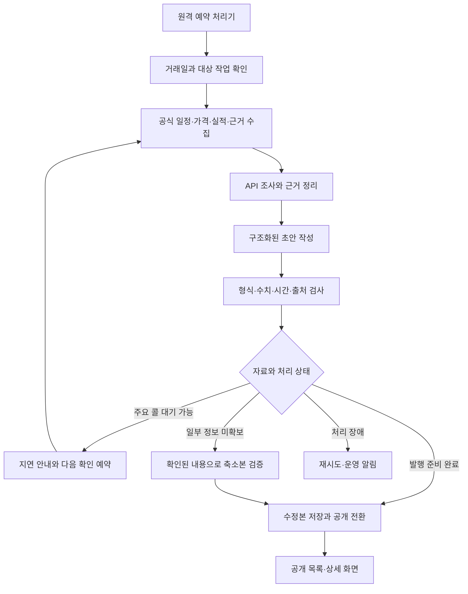

# NOCT Brief 기술 설계

상태: 구현 인계를 위한 기술 기준, 2026-10-27. 구현 시작 지시 대기. 제품 요구사항은 [PRODUCT_SPEC.md](PRODUCT_SPEC.md), 작업 승인 기준은 [AGENTS.md](../AGENTS.md)를 따른다. 서버/API로 시작하는 교체 가능한 생성 구조와 Google 로그인을 채택했다. 환경은 로컬·운영 두 개로 계획한다. 차트·화면·조기 폐장일·어닝콜 재확인·텔레그램은 확정된 제품 정책을 따르며 별도의 공개 전 운영 시험 기간은 제외했다. 그 밖의 기술 세부안은 AI 추천이며 운영 모델·유료 서비스·데이터 공급원과 계약은 미확정이다.

이 문서는 공식 자료에서 확인한 기능, 설계 제안, 실제 계정에서 확인할 사항을 구분한다. 애플리케이션 코드·실제 비밀정보 설정·DB·외부 계정은 만들지 않았고 유료 API나 예약 실행을 시험하지 않았다. 가격과 기능은 조사일 기준이며 도입 직전에 다시 확인한다.

## 1. 기준 구성과 남은 선택

사용자는 **4GB 자체 서버 + Node.js**를 확정했다. Next.js·TypeScript 구성을 유지하며 AWS Lightsail을 우선 후보로 검토한다. **PostgreSQL은 같은 서버에 직접 설치하고 DB 백업은 하루 1회·14일 보관하며 서버 전체 스냅샷은 제외**하는 것으로 확정했다. 리전·실행 구성·서버 구매는 아직 정하지 않았다. 기존 Vercel+Neon 안은 비교 자료로 보존하며 현재 구현 기본안으로 사용하지 않는다. 관리형 DB의 기존 비교와 비용·운영 책임·복구 범위는 8절에 보존한다. 서버에서 수집·AI 생성·검증·발행을 제어하는 방향은 유지한다. 공개 화면은 저장된 검증 결과를 읽으며 방문자 요청마다 AI를 실행하지 않는다. 생성 경로가 달라져도 공통 브리핑 데이터와 표시 화면은 유지한다.

| 구성 | 제안과 이유 | 확인·선정 상태 |
| --- | --- | --- |
| 웹·런타임 | Next.js App Router + TypeScript + Node.js. 공개 조회·관리자·발행 처리를 한 프로젝트에서 관리 | Node.js 확정, 기존 프레임워크 유지; 버전·자체 배포는 구현 승인 후 검증 |
| 호스팅·스케줄 | 4GB 자체 서버와 서버 예약 실행. 구체 후보는 AWS Lightsail | 4GB 자체 서버 확정; AWS 세부 상품·리전·설정 검토, 가입·결제 미승인 |
| DB | 같은 4GB 서버에 PostgreSQL 직접 설치 | 사용자 확정. 외부 관리형은 초기 제외; 로컬·운영 분리는 11절 |
| 생성 | 서버/API로 조사·작성하고 생성 부분은 교체 가능하게 분리. 초기 연결 후보는 OpenAI Responses API | API 시작 방향 확정; 실제 모델·도구 조합과 유료 사용은 미확정 |
| 시장 데이터 | 공개 표시 권한이 확인된 공급원 + 공식 경제 일정·기업 IR | 공급원·요금·대상 종목/지표 범위 미선정 |
| 관리자 | Google OIDC와 운영자 한 명의 고유 계정 ID 허용 목록 | Google 채택 확정; OAuth 설정·인증 구현 전 |
| 알림 | 텔레그램 봇의 운영자 개인 대화로 예외 알림 | 채널과 영구 실패·기술적 15분 지연 기준 확정; 실제 설정 전 |
| 환경·배포 | 로컬·운영 두 환경, GitHub 연동 배포 후보 | 별도 스테이징 제외; 실제 저장소 연동·공개 배포는 별도 승인 후 |

Next.js 구성의 공식 기준은 [App Router 문서](https://nextjs.org/docs/app)를 따른다. 초기에는 별도 메시지 큐, Redis, 마이크로서비스, 다중 에이전트 플랫폼을 추가하지 않는다. DB에 지속되는 작은 작업 상태와 짧은 처리 단계로 시작하며 실제 한계가 확인될 때 확장한다.

초기 제외 범위: 사용자 회원가입, 관심 종목 설정 UI, 개인화 생성, 커뮤니티, 결제, 텔레그램 명령 처리, 전체 본문 검색, 자유 본문 편집기, 실시간 시세 스트리밍. 시장 전체 범위를 식별하는 필드를 두되 미래 개인화를 위해 별도 권한·추천 시스템을 미리 만들지 않는다.

### 자체 운영과 언어·런타임 선택 — 2026-10-27 보완

사용자는 자체 서버라면 Node.js에 고정할 필요가 없으며 적절하면 그대로 사용해도 된다고 밝혔다. AI는 기존 Next.js·TypeScript·Node.js 구성을 유지하는 것으로 정리했고 사용자가 후속 답변에서 4GB 자체 서버·Node.js를 확정했다. 웹 화면·관리자 인증·수집 및 발행 처리를 같은 언어와 데이터 계약으로 관리하고, 현재 요구에 별도 언어의 백엔드를 추가할 구체적인 필요가 없다는 설계 판단이다. 다른 언어보다 빠르거나 메모리가 적게 든다고 실측 비교한 결과는 아니다.

자체 서버는 실행 언어를 선택할 수 있다. 현재 계획한 Next.js 서버 기능을 유지하는 안에서는 Node.js 서버로 배포하며 Vercel 이용은 필수가 아니다. 정적 내보내기만 사용하는 안은 로그인·DB·발행 처리의 서버 기능을 별도로 구성해야 하므로 현재 기본안으로 채택하지 않는다. [Next.js 배포 방식](https://nextjs.org/docs/app/getting-started/deploying)

자체 서버에는 웹·관리자 앱과 같은 코드베이스의 예약 작업 실행기를 둔다. PostgreSQL은 같은 서버에 직접 설치한다. 외부 관리형은 비교 자료로만 남긴다. 실행기는 웹 요청과 분리해 호출하고 작업 상태·중복 방지·실패 복구는 DB에 유지한다. HTTPS를 처리하는 앞단 프록시, 프로세스 재시작, 예약 실행 수단, 외부 백업은 공급자 선정 후 구체화한다. 같은 서버의 장애는 웹·작업·DB에 함께 영향을 주므로 OS·DB 업데이트와 외부 백업·복원을 직접 관리한다. 4GB의 실제 여유는 구현 후 검증한다. [Next.js 자체 운영 안내](https://nextjs.org/docs/app/guides/self-hosting)

## 2. 생성 경로 비교

현재 선택은 서버/API 경로다. 아래 비교와 Work 조사는 선택 근거와 후속 대안으로 보존하며, 초기 구현에 Work 검증이나 동시 구현을 요구하지 않는다.

| 비교점 | Work 클라우드 → HTML → Drive → 수집 | 서버/API → 구조화된 브리핑 |
| --- | --- | --- |
| PC가 꺼진 상태 | 웹 기반 예약 작업 후보 사용. 로컬/데스크톱 작업과 구별 필요 | 서버 스케줄과 외부 API로 처리 |
| 공식 확인 범위 | Work 예약 작업과 연결 도구 활용은 안내됨 | 비동기 응답, 검색 도구, 구조화 출력이 문서화됨 |
| 미확인 핵심 | 해당 계정에서 임의 HTML을 Drive 파일로 무인 저장하고 실패·수정 상태를 전달하는 전체 흐름 | 선택 모델의 도구 조합·계정 한도, 실제 조사 품질·지연·사용량 |
| 발행·오류 제어 | 외부 작업의 완료·실패 신호와 파일 버전 규약을 확보해야 함 | 작업 상태, 재시도, 자료 마감과 수정본 검증을 서비스에서 제어 |
| 비용 | 기존 구독을 활용할 여지가 있으나 이용 한도·추가 연동 비용 미확인 | 모델·검색·서버·데이터 비용을 사용량으로 계산 가능 |
| 추천 | 구독 활용을 우선할 경우 아래 최소 확인부터 | 발행 운영을 직접 관리하려는 현재 요구에는 이 경로 권장 |

사용자는 API로 먼저 시작하고 생성 부분을 교체 가능하게 분리하는 제안을 채택했다. API 추천의 근거는 운영 제어에 관한 AI 설계 판단이며 더 좋은 시황 품질이나 더 싼 총비용을 실측한 결과가 아니다. 초기에는 API 경로만 구현한다.

공식 Work 안내는 웹 작업과 로컬 프로젝트 작업을 구분한다. 로컬 실행은 컴퓨터·앱 상태의 영향을 받으므로 PC가 꺼져도 돌아가야 하는 요구에 그대로 적용할 수 없다. 계정·플랜·워크스페이스에 따라 기능이 달라질 수 있다. [Work 예약 작업](https://learn.chatgpt.com/docs/automations), [PC가 꺼진 경우 웹 사용 예시](https://learn.chatgpt.com/use-cases/manage-your-inbox)

Drive API 자체는 일반 파일의 내용·메타데이터 업로드와 다운로드를 제공한다. 이것은 Work의 연결 도구가 같은 작업을 무인 수행한다는 증거가 아니다. [업로드](https://developers.google.com/workspace/drive/api/guides/manage-uploads), [다운로드](https://developers.google.com/workspace/drive/api/guides/manage-downloads)

### 공개 자료로 확인한 범위 — 2026-10-27 추가 조사

| 기능 | 공개 근거 | 이 프로젝트에서 아직 확인하지 못한 부분 |
| --- | --- | --- |
| Work에서 Google 문서 만들기 | 공식 교육 자료가 Google Docs·Slides 생성 과정을 보여줌 | HTML 파일을 원래 MIME으로 저장하는 동작은 이 예시가 아님 |
| Drive 연결과 파일 생성 | 조직용 연결 문서는 파일 생성 시 저장 위치·접근권 확인과 읽기/쓰기 권한 구분을 안내 | 개인 Pro 계정에 같은 작업·권한이 제공되는지, 임의 HTML 업로드가 있는지 |
| 연결 도구를 이용한 예약 작업 | 공식 예약 작업 안내는 연결 도구만 필요하면 웹/클라우드에서 실행하는 방식을 설명 | HTML 생성→지정 Drive 폴더→수집까지 사람 개입 없이 반복되는 전체 흐름 |

근거: [Google 문서·슬라이드 제작 예시](https://learn.chatgpt.com/training/walkthroughs/create-slides-and-docs), [Drive를 포함한 조직용 연결](https://learn.chatgpt.com/docs/enterprise/shared-connections), [연결 도구와 예약 실행](https://developers.openai.com/training/walkthroughs/scheduled-tasks).

기존 공개 자료가 전혀 없거나 Drive가 무조건 읽기 전용이라는 결론은 아니다. 이번에 확인한 자료에는 NOCT Brief가 요구하는 HTML 원본의 무인 예약 업로드·수정본·실패 처리까지 입증하는 명세나 재현 예시가 없었다. Google Docs 생성 사례를 HTML 업로드 성공 사례로 대체하지 않으며, 검색에서 찾지 못했다는 이유로 기능이 불가능하다고 단정하지 않는다. 실제 계정에서 필요한 작업을 확인하면 후보 판단을 갱신한다.

### 후속 Work 전환을 검토할 경우의 최소 확인

현재 API 구현의 선행 작업이 아니다. 후속 전환을 검토하고 필요한 설정 승인을 받은 경우 아래 최소 확인으로 판단한다. 실제 계정 연결·예약 시험은 수행하지 않았다.

1. 웹 기반 예약 작업과 Drive 쓰기 도구가 계정에서 사용 가능하고, 반복 실행이 사용자 개입 없이 허용되는지 확인한다.
2. 실제 시황 대신 명확히 가짜라고 표시한 작은 HTML 본문 조각과 메타데이터를 지정 폴더에 저장한다. Google Docs로 변환되지 않는지, 파일 ID·MIME·수정 시각·버전을 읽을 수 있는지 확인한다.
3. 서비스가 인증된 상태로 해당 파일을 내려받고 원문과 메타데이터를 검증할 수 있는지 확인한다. 폴더를 공개해서 연동 문제를 우회하지 않는다.
4. PC가 꺼진 상태의 예약 실행, 실패 식별, 같은 회차 수정본 전달을 확인한다. 실패나 정정 요청을 프로그램으로 처리할 수 없다면 관리자 수동 외부 실행이라는 운영 부담을 명시하고 API 경로와 비교한다.

실패한 경로를 브라우저 클릭 자동화로 억지로 유지하지 않는다. Work를 채택한다면 HTML은 전체 실행 가능한 페이지가 아닌 제한된 본문 조각으로 받고, 4절의 공통 데이터로 변환한다. 이 전달 형식 역시 확인 시험 전 제안이다.

## 3. 데이터 공급원·공개 권한·자료 지연

### 필요한 자료와 후보

| 자료 | 후보와 확인 범위 | 남은 확인 |
| --- | --- | --- |
| 미국 거래일·조기 폐장 | NYSE 공식 달력·거래시간 | 당해·다음 해 달력, 임시 휴장 반영 절차 |
| 경제 일정·결과 | Federal Reserve, BLS, BEA 공식 발표 | 수집 가능한 형식·업데이트 주기·시간대와 개별 이용 조건 |
| 실적·콜 일정·발표 | 기업 IR, SEC 공시, 계약한 기업 데이터 API | 실적 발표/콜 시각 구별, 변경 일정, 원문 접근성 |
| 지수·섹터·시장 지표 | FMP 또는 Twelve Data 등의 공급원 | 공개 표시 권리, 지표별 지연·정규장/시간외 범위·호출 한도 |
| 콜 원문 | 기업 IR의 공개 자료, 계약한 전문 공급원 | 실제 게시 지연·누락·허용 저장·인용 범위 |
| 사건과 해석 | 원문 발표와 검색으로 찾은 신뢰 가능한 보도 | 근거 연결, 중복 보도, 게시·수정 시각, 접근 가능성 |

공식 시작점: [NYSE](https://www.nyse.com/markets/hours-calendars), [FOMC 일정](https://www.federalreserve.gov/monetarypolicy/fomccalendars.htm), [BLS 발표 일정](https://www.bls.gov/schedule/), [BEA 발표 일정](https://www.bea.gov/news/schedule), [SEC API](https://www.sec.gov/search-filings/edgar-application-programming-interfaces). SEC의 공시·XBRL API를 실시간 가격이나 모든 콜 전문을 제공하는 API로 취급하지 않는다. 공급자의 접근 빈도 제한과 이용 조건을 따른다.

확정된 차트 범위는 일별 추이·섹터 비교 중심이며 사건 전후 장중 차트·실시간 스트리밍은 초기 필수가 아니다. 장전 선물·금리 등 필요한 시점의 상황 수치는 제외하지 않는다. 구체적인 가격 범위 후보는 미국 주요 지수, 필요할 때의 금리·달러·변동성 지표, 주요 섹터 비교다. S&P 500·Nasdaq·Dow 등 지수의 정확한 상품명과 공급원 심볼을 매핑한다. ETF 대체 시 지수라고 표시하지 않는다. 어떤 Nasdaq 지수를 쓰는지, 선물 계약·롤오버·수정 주가를 어떻게 처리하는지도 상품 선정 시 정한다. 전부를 매회 표시하는 요구는 아니다.

### 공개 서비스에서 중요한 비용 제약

- FMP 가격표의 개인용 Ultimate는 조사 시 월 환산 $99, 연간 청구로 표시된다. 해당 가격만으로 공개 시세·차트 서비스 사용권이 확보되지 않는다. 공식 페이지는 데이터 표시·재배포에 별도 Data Display and Licensing Agreement가 필요하다고 안내한다. 공개 범위와 계약 견적을 별도로 확인해야 한다. [FMP 가격·라이선스 안내](https://site.financialmodelingprep.com/developer/docs/pricing)
- Twelve Data는 개인 이용과 외부 표시·재배포를 구분한다. 공개 화면용 상품도 거래소·데이터별 권리를 확인해야 하며 재배포는 별도 조건일 수 있다. 조사 시 Business 페이지에 표시된 한 Venture 구성은 월 청구 $499였지만, 이것은 이 프로젝트의 견적이나 최저 요금이 아니다. [이용 구분](https://support.twelvedata.com/en/articles/5332349-commercial-and-personal-usage), [Business 가격](https://twelvedata.com/pricing-business)
- 공개 포트폴리오라는 목적만으로 개인용 시세 구독을 외부 표시해도 된다고 판단하지 않는다. 출처 링크를 넣거나 지연 시세를 사용한다고 자동으로 권리 문제가 해결되지 않는다. 기사 전문·콜 전문도 무조건 장기 저장하거나 공개하지 않는다.

공급원 선정 시 **대상 지표, 공개 방문자, 지연 시간, 차트·파생값, 캐시·보관, 출처 표시, 가격**을 함께 확인한다. 현재 업체 문의·견적 요청·계약은 하지 않았다. 권한이 불명확한 실제 데이터로 공개 배포하지 않으며, 권한 확보 대신 공개 열람 요구를 임의로 개인 전용으로 바꾸지도 않는다.

### 콜 종료와 원문 확보는 다른 시점

FMP는 최신 콜 전문을 찾는 목록·날짜 관련 엔드포인트의 갱신 주기를 4~6시간으로 설명한다. 이것을 모든 콜 전문이 종료 4~6시간 뒤 반드시 나온다는 SLA로 해석하지 않는다. 수집 설계는 실제 콜 시각, 자료 게시 시각, 최초 관측 시각을 구분해야 한다. [FMP 데이터 갱신 설명](https://site.financialmodelingprep.com/insights/platform/api-access/how-fresh-is-fmp-data-understanding-update-timing-across-prices)

따라서 합의된 ET 19:30 발행과 최대 1시간 대기 후에도 일부 전문이 없을 수 있다. 그때는 확보한 공식 실적 발표·준비 발언·출처가 분명한 보도의 확인 범위만 사용한다. 전문 미확보를 숨기거나 콜 발언을 만들어 채우지 않는다. 뒤늦은 새 정보는 다음 회차에 반영한다. 음성 녹음 수집·전사는 초기 필수 기능으로 추가하지 않는다.

## 4. 공통 브리핑 데이터와 인터페이스

API 경로에서는 모델이 페이지 HTML을 만드는 대신 구조화된 내용을 반환하고 서비스가 일정한 화면으로 표시하는 안을 권장한다. 외부 생성 경로를 선택하더라도 하나의 입력 변환 단계만 달리하고 이후 검증·저장·조회는 공유한다. 범용 플러그인 프레임워크는 만들지 않는다.

### 생성 부분 교체를 위한 최소 경계 — 방향 채택, 구현 세부안

사용자는 API로 시작하되 생성 부분을 교체할 수 있게 분리하는 방향을 채택했다. 아래 경계는 그 방향을 구현할 최소 설계이며 처음부터 여러 제공자를 모두 구현하지 않는다.

| 변경 수준 | 분리할 부분 | 유지할 부분과 한계 |
| --- | --- | --- |
| 같은 API 안의 모델·추론 강도 | 모델명·추론 강도·출력/검색 한도·프롬프트 버전을 설정으로 관리 | UI·DB·발행 정책 유지. 모델별 지원 옵션과 결과 품질은 다시 확인 |
| 다른 모델 API | 조사·생성 요청, 비동기 상태 조회, 결과·사용량 정규화를 맡는 작은 연결 모듈 | 공통 브리핑 계약·검증·저장·공개 유지. 검색·인용·구조화 출력 지원 차이는 모듈에서 처리 |
| Work→Drive 전달로 교체 | 외부 예약 실행과 파일 수집을 연결하는 모듈, 인증·파일 버전·실패 상태 규약 | 검증된 결과 이후의 저장·화면은 재사용. 외부 작업을 프로그램으로 재실행·정정할 수 있는지는 별도 확인 |

공통 입력은 대상 회차·자료 기준 시각·조사 범위·필요한 기존 근거다. 공통 결과는 4절 브리핑 계약에 맞춘 내용·출처·수치와 생성 방식·사용량·외부 참조 ID다. 준비 중/완료/실패 상태를 서비스 작업으로 정규화하되, Work가 지원하지 않는 실행·취소·재시도 기능을 지원한다고 가장하지 않는다.

진행 중인 작업에는 사용한 생성 경로·모델·프롬프트 버전을 고정하고 경로 변경은 다음 새 작업부터 적용한다. 같은 회차를 두 경로가 동시에 공개하지 않도록 기존 회차 키와 공개 버전 제약을 공유한다. 가격 데이터 공급원도 모델 생성과 구분해, 생성 모델 변경이 차트 수집 전체 변경을 요구하지 않게 한다.

이 설계는 변경 범위를 줄이기 위한 것이며 설정 한 줄로 모든 제공자나 Work 경로를 즉시 바꿀 수 있다는 보장은 아니다. 범용 플러그인 시스템·자동 모델 라우터·중복 생성 시스템은 초기 범위에 추가하지 않는다. 비용만으로 조용히 더 약한 모델에 자동 전환하는 정책도 채택하지 않는다.

### 브리핑 계약

| 묶음 | 주요 필드·의미 |
| --- | --- |
| 식별 | `schema_version`, `market_scope=us_market`, `us_trading_date`, `session=pre/post`, 회차 ID |
| 시간 | 목표 발행, 자료 기준, 생성, 실제 공개, 정정 시각. 시각은 UTC 저장, 거래일은 미국 날짜로 별도 보관 |
| 표시 | 제목, 요약 항목, 중요도 순서가 확정된 구역 배열, 각 구역의 안정적인 ID와 유형 |
| 주장 | 문장, `fact/source_interpretation/ai_inference`, 근거 ID 목록, 해석의 한계, 연결 사건 ID |
| 수치 | 상품 종류·공급원 심볼, 값·단위·통화, 가격 구간, 관측 시각, 비교 기준, 출처 ID |
| 시각자료 | 차트 유형, 관측값 또는 허용된 저장 참조, 기간·단위·출처, 대체 설명. 임의 실행 코드는 금지 |
| 사건 | 일정·실제 발생 시각, 예정/발표/연기/미확인, 결과·컨센서스의 출처와 발표 전후 관계 |
| 품질·누락 | 반영하지 못한 자료와 영향 범위, 검사 결과, 축소 발행 여부. 숫자형 신뢰도 점수는 초기 제외 |
| 출처 | URL·문서명·발표 주체·게시/확인 시각, 수집 방식, 사용권·보관 제약, 필요한 최소 근거 발췌 |

수치와 실제 사건 시간은 가능하면 수집 데이터에서 직접 연결한다. 모델이 입력에 없는 숫자를 새로 만들거나 출처 ID를 발명하면 검증에서 걸러낸다. 금액·기간·단위가 맞지 않는 값은 조용히 대체하지 않는다. 사실성 검사는 형식 검사와 별개다.

### 최소 저장 구조

| 논리 테이블 | 역할과 핵심 제약 |
| --- | --- |
| `briefings` | 미국 거래일+세션+시장 범위로 유일한 회차. 현재 공개 버전 참조, 공개 여부, 목표 시각 |
| `briefing_versions` | 검증된 본문·근거 연결의 불변 수정본. 정정 사유·이전 버전·정정 시각·작성 설정 버전 |
| `jobs` | 회차·단계·시도·대기 사유·다음 재시도 시각·잠금 기한·외부 응답 ID·사용량 |
| `evidence` | 근거 메타데이터와 허용된 최소 원문/발췌. 변경된 원문은 별도 수집 버전으로 구분 |
| `events` | 일정과 결과, 회사/회계 기간, 이전 브리핑의 확인점과 연결. 늦게 확보한 자료의 최초 관측 시각 |
| `notification_outbox` | 발송 예정·성공·실패, 중복 방지 키, 해당 장애·회차와 연결 |

실제 SQL·마이그레이션은 구현 승인 후 작성한다. 인증 라이브러리가 필요로 하는 세션 등 저장 구조는 선정 후 최소 범위로 추가한다. 빈 회차나 실패 작업을 공개된 브리핑 버전처럼 저장하지 않는다.

공개 API/조회는 공개 회차의 목록·상세·다음 예정·지연 상태만 제공한다. 관리자 인터페이스는 상태 조회, 단계별 재시도, 근거를 포함한 정정 요청, 공개/비공개 전환으로 제한한다. 생성 처리기는 인증된 내부 호출만 받는다. 실제 경로·요청 형식은 이 경계를 유지해 구현 단계에서 정하고, 문서에는 검증된 형식을 보완한다.

## 5. 수집·생성·발행 흐름

1. 이전 회차의 자료 기준·핵심 변수·미반영 항목과 대상 거래일 일정을 읽는다. 조사 범위가 휴장 기간을 포함하도록 한다. 검색 기간만 최근 24시간으로 고정하지 않는다.
2. 가격·캘린더·IR 등 수집 결과의 시각과 출처를 보존한다. 콜 탐색은 최신 목록 첫 항목만 읽지 않고 회사·회계 기간·자료 버전으로 비교한다. 늦게 올라온 과거 콜도 다음 회차 후보에 포함한다.
3. AI는 추가 조사, 근거 정리, 중요도 판단과 설명을 수행한다. 검색 결과·기사·HTML은 자료로 취급하며 그 안의 지시를 실행하지 않는다. 이전 글의 AI 해석을 새 원문 사실의 근거로 재사용하지 않는다.
4. 확인한 근거 묶음을 입력으로 구조화된 초안을 작성한다. 긴 조사와 최종 출력은 나눌 수 있고, 조사 전체를 매번 다시 실행하지 않는다. 모델·프롬프트·스키마 버전과 사용량을 남긴다.
5. 자동 검사 후 문제가 있는 부분은 제한적으로 수정하거나 제외하고 한계를 표시한다. 같은 모델에게 재확인시켰다는 이유만으로 검증을 완료했다고 보지 않는다. 출처·수치의 직접 대조와 시간 관계 검사가 필요하다.
6. 검증된 버전 저장과 현재 공개 버전 전환을 하나의 DB 트랜잭션으로 처리한다. 목표 시각보다 일찍 준비된 결과는 비공개로 보관한다. 공개 전 자료 시각·지연 여부를 다시 판단한다.

Responses API의 비동기 실행을 사용하면 긴 생성 동안 서버 함수를 계속 열어둘 필요가 없다. 외부 응답 ID를 저장하고 다음 짧은 처리에서 상태와 결과를 회수한다. 결과 보관 옵션은 명시적으로 선택하고 완료 결과를 자체 DB에 신속히 저장한다. 현재 문서는 `store`를 생략하거나 false로 두는 백그라운드 응답의 짧은 보관 기간을 설명하므로 재개 가능성을 고려해 설정해야 한다. [Background mode](https://developers.openai.com/api/docs/guides/background)

Structured Outputs는 데이터 형태를 제한하는 기능이며 사실성을 보증하지 않는다. 거부·중단·형식 오류와 내용 오류를 따로 처리한다. 웹 검색을 사용한 답변에는 독자가 볼 수 있는 클릭 가능한 인용을 제공한다. 선택 모델과 검색·비동기·구조화 출력 조합은 승인 후 작은 시험에서 확인한다. [구조화 출력](https://developers.openai.com/api/docs/guides/structured-outputs), [웹 검색](https://developers.openai.com/api/docs/guides/tools-web-search)

## 6. 시간·중복·실패·정정 운영

### 발행 일정과 짧은 작업 처리

발행 시각·휴장·최대 콜 대기 시간은 제품 기획 4절을 그대로 따른다. `America/New_York`으로 대상 미국 거래일의 시각을 만든 뒤 UTC로 저장하고 `Asia/Seoul`로 표시한다. 한국 날짜로 회차 키를 만들지 않는다. 임시 휴장 등 공식 달력 변경은 감지·재확인 후 미발행 일정에 반영하고 이미 공개된 회차를 삭제하지 않는다.

이전 Vercel 비교 참고: Vercel Cron의 시간대는 UTC다. Hobby는 각 작업의 실행 빈도가 하루 한 번이며 실행 정밀도가 시간 단위다. 두 개의 일일 작업을 만드는 것 자체가 불가능한 것은 아니지만, 현재 요구의 분 단위 예약·진행 상태 확인에는 Pro가 더 적합하다. Cron 실패의 자동 재시도도 제공되지 않으므로 서비스에서 처리한다. [Cron 개요](https://vercel.com/docs/cron-jobs), [플랜별 제한](https://vercel.com/docs/cron-jobs/usage-and-pricing), [실행·실패 관리](https://vercel.com/docs/cron-jobs/manage-cron-jobs)

초기 운영 제안: 자체 서버의 OS 예약 실행기로 짧은 작업 처리기를 호출한다. systemd timer 등 구체 수단은 배포 설계에서 정하며 Vercel 함수 제한을 현재 환경의 제약으로 사용하지 않는다. 발행 시각·작업 상태·중복 방지·재시도 요구는 유지한다.

- 분 단위 처리기가 DB에서 실행할 작업을 가져와 짧게 처리한다. 처리 시간 제한과 중복 방지를 두고 진행 상태를 저장해 프로세스 재시작 후 이어갈 수 있게 한다. 장시간 대기를 웹 요청 안에 두지 않으며 작업이 없을 때 모델 호출은 하지 않는다.
- 조사 준비는 목표 발행 약 30분 전부터, 핵심 수치·일정 확인은 발행 직전 다시 수행하는 안으로 시작한다. 실제 조사 소요 시간을 측정해 조정하며 30분이면 항상 충분하다고 약속하지 않는다.
- 최신 자료가 없는 것은 자료 대기, 네트워크/API 오류는 처리 실패, 사실·단위 불일치는 검증 실패로 구분한다. 대기 때문에 같은 긴 모델 호출을 반복하지 않는다.
- 콜 자료 대기 상한에 도달하면 추가 자료 수집을 기다리지 않고 확보된 내용으로 마무리한다. 상한은 실제 발행 성공 시각을 보장하는 SLA가 아니다.
- 조기 폐장일에도 발행 시각을 유지하고 실제 폐장 시각을 표시하는 제품 기획 11절의 확정 정책을 따른다. 주요 어닝콜 자료 대기는 최대 1시간, 재확인은 약 10분 간격으로 한다.

### 작업 상태와 재시도 기본값

작업 상태는 `queued → collecting → generating → validating → ready → published`를 기본으로 하되 `waiting_data`, `retry_wait`, `failed`를 별도로 둔다. 실제 호출 기록 없이 “생성 중”으로 표시하지 않는다. 회차의 공개 여부와 자료 완전성은 작업 상태와 다른 필드로 관리한다.

- 회차·작업 종류의 중복 생성은 유일 제약으로 막는다. 작업 잠금에는 만료 시각과 소유자/버전을 두고 현재 잠금을 가진 처리기만 결과를 반영한다. 중복 Cron·동시 관리자 재시도가 두 개의 공개 글을 만들지 않아야 한다.
- 잠금 안에서 외부 요청을 기다리며 긴 DB 트랜잭션을 유지하지 않는다. 저장한 단계와 외부 응답 ID로 중단 지점부터 이어간다. 외부 요청 접수 여부가 불분명하면 별도 상태로 남기고 무제한 새 유료 요청을 만들지 않는다.
- 일시적 네트워크·429·5xx 오류는 최초 시도 후 최대 3회, 기본 1·5·15분 간격으로 재시도하는 안을 제안한다. 제공자의 Retry-After와 발행·자료 마감 정책을 우선한다. 인증·권한·잘못된 요청은 같은 요청을 반복하지 않고 실패 원인을 알린다.
- 내용 검증에 실패하면 해당 범위의 수정 시도를 1회로 제한하는 안을 제안한다. 해결하지 못한 항목은 제외·표시하여 축소 발행한다. 전체 초안을 믿을 수 없거나 생성 서비스가 실패하면 확보한 사실만 정해진 형식으로 표시하는 축소본을 시도한다.
- 저장·조회 서비스 장애까지 포함해 매회 성공을 보장하지 않는다. 실패 회차는 미발행으로 남기고 복구 후 실제 공개 시각을 표시한다. 지나간 마감 시점의 자료가 없다면 나중 정보를 원래 알고 있었던 것처럼 과거 회차를 재작성하지 않는다.
- 데이터 공급원·모델 호출 횟수, 사용량과 지연을 회차별로 관찰한다. 재시도 제한은 폭주를 막는 운영 기본값이며 사용자가 월 예산 상한을 정한 것으로 해석하지 않는다.

### 정정과 공개 상태

새로 나온 정보는 다음 회차로 넘기고 기존 오류는 해당 글에서 정정하는 제품 정책을 따른다. 수정된 출처를 뒤늦게 확보했을 때도 새 정보인지 기존 주장의 오류인지 먼저 구별한다.

관리자의 정정 요청은 문제 항목·이유·근거와 원래 버전 ID를 받는다. 자료를 재확인하고 해당 범위의 수정본을 검증한 후 현재 버전이 요청 시점과 같은지 확인해 교체한다. 정정 이력에 변경 내용·이유·시각을 남기고 원래 버전은 내부에서 보존한다. 새로운 본문이 검증될 때까지 기존 버전을 자동 덮어쓰지 않는다. 현재 내용이 심각하게 잘못됐다면 운영자가 먼저 비공개로 전환할 수 있다.

비공개 전환·정정 시 목록·상세·공유 미리보기 캐시도 갱신한다. 공개 요청마다 공개 상태가 유효하도록 하고 이전 버전의 직접 URL로 비공개 본문이 노출되지 않게 한다. 관리자가 공개를 복구하더라도 내용 검증을 건너뛰는 기능은 제공하지 않는다.

### 텔레그램과 운영 관측

- 사용자 확정: 복구할 수 없는 실패와 기술적 이유로 목표 시각보다 15분 이상 미발행인 경우 텔레그램으로 알린다. 인증·권한 오류는 즉시 감지하고, 일시적 오류의 재시도 소진은 상세 재시도 기본값에 따라 처리한다.
- 합의된 주요 콜 대기 중에는 공개 화면에서 지연을 안내하되 단순 대기만으로 장애 알림을 보내지 않는다. 최대 대기 뒤 축소 발행까지 완료됐다면 정상 발행 알림은 생략한다. 대기 상한을 넘어서도 실제로 공개하지 못했거나 새 기술 장애가 있으면 알린다.
- 회차+문제 종류로 알림을 중복 억제한다. 동일 문제의 매분 알림은 보내지 않는다. 원인·심각도가 바뀌면 새 상태로 알릴 수 있다. 알림에는 회차, 문제, 확인된 현재 상태, 관리자 링크만 넣는다.
- 발송은 별도 outbox에 기록해 실패한 발송을 제한적으로 재시도한다. 텔레그램 발송 성공을 브리핑 공개 성공과 혼동하지 않는다. 봇 비밀키와 운영자 chat ID는 서버에서만 사용한다. 실제 전송 방식은 [Telegram Bot API](https://core.telegram.org/bots/api)를 따른다.
- 관리 화면에는 마지막 예약 실행, 회차별 목표·실제 발행·자료 기준, 실패 단계, 미확보 자료, 알림 발송 결과, 모델/검색 사용량을 보여준다. 전체 민감 로그를 공개하거나 운영자 화면에 그대로 출력하지 않는다.
- 예약 처리기·호스팅 전체가 멈추면 같은 서비스 안의 코드만으로는 스스로 알림을 보낼 수 없다. 외부 heartbeat 감시를 운영 배포 전 후보로 검토한다. 외부 감시를 아직 설치하거나 동작 검증한 것으로 취급하지 않는다.

### AWS 설정·업데이트·주기적 백업 — 방향과 설계 제안

사용자는 AWS 설정 지원을 요청했고 서버 업데이트를 스크립트로 관리하며, 비용이 크지 않으면 백업도 주기적으로 실행하기를 원한다. 후속 사용자 결정으로 PostgreSQL 자체 설치, DB 백업 하루 1회·14일 보관, 서버 전체 스냅샷 제외를 확정했다. 아래의 실행 시각·저장소·도구·복구 세부안은 AI 운영 제안이며 운영 스크립트 작성은 구현 승인 후 진행하고, 실제 자원·계정 설정·구매·운영 적용은 해당 배포·비용 승인 범위에서 수행한다.

- Lightsail을 우선 검토하며 일반 EC2에서 VPC·서브넷·라우팅·게이트웨이를 직접 구성하는 안과 구별한다. 단일 서버안에 별도 NAT Gateway나 로드밸런서를 기본 추가하지 않는다. 리전·OS, 고정 IP, DNS·HTTPS, SSH 접근, 인스턴스/OS 방화벽, 비밀정보, 백업·감시 설정을 배포 단계에서 함께 준비한다. 자동 네트워크 구성도 접근 규칙 확인을 대신하지 않는다. [AWS 비교 안내](https://aws.amazon.com/free/compute/lightsail-vs-ec2/), [네트워크 설정](https://docs.aws.amazon.com/lightsail/latest/userguide/amazon-lightsail-faq-networking.html)
- 외부 웹 접근은 HTTPS 중심으로 구성하고 SSH는 허용한 관리 경로로 제한한다. 자체 DB는 로컬 연결 등 최소 범위에서 접근하며 인터넷에 DB 포트를 공개하지 않는다. 관리형은 해당 서비스의 TLS·접근 제한을 적용한다.
- Ubuntu를 선택하면 OS 보안 업데이트는 unattended-upgrades 같은 표준 도구를 활용한다. 스크립트는 설정 재현, 사전 확인·백업, 앱 배포·상태 확인·복원에 집중한다. Node.js·PostgreSQL 주요 버전과 앱 의존성을 무조건 최신으로 올리지 않는다. 재부팅·DB 변경은 발행·수집과 겹치지 않는 유지보수 시간에 수행하는 안이다. [Ubuntu 자동 업데이트](https://ubuntu.com/server/docs/how-to/software/automatic-updates/)
- 사용자 확정: **DB 백업 하루 1회·14일 보관**. 구현안은 압축 pg_dump를 비공개 외부 저장소에 보관하고 주요 DB 변경 전 추가 백업하는 방식이다. 사용자 표현의 “DB 데이터 스냅샷”은 DB를 복원할 백업이라는 요구로 반영하고 구현안은 논리 덤프로 구체화한다. 실행 중인 DB 폴더를 단순 복사하는 방식은 사용하지 않는다. 덤프에는 데이터와 스키마를 포함하고 역할·권한 등 별도 복원 요소는 재현 가능한 설정이나 적절히 보호한 백업으로 준비한다. 실행 시각과 저장소는 배포 준비에서 정한다. 최근 성공한 백업 이후 변경은 유실될 수 있다. [PostgreSQL 덤프·복원](https://www.postgresql.org/docs/current/backup-dump.html)
- 백업 성공 시각·파일·업로드를 확인하고 실패·장기 미실행은 텔레그램 예외 알림 대상으로 추가하는 안을 제안한다. 분리된 DB에서 실제 복원을 확인한다. 저장소는 비공개·제한된 자격 증명을 사용하고 운영 DB 백업에 확정된 14일 보관 정책을 적용한다. 일일 생성·외부 업로드·만료 정리를 확인하고, 백업 실패 상태에서도 정상 보관 중인 복사본을 잘못 삭제하지 않도록 검증한다.
- 복구는 원인에 따라 구분한다. 앱 배포 오류는 이전 검증 버전을 재배포하고, OS·디스크·인스턴스 문제는 새 서버 생성 → 정식 설정·배포 스크립트 실행 → 비밀정보 재주입 → DB 복원으로 대응한다. 코드 롤백이 OS와 DB 변경까지 되돌린다고 가정하지 않으며 스키마 변경 후에는 이전 앱과의 호환성을 확인한다. 비밀정보는 Git과 별도의 안전한 보관 수단에서 복원한다.
- 서버 스냅샷을 생략하는 대신 필요한 OS·Node.js·DB 버전, 프록시·프로세스·예약 작업 설정, 복원 절차를 재현 가능하게 남긴다. 이전 검증 버전의 소스·의존성 잠금 파일 또는 배포 산출물을 유지한다. 서버 내부에만 존재하는 영구 데이터를 두지 않으며 추후 DB 밖의 원본 파일이 생기면 보존 대상을 별도로 정한다. 새 서버 재구성은 스냅샷 복원보다 수작업·시간이 늘 수 있고 실제 복구 소요 시간은 검증 전이다.
- 계속 사용하는 운영 스크립트는 구현 승인 후 정식 scripts/ops/ 등 프로젝트 경로와 docs/ 운영 안내에서 관리한다. 현재 스크립트·AWS 자원·예약 작업을 생성하거나 실행하지 않았다.

## 7. 보안·관리자 인증·HTML

사용자는 Google 로그인 추천을 채택했다. 초기에는 Google 하나만 연결하며 GitHub 로그인은 함께 구현하지 않는다. Better Auth는 두 제공자를 모두 지원한다. Google은 Cloud 프로젝트·OAuth 동의 화면·클라이언트와 리다이렉트 설정, GitHub는 OAuth 앱·클라이언트와 콜백 설정이 필요하다. 기본 로그인 하나를 붙이는 범위에서 제공자 때문에 전체 구조가 크게 달라지지 않는다는 판단이며 실제 개발 시간을 비교 측정한 것은 아니다. [Google 인증](https://better-auth.com/docs/authentication/google), [GitHub 인증](https://better-auth.com/docs/authentication/github)

Google 인증에서는 검증된 ID 토큰의 발급자·대상·만료 등을 확인하고 안정적인 `sub`로 운영자 한 명을 허용한다. 이메일이나 표시 이름만으로 계정을 식별하거나 첫 로그인 사용자를 자동 관리자로 만들지 않는다. Google 공식 문서는 이메일 대신 `sub`를 고유 식별자로 사용하도록 설명한다. 로그인에는 필요한 기본 신원 범위만 요청하며 Drive·Gmail 권한을 묶지 않는다. Google 로그인 선택과 Work/Drive 연동 선택은 독립적이다. [Google OIDC](https://developers.google.com/identity/openid-connect/openid-connect)

모든 관리 조회·수정·재시도에서 서버가 인증·권한을 확인한다. 공개 가입 UI나 여러 관리자 역할은 만들지 않는다. 쿠키·세션·CSRF 보호와 변경 요청의 재실행 방지를 적용하고 테스트한다. 예약 요청은 서버 비밀정보로 검증하며 URL 쿼리에 키를 넣지 않는다. 환경별 데이터·비밀정보·자동 실행 분리는 11절을 따르며 운영 외 환경이 운영 작업이나 알림을 실행하지 않도록 한다.

API 출력은 검증된 구조화 데이터로 표시하고 문자를 이스케이프한다. Work HTML을 선택한 경우에는 허용된 문단·제목·목록·표·링크만 변환하며 script, 이벤트 핸들러, iframe, 실행 URL, 임의 스타일·외부 리소스를 거부한다. 단순 정규식 치환만으로 HTML을 정제하지 않는다. [OWASP XSS 예방 기준](https://cheatsheetseries.owasp.org/cheatsheets/Cross_Site_Scripting_Prevention_Cheat_Sheet.html)

외부 URL 수집은 HTTP(S), 대상 호스트·리다이렉트 검증, 내부망·메타데이터 주소 차단, 용량·시간 제한을 둔다. 원문 안에 포함된 명령·키 요청·도구 지시는 실행하지 않는다. 출처 링크와 표기 텍스트도 검증한다. API 비밀정보, 인증 토큰, 원문에 포함된 민감정보를 공개 출력·로그·모델 입력에 불필요하게 포함하지 않는다.

사용권이 허용하는 범위의 근거·버전·정정 기록을 보관한다. 원문 전체의 무기한 저장을 기본값으로 삼지 않는다. 공개 문서 삭제 여부와 내부 증거 보관은 공급 계약·보안 원칙에 맞춰 별도로 처리한다. 저장·백업·복구는 확정한 자체 PostgreSQL·일일 백업·14일 보관을 기준으로 하며, 데이터 보관 권한과 외부 저장소 조건을 함께 확인한다.

## 8. 비용 예시와 남은 견적

금액은 USD, 세금·환율 제외다. **모든 수량은 계산용 가정이며 측정값이나 월 요금 보장이 아니다. 공개 데이터 계약 금액이 없으므로 전체 운영비는 아직 산정 완료가 아니다.**

### 모델·검색

비용 계산 후보는 GPT-6.1 Sol의 Standard 입력 $2/100만 토큰, 출력 $10/100만 토큰이다. 최종 생성 모델을 확정한 것이 아니다. 검색은 호출당 $0.01이며 검색 내용의 입력 토큰 요금은 별도이므로 아래 입력량에 포함한다. [모델 가격](https://developers.openai.com/api/docs/models/gpt-6.1-sol), [도구 가격](https://developers.openai.com/api/docs/pricing)

월 22개 미국 거래일×2회=44회를 가정한다. 토큰 수는 회차별 조사·작성·검증 호출 전체 합계이며, 과금되는 추론 출력과 검색 내용 입력도 포함해야 한다. 캐시·Batch 할인은 적용하지 않았고 각 호출은 사용한 기본 가격 구간 안이라는 가정이다.

| 계산 시나리오 | 회차당 입력 / 출력 / 검색 | 회차당 | 월 44회 | 재시도 등 50% 여유 포함 |
| --- | --- | --- | --- | --- |
| 가벼운 조사 | 20,000 / 4,000 / 8회 | $0.16 | $7.04 | $10.56 |
| 기준 예시 | 60,000 / 12,000 / 20회 | $0.44 | $19.36 | $29.04 |
| 긴 조사 | 150,000 / 30,000 / 40회 | $1.00 | $44.00 | $66.00 |

계산식: 입력 토큰÷1,000,000×2 + 출력 토큰÷1,000,000×10 + 검색 횟수×0.01. 50%는 비교용 여유분이며 합의된 예산이나 재시도 성공률이 아니다. 실제 품질을 확인한 뒤 모델·호출 수·조사 범위를 조정한다.

### API만 분리한 비용

위 가정에서 모델 요금과 검색 호출료를 나누면 아래와 같다. 검색 내용 토큰은 모델 요금에 포함한다. 월 44회, Standard 가격, 세금 제외이며 서버·DB·시세 데이터 API·전문 이용권은 포함하지 않는다.

| 조사량 가정 | 모델만 | 검색 호출료 | 모델+검색 | 50% 여유 포함 |
| --- | --- | --- | --- | --- |
| 가벼운 조사 | $3.52 | $3.52 | $7.04 | $10.56 |
| 기준 예시 | $10.56 | $8.80 | $19.36 | $29.04 |
| 긴 조사 | $26.40 | $17.60 | $44.00 | $66.00 |

개발을 수행하는 Codex 모델과 브리핑을 매일 생성하는 운영 모델은 별개다. 개발 대화에서 Astra를 사용한다는 이유로 운영 모델이나 API 과금을 Astra로 고정하지 않는다. 위 계산은 Sol 기준이며 최종 모델 선택 전이다. 확정 월 요금·최대 비용은 아니고, 구현 중 회차별 실제 입력·출력·검색·재시도 사용량을 확인해 추정치를 갱신한다. 비용을 측정하기 위해 별도의 5거래일 비공개 운영 기간을 강제하지 않는다.

### 호스팅·DB·데이터

- Vercel Pro 기본 금액은 월 $20이며 포함 사용량 크레딧이 있다. 크레딧을 추가 현금 비용처럼 중복 계산하지 않는다. 사용량·좌석 등 추가 과금은 별도다. [Vercel 가격](https://vercel.com/pricing)
- Neon Free는 프로젝트당 월 100 CU-hours·저장 1GB를 제시한다. 하지만 분 단위 DB 조회는 5분 유휴 정지를 막을 수 있어 운영에서 무료를 보장할 수 없다. Launch의 계산 단가는 $0.106/CU-hour, 저장 $0.35/GB-month다. 0.25 CU가 30일 내내 실행되고 1GB를 저장한다면 기본 컴퓨트·저장은 약 $19.43다. 추가 브랜치·복구 이력·전송 등은 별도 확인한다. [Neon 가격](https://neon.com/pricing), [유휴 정지](https://neon.com/docs/introduction/scale-to-zero)
- 초기에는 항상 상태를 확인하는 단순 운영안으로 비용을 비교한다. DB 조회를 발행 시간대에 집중해 비용을 줄이는 안은 추후 사용량이 확인되면 검토한다. 장애 감지·수동 재시도의 원격 실행을 깨뜨리면서 무료 한도에 맞추지 않는다.
- 이전 Vercel 대안의 참고 계산: 위 모델 여유분 + Vercel $20 + DB 기본 예시 $19.43를 합치면 가벼운 조사 **$49.99**, 기준 **$68.47**, 긴 조사 **$105.43/월**이다. 방문량·저장량이 작다는 가정이며 확정 청구액이 아니다.
- **위 합계에는 공개 시세·차트·전문·뉴스 이용권, 도메인, 초과 호스팅/DB 사용량, 추가 감시 서비스, 세금이 포함되지 않는다.** 데이터 공개 권한 비용이 모델 비용보다 클 수 있다. 3절의 개인용 가격을 전체 공개 서비스의 데이터 예산으로 합산하지 않는다.

무료 개발 환경의 가능성과 안정적인 공개 운영 예산은 구별한다. 월 고정 상한은 사용자가 정하지 않았다. 구체적인 유료 사용은 필요한 항목과 예상액을 보고 선택한 뒤 시작한다.

### 호스팅 대안·도메인·백업을 포함한 비교 — 2026-10-27 검토

사용자는 단일 서버에서 웹과 PostgreSQL을 함께 운영할 때 2GB의 메모리 여유를 우려하며 4GB 이상이 필요하다는 의견을 제시했다. AWS 대안은 **Lightsail Linux·공인 IPv4 포함 4GB, 월 $24**를 비교 기준으로 사용한다. 후속 논의에서 사용자는 4GB 자체 서버·Node.js를 확정했다. 아래 자체 PostgreSQL 비용은 확정한 DB 직접 설치 기준의 예시다. AWS 세부 설정·실제 서버 구매·백업 저장소는 미확정이다. 4GB의 실제 여유도 구현 후 동시 조회·수집·DB 작업과 배포 과정에서 확인한다. AWS에서는 운영용 빌드를 Linux CI 등 서버 외부에서 수행하는 안을 우선 검토한다. [Lightsail 요금](https://aws.amazon.com/lightsail/pricing/)

백업 범위를 다음과 같이 구분한다.

- **앱 배포 복구:** 자체 서버에서는 이전 검증 버전 재배포와 서버 재구성을 6절 기준으로 구분한다. 이전 비교안의 Vercel Instant Rollback은 이전 앱 배포로 트래픽을 돌리는 기능이다. 외부 PostgreSQL 데이터를 이전 상태로 복구하는 기능으로 취급하지 않는다. 소스는 Git 이력으로 관리하되 Git도 실제 운영 데이터의 백업을 대신하지 않는다. [Vercel 배포 복구](https://vercel.com/docs/instant-rollback)
- **Neon DB 복구:** 변경 이력으로 특정 시점에 복구하는 기능을 제공한다. Launch의 이력 보관은 기본 1일·최대 7일이며 보관하는 변경 이력은 $0.20/GB-month로 일반 DB 저장과 별도 과금한다. 기존 $19.43의 컴퓨트·일반 저장 예시에는 이 비용이 포함되지 않았다. [이력 보관과 과금](https://neon.com/docs/postgres/backup-restore/history-window)
- **Lightsail 서버 스냅샷 — 초기 범위에서 제외:** 아래는 이전 비교를 위한 참고이며 현재 운영안·비용 합계에는 포함하지 않는다. 스냅샷은 서버·디스크를 해당 시점 기준으로 복원할 자료다. 자동 스냅샷은 활성화해야 매일 생성되며 최근 7개가 유지되고 저장 비용은 별도다. $0.05/GB-month로 청구되며 전체 청구 대상 저장량이 월평균 40GB라면 $2다. 디스크 용량에 스냅샷 개수를 단순히 곱하지 않고 변경분과 보존량으로 계산한다. 원본 삭제 시 자동 스냅샷도 삭제되는 정책이 있으므로 자동 스냅샷만을 독립 보존 수단으로 삼지 않는다. [자동 스냅샷](https://docs.aws.amazon.com/lightsail/latest/userguide/amazon-lightsail-configuring-automatic-snapshots.html), [스냅샷 과금](https://docs.aws.amazon.com/lightsail/latest/userguide/amazon-lightsail-frequently-asked-questions-faq-billing-and-account-management.html)
- **DB 백업 파일:** PostgreSQL 자체 설치와 하루 1회·14일 보관은 확정했다. 일관된 pg_dump 백업을 서버 밖에 보관하고 실행 시각·복구 목표·저장소는 구체화한다. Neon의 독립 보관은 이전 대안의 비교 내용이다. 일별 스냅샷·덤프와 연속 변경 이력을 통한 시점 복구는 복구 정밀도가 같지 않다. 설정만으로 복구 성공을 가정하지 않고 실제 복원을 확인한다. [PostgreSQL SQL Dump](https://www.postgresql.org/docs/current/backup-dump.html)

도메인은 서버와 독립적으로 등록·갱신한다. 사용자는 .com을 필수로 요구하지 않으므로 아래 .com 금액은 동일 조건의 비교 예시로만 남긴다. 이름·확장자·등록처를 정할 때 첫해 할인과 이후 갱신비를 구분한다. Vercel은 기본 .vercel.app 주소를 제공하므로 이 주소를 사용하면 별도 도메인 구매가 필요 없다. 자체 도메인을 선택하면 일반적으로 별도 등록·갱신 비용이 든다. [Vercel 도메인 안내](https://vercel.com/docs/domains/working-with-domains)

현재 AWS 공식 등록 요금표의 일반 .com은 연 $15이므로 비교에서 월 $1.25로 환산한다. 실제 청구는 연 단위이며 도메인 이름·등록처·갱신 가격·구매 시점에 따라 달라질 수 있다. 도메인·등록처 선택이나 이름의 구매 가능 여부는 확인하지 않았다. [공식 도메인 요금표](https://d32ze2gidvkk54.cloudfront.net/Amazon_Route_53_Domain_Registration_Pricing_20140731.pdf)

Vercel 유료 Pro 팀에는 프로모션 기간 중 .app·.dev 등 대상 도메인 하나의 첫 1년 등록 무료 혜택이 있다. 실제 계정·선택 이름에 Free With Pro가 표시되는지 확인해야 하며 Pro 체험판은 제외된다. .com은 대상 목록에 없고, 프리미엄 이름은 제외되며 이후 정상 갱신 가격을 적용한다. 동일 .com 비교에는 혜택을 빼서 계산하고 실제 선택 시 첫해와 갱신 이후를 따로 확인한다. Lightsail의 포함 DNS 또는 무료 DNS 구성을 기준으로 하며 별도 유료 DNS를 선택하면 그 비용도 추가한다. [Vercel 도메인 혜택](https://vercel.com/docs/domains/free-domain-with-pro), [Lightsail DNS](https://docs.aws.amazon.com/lightsail/latest/userguide/amazon-lightsail-frequently-asked-questions-faq-billing-and-account-management.html)

| 월 비용 항목 | Vercel Pro + Neon Launch 예시 | Lightsail 4GB + 자체 PostgreSQL 예시 |
| --- | --- | --- |
| 웹·작업 실행 | $20, 포함 사용량 내라는 가정 | $24, 포함 트래픽 내라는 가정 |
| DB 컴퓨트·일반 저장 | $19.43: 기존 0.25 CU 상시 가동·1GB 저장 가정 | 위 서버에 함께 설치, 별도 관리형 DB 요금 없음 |
| 복구용 저장 예시 | $1: 평균 변경 이력 보관 5GB × $0.20 | $0: 서버 전체 스냅샷 제외. DB 백업 저장은 다음 행 |
| 독립 DB 백업 파일 보관 예산 | $1 임시 예산 | $1 임시 예산 |
| 일반 .com 도메인 월 환산 | $1.25 | $1.25 |
| **가정에 따른 월 합계** | **$42.68** | **$26.25** |

두 안의 실제 복구 기능·메모리·관리 수준이 동등하다는 비교가 아니다. Neon 변경 이력 5GB는 계산 가정이다. 이전에 가정한 서버 스냅샷 40GB·$2는 제외했고 자체 서버 예시 합계는 $28.25에서 $26.25로 조정했다. 실제 저장량이나 절감 성과를 측정한 것은 아니다. 독립 백업의 $1은 저장소를 선정하기 전 임시 예산이며 확인된 상품 요금이나 상한이 아니다. 실제 보관량·요청·전송 비용을 확인해 바꾼다. AI·시장 데이터 이용권·세금·초과 사용량·복구 시험 중 임시 자원 비용은 이 합계에서 제외한다. AWS는 OS·배포·HTTPS·DB 운영과 복구 절차를 직접 관리하고 Vercel+Neon은 해당 관리 부담을 줄이는 대가를 지불한다.

### DB 운영 방식 비교 — 2026-10-27 자체 설치 확정, 비교 근거 보존

현재 선택은 4GB 서버에 PostgreSQL을 직접 설치하는 방식이다. 아래는 검토했던 외부 관리형 대안의 비교로, 초기 구현 대상이 아니다. 주된 차이는 SQL 기능보다 자원·장애 범위의 분리와 업데이트·백업·시점 복구의 관리 책임이다. 관리형도 스키마·권한·쿼리·앱 연결·복원 확인까지 대신하지 않으며 모든 상품이 고가용성인 것은 아니다.

| DB 방식 | 월 DB 추가 비용 또는 계산 예시 | 4GB 앱 서버 $24와 합계 | 운영 차이 |
| --- | --- | --- | --- |
| 같은 서버에 PostgreSQL 설치 | DB 서비스 요금 $0, 백업 저장 별도 | $24 + 백업 저장 | 웹과 자원·장애 범위 공유. 업데이트·백업·복원 직접 관리 |
| Neon Launch | 0.25 CU 상시 30일 + 1GB 저장 약 $19.43 | 약 $43.43 + 복구 이력 등 | DB 인프라 관리 분리, 사용량 과금. 복구 이력·전송 등 별도 |
| Lightsail 관리형 Standard 1GB | $15 | $39 | 7일 자동 백업·시점 복구, 마이너 업데이트. 저장 데이터 암호화 없음 |
| Lightsail 관리형 Standard 2GB | $30 | $54 | 저장 데이터 암호화 포함, 7일 자동 백업·시점 복구. HA 상품은 별도 |

AI·시장 데이터·도메인·세금·초과 사용량·추가 백업 저장은 제외했다. 같은 성능·복구 수준의 비교가 아니다. Neon 금액은 무료 한도나 고정 요금이 아니며 분 단위 DB 조회 시 유휴 정지를 기대하지 않는 기존 가정이다. Lightsail 일반 설명의 암호화 안내와 달리 가격표에 최소 요금제 예외가 있어 선택 시 확인해야 한다. 관리형 Lightsail 자동 백업은 7일이며 원본 DB 삭제 시 함께 사라지므로 독립 보관 필요는 별도 판단한다. [Neon 요금](https://neon.com/pricing), [Lightsail 요금](https://aws.amazon.com/lightsail/pricing/), [관리형 DB 유지보수·백업](https://docs.aws.amazon.com/lightsail/latest/userguide/amazon-lightsail-faq-databases.html)

외부 백업 후보인 Lightsail Object Storage는 5GB 저장·25GB 전송이 월 $1, 100GB 저장·250GB 전송이 월 $3이다. 한도 초과와 리전별 전송 조건은 별도다. 14일 전체 덤프가 5GB에 들어간다고 가정하지 않고 실제 압축본·보존 개수로 선택한다. 서버 전체 스냅샷은 제외했으며 기존 표의 $1 임시 예산은 DB 백업 비용의 상한이 아니다. $3 저장소가 필요하면 해당 표의 자체 서버 예시 합계도 $2 늘어난다. [저장소 요금](https://aws.amazon.com/lightsail/pricing/)

PostgreSQL을 AWS 인스턴스에 직접 설치하는 방식은 AWS가 공식 백서에서 다루는 배포 선택지다. 공식 자료의 존재가 사용 비율이나 이 프로젝트의 안정성을 보장하지는 않으며 실제 운영 검증은 필요하다. [AWS 자체 PostgreSQL 운영 백서](https://docs.aws.amazon.com/pdfs/whitepapers/latest/optimizing-postgresql-on-ec2-using-ebs/optimizing-postgresql-on-ec2-using-ebs.pdf)
AI가 현재 규모와 비용을 고려해 제안한 자체 PostgreSQL·자동 외부 백업을 사용자가 채택했고 하루 1회·14일 보관을 확정했다. 관리형으로 운영 부담을 줄이는 가치와 아래 비교는 후속 검토 자료로 보존한다. 관리형을 추가하면 자체 서버의 비용 절감 폭이 줄어드는 점을 함께 비교한다. 표준 PostgreSQL과 버전 관리한 마이그레이션을 사용해 이전 여지를 두되 나중의 서비스 이전도 데이터 복사·확장 기능·권한·연결·중단 시간 검증이 필요하다.

## 9. 개발 중 확인 항목과 현재 결과

사용자는 별도의 공개 전 검증 단계·5거래일 비공개 관찰을 제외하고 개발 도중 내용과 화면을 보며 수정한 뒤 공개하는 방향을 선택했다. 아래 항목은 개발 중 기능·보안·콘텐츠 처리를 확인하기 위한 기준이며, 모두를 별도 운영 시험 기간으로 묶어 공개를 지연하는 절차가 아니다. 운영에서만 확인되는 사용량·지연·희귀 상황은 공개 후 관찰과 필요한 모의 재현으로 보완한다.

| 검증 영역 | 개발 중 확인할 사례·기대 동작 |
| --- | --- |
| 시간·달력 | DST 전환 전후의 목표 KST, 미국 금요일→한국 토요일, 미국 휴장·연휴 누적, 조기 폐장·임시 휴장, 다음 예정과 실제 회차 일치 |
| 자료 범위 | 장전 확인점의 장후 결과 연결, 콜 발표/시작/자료 확보 시각 구분, 늦게 추가된 이전 콜, 누락·충돌 표기 |
| 수치·내용 | 단위·통화·기간·회계 기준, 정규장/시간외·지수/ETF/선물, 근거 없는 숫자·출처 ID 거부, 인과 과장과 미래 정보 소급 방지 |
| 발행 | 조기 준비 후 목표 시각 공개, 정상 회차, 원인 불명 회차, 최대 1시간 콜 대기와 축소본, 기술 실패 시 실제 미발행 표시 |
| 재실행 | 중복 Cron, 같은 회차 동시 처리, 잠금 만료·중간 재시작, 외부 요청 접수 불명, 429/5xx·영구 오류, 알림 중복·전송 실패 |
| 정정·보안 | 잘못된 수치 정정과 새 정보 구분, 수정 중 원본 보존, 동시 수정 충돌, 비공개 캐시·직접 주소, 비운영자 차단, 악성 HTML/URL 거부 |
| 화면 | PC·모바일의 요약→본문→출처→지난 회차, 필터, 빈 상태·오류·로딩, 긴 표·차트, 키보드·확대·대비 |
| 원격 운영 | PC를 끈 상태의 예약 실행·수집·발행·예외 알림, 제공자 중단 시 복구, 실제 비용·지연 측정 |
| 백업·복구 | 하루 1회 DB 백업·외부 업로드·14일 보관 및 만료 처리, 실패 감지, 새 서버 재구성과 분리된 DB 복원. 서버 전체 스냅샷에 의존하지 않음 |
| 환경 분리 | 로컬 빌드·테스트가 개발 DB만 사용, 운영 예약·공개·알림 차단, Google 콜백·키 구분, 알 수 없는 환경에서 외부 실행 차단 |

구현 후 중요한 실패 사례는 테스트 데이터와 모의 실패로 재현한다. 의도한 실패 시험을 실제 운영 장애나 검증된 서비스 성과로 소개하지 않는다. 빌드·정적 검사·테스트 명령은 실제 프로젝트 설정 후 실행 결과와 함께 README에 기록한다.

현재 확인한 범위: 공식 제품·가격·제약 문서, 요구사항 사이의 정합성 검토, 후보 색상 대비와 비용 산식 계산. 현재 미확인: 계정 연동, 모델 응답 품질·지연, 실제 API 도구 조합, 데이터 권리 계약, 자동 발행, 화면 사용성, 운영 복구. 제품 완료 판단은 제품 기획 12절과 함께 한다.

## 10. 구현 승인 후 순서와 준비사항

다음은 실행한 작업이 아닌 계획이다. 핵심 제품·운영 방향은 초기 구현을 시작할 만큼 정리됐으나 새 대화에서 사용자가 명시적으로 구현을 지시하기 전에는 시작하지 않는다. 추가 제품 질답 없이 샘플 기반 구현을 시작할 수 있고, 실제 연동에 필요한 공급원·이용권·모델·계정은 해당 단계 전에 확인한다. 세부 기술 제안의 적용 범위는 공통 규칙을 따르고, 외부 연동이 보류되더라도 독립적으로 가능한 구현·모의 검증·운영 스크립트 작업은 계속한다. 이 판단은 데이터 확보·공개 가능성이나 운영 품질이 검증됐다는 뜻이 아니다.

1. 채택한 Next.js·TypeScript·Node.js·자체 PostgreSQL, API·Google 로그인·로컬/운영 환경과 화면 기준으로 시작하고 호환 버전·운영 모델·공개 데이터 공급원을 구체화한다. 데이터 계약 전에는 명확한 가상 데이터를 사용할 수 있으나 실제 공개 데이터 사용으로 넘어가지 않는다.
2. 공통 브리핑 계약과 공식 소스 구조, 가상 데이터, 공개 목록·상세·상태 화면을 구현한다. 승인된 명세와 검증 도구는 저장소의 정식 경로에 둔다.
3. 승인된 공급원 연결, 저장·조회, 조사·생성·검증과 수정본 발행을 연결한다. 선택하지 않은 생성 경로는 함께 구현하지 않는다.
4. 관리자 인증, 재시도·정정·비공개, 원격 예약 실행과 텔레그램 예외 알림을 연결한다. 정식 운영 스크립트로 하루 1회 DB 외부 백업·14일 보관, 앱 배포·복원과 서버 재구성 절차를 구현하고 해당 환경에서 확인한다.
5. 개발 중 9절의 관련 기능·보안과 실제 콘텐츠·화면을 확인하고 수정한다. 별도 공개 전 운영 시험 기간은 두지 않고 운영 관찰은 공개 후에도 이어간다. 과금 설정·외부 계정 변경은 승인된 범위에서 진행한다.
6. 실제 운영 전 이용권·비밀정보·캐시·백업·실패 감시와 비용을 점검하고 별도 배포 승인을 받는다. 개발 완료만으로 자동 공개 배포하지 않는다.

예상 소스 배치: 웹·서버 경로는 `app/`, 공통 표시 요소는 `components/`, 수집·검증·일정·저장은 `lib/`, 정식 테스트는 `tests/`, DB 마이그레이션은 선정 도구의 정식 경로. 상세 문서는 `docs/`를 유지한다. 아직 이 디렉터리나 설정을 만든 상태가 아니다.

환경 변수 이름·기본값·항목별 준비 방법은 루트 [.env.example](../.env.example)을 공개 샘플로 관리하고, 복사·보관 방법은 [README](../README.md)의 환경 설정 안내를 따른다. 현재 샘플은 구현 전 설정 계약 초안이며 로더·필수 값 검사·기능 차단은 아직 구현하지 않았다. 아래는 필요한 정보의 범위다. 실제 값은 대화나 문서에 붙여 넣지 않고 승인된 비밀 저장 수단에 등록한다.

| 환경 정보 | 용도 |
| --- | --- |
| 로컬·운영 각각의 DB 연결 정보 | 개발 데이터와 운영 데이터 분리, 저장·조회와 필요한 마이그레이션 권한 구분 |
| OpenAI API 키·선택 모델 | 채택한 API 경로의 초기 연결 후보; 승인된 사용 범위·사용량과 환경별 키 권한 확인 |
| 시장 데이터 키·상품 설정 | 공개 이용 계약 범위와 공급원 심볼·지연 정보 |
| 예약 호출 비밀정보 | 외부 임의 실행 방지 |
| Google OAuth 클라이언트·인증 비밀키·운영자 고유 ID | 로컬·운영의 클라이언트와 콜백 분리, 운영자 한 명만 허용 |
| 텔레그램 봇 토큰·운영자 chat ID | 운영 예외 알림; 사용자가 봇과 대화를 시작하는 초기 절차 필요 |
| 로컬·운영 주소와 실행 환경 구분 | OAuth 콜백·관리자 링크 구분, 운영 외 환경에서 실제 자동 발행·알림 차단 |

초기 생성 경로·Google 로그인·두 환경의 방향은 정리됐다. 남은 연동 준비는 **공개 데이터 공급원·권리·비용, 운영 모델과 실제 계정·요금 설정**이다. 차트·화면은 제품 기획의 초기 기준을 따르고 조기 폐장·어닝콜 재확인·텔레그램 정책과 별도 공개 전 시험 기간 제외도 유지한다. API 선택만으로 모든 공급원과 과금이 승인되는 것은 아니다. 승인 후 실제 데이터 연결 전에 필요한 계정·요금 준비를 구체화하며, 확인되지 않은 기능을 전제로 전체 구현 완료를 선언하지 않는다.

## 11. 로컬·운영 환경 분리 — 두 환경을 기준으로 계획

초기에는 로컬 개발과 실제 운영 두 환경만 관리하고 별도 스테이징 서버·DB·배포 절차는 만들지 않는다. 운영자 한 명과 현재 기능 범위에서는 환경 하나를 더 유지하는 부담보다 두 환경의 데이터와 외부 실행을 명확히 구분하는 것을 우선한다. 아래는 구현 시 적용할 설계이며 실제 환경을 생성한 상태는 아니다.

| 항목 | 로컬 | 운영 |
| --- | --- | --- |
| 용도 | 개발·화면 확인·기능 시험 | 공개 서비스·정기 브리핑 발행 |
| DB | 별도 개발 PostgreSQL, 가상·시험 데이터. 로컬 실행을 우선 검토 | 운영용 PostgreSQL, 실제 회차·작업·정정 이력 |
| AI·외부 데이터 | 기본은 가상·고정 샘플, 승인된 범위의 명시적인 연동 시험만 실제 호출 | 승인된 공급원·모델로 예약 작업 실행 |
| 발행 | 수동 시험 결과를 개발 DB에만 저장·표시 | 거래일·목표 시각에 실제 자동 공개 |
| 텔레그램 | 기본 비활성, 필요한 발송 시험은 명시적으로 실행하고 시험 표시 | 기존 실패·지연 기준의 운영 알림 |
| Google 로그인 | 로컬용 OAuth 클라이언트·콜백·세션 비밀키 | 운영용 OAuth 클라이언트·실제 도메인 콜백·별도 세션 비밀키 |
| 비밀정보 | 개발용 값만 사용, 실제 값을 담는 로컬 환경 파일은 Git 제외 | 호스팅 환경의 비밀정보 저장 수단으로 관리 |

- 두 DB는 연결 정보와 접근 자격을 분리한다. 로컬에서 운영 DB에 연결해 개발하거나 시험 데이터를 운영에 넣지 않는다. 스키마와 마이그레이션은 같은 버전 관리 파일을 사용한다.
- Google Cloud 프로젝트 전체를 두 개 만들 필요는 없으며 클라이언트·콜백·비밀정보를 분리하는 안을 사용한다. 관리자 한 명 허용 정책은 두 환경에 동일하게 적용한다.
- 애플리케이션의 실행 환경은 샘플의 `APP_ENV=local|production`으로 명시적으로 구분한다. 변수 이름이나 필수 조건을 바꾸면 샘플·README와 구현을 함께 갱신한다. `NODE_ENV=production`만으로 실제 운영을 판단하지 않는다. 로컬의 배포용 빌드·테스트도 같은 값을 사용할 수 있기 때문이다.
- 예약 발행·외부 알림은 명시적으로 허용된 실제 운영 배포에서만 자동 실행한다. 환경 설정이 없거나 서로 맞지 않으면 자동 실행을 차단한다. 로컬 수동 시험은 같은 처리 로직과 개발 DB를 사용한다.
- 유료 API 연동 시험은 UI 조회나 파일 변경만으로 반복 호출되지 않게 분리하고 사용량을 기록한다. 실제 호출을 허용한 범위와 비용 기준은 기존 승인 정책을 따른다.
- 이전 Vercel 대안의 참고: Vercel은 Local·Preview·Production 구분과 환경별 변수를 제공한다. 이 프로젝트는 별도 Preview를 상시 운영할 요구사항을 두지 않으며 초기 자동 배포 연결 시 불필요한 Preview 생성을 제한한다. 필요에 따라 임시 화면 확인용 배포를 만들더라도 운영 DB·운영 비밀정보·예약 발행·운영 알림을 연결하지 않고 가상 데이터만 사용한다. 플랫폼 기본 구분이 있다는 이유로 세 번째 상시 환경을 만들지는 않는다. [Vercel 환경 문서](https://vercel.com/docs/deployments/environments)
- 로컬에서 빌드·관련 기능을 확인한 변경을 기존 배포 승인 범위에 맞춰 운영에 반영한다. DB 변경은 대상 환경을 확인하고 운영 적용 전에 백업·복구 방법을 준비한다. 별도 스테이징을 공개의 필수 절차로 추가하지 않는다.

환경 설정을 구현할 때는 문자열 `"false"`를 켜짐으로 취급하지 않도록 불리언과 열거값을 명시적으로 검증한다. 비밀 값이 비어 있으면 해당 외부 연동을 실행하지 않고, 관리자 식별자가 없으면 관리자 권한을 부여하지 않는다. 운영의 필수 설정 누락을 샘플 모드로 조용히 대체하지 않는다. 오류에는 누락된 변수 이름만 표시하고 실제 값은 출력하지 않는다. `.env.example`의 빈 값은 실제 값으로 쓸 수 있는 기본 비밀키가 아니다.
